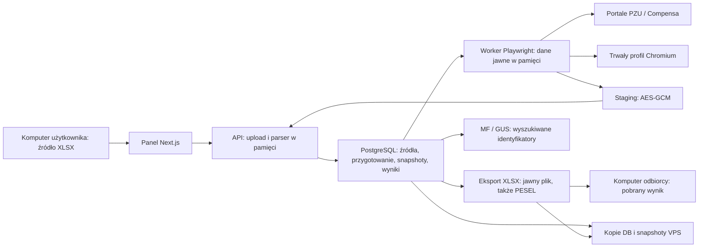

# Audyt poufności danych platformy i automatyzacji na VPS

**Data:** 9 października 2026 r. **Decyzja:** obecnej konfiguracji nie dopuszczać do produkcyjnego VPS z rzeczywistymi danymi klientów. Jest to ocena audytowa, nie blokada techniczna wdrożenia.

W aplikacji działają istotne zabezpieczenia dostępu, ale nie obejmują wszystkich kopii danych ani skutków przejęcia usług. Największe ryzyka to jawne eksporty z PESEL, jawne dane wejściowe i snapshoty w bazie, wspólne konto PostgreSQL z uprawnieniami superuser, brak kompletnego profilu HTTPS i MFA oraz przeglądarka automatyzacji bez włączonego sandboxa Chromium.

Nie stwierdziłem w wykonanych scenariuszach możliwości anonimowego pobrania Excela ani odczytu danych innego tenanta. To ograniczony wynik testów, a nie dowód braku wszystkich możliwych podatności.

Nie można zagwarantować, że dane „w żaden sposób” nie trafią do niepowołanych osób. Uprawniony odbiorca może skopiować wynik; przejęty działający serwer może odczytać dane, które aplikacja musi przetwarzać; operator infrastruktury pozostaje częścią modelu zaufania. Celem wdrożenia jest ograniczenie dostępu, zasięgu kompromitacji, liczby i czasu życia kopii oraz możliwość wykrycia incydentu.

## Zakres i ograniczenia

Audyt objął bieżący katalog roboczy: frontend Next.js, API NestJS, model i migracje PostgreSQL 001–051, kolejki Redis/BullMQ, worker Playwright, rejestry MF/GUS, importy i eksporty XLSX, kontrolę sesji/ról/grantów, logi/audyt, usuwanie danych i odtwarzanie, skrypty lokalnego backupu oraz Dockerfile/Compose. Repozytorium ma liczne wcześniejsze zmiany niezatwierdzone; przegląd dotyczy ich aktualnej treści, nie tylko commita `e3a507e`.

Wykonano testy na danych syntetycznych, oddzielnych tymczasowych kontenerach PostgreSQL/Redis i lokalnej przeglądarce. Nie czytano treści rzeczywistych arkuszy klientów ani wartości lokalnych sekretów. Nie uruchomiono automatyzacji na prawdziwych portalach. Nie zmieniano konfiguracji wdrożenia ani istniejącej bazy.

Nie udostępniono konkretnego VPS, domeny ani jego konfiguracji. Nie sprawdzono więc rzeczywistego firewalla, SSH, HTTPS, snapshotów dostawcy, szyfrowania dysków, kont operatorów, kluczy, ACL, uprawnień systemu plików Linux, publicznej ekspozycji portów ani dostępu dostawcy do maszyny. Nie wykonano pełnego pentestu, skanu systemu operacyjnego obrazów, analizy całej historii Git, pełnej macierzy wszystkich endpointów i ról ani testów obciążeniowych. Te elementy pozostają bramami odbioru.

## Gdzie trafiają dane z Excela

| Miejsce | Co zawiera | Obecna ochrona i jej granica |
| --- | --- | --- |
| Upload | Cały XLSX podczas żądania | Parser pamięciowy, limity ZIP/XML; `ImportService.create` nie archiwizuje oryginału na dysku. HTTPS zależy od wdrożenia. |
| `source_rows` | Nazwa, osoba decyzyjna, NIP/REGON, adres, kod, miasto | Jawne kolumny PostgreSQL; autoryzacja aplikacji nie chroni przed bezpośrednim odczytem DB. |
| Przygotowanie i runy | `source_snapshot`, `input_snapshot`, znormalizowane identyfikatory | Kolejne jawne kopie danych wejściowych. Usunięcie oryginalnego XLSX ich nie usuwa. |
| Tożsamość i polisy | Imię/nazwisko, informacje o polisach i pojazdach | PESEL szyfrowany AES-256-GCM z powiązaniem run/source; pozostałe dane zasadniczo jawne. |
| Wyniki `export_data` | XLSX z PESEL i danymi polis | Pliki 0600, katalog 0700, prywatny endpoint, kontrola grantu i SHA-256. Brak szyfrowania treści pliku. |
| Staging workera | Tymczasowy wynik automatyzacji | AES-256-GCM, wersja klucza, weryfikacja integralności i ograniczenie dostępu do plików. Klucz dostępny w workerze. |
| Profil Chromium | Sesje portali; potencjalnie cache, historię i dane witryn | Trwały wolumen, katalog tworzony z 0700. Brak aplikacyjnego szyfrowania całego profilu i pełnego purge w jobach usuwania. Dokładnej zawartości profilu produkcyjnego nie mierzono. |
| Redis | Identyfikatory runów, stan kolejek i limiterów | Produkcyjny payload kolejki zawiera `runId`; nie całe wiersze ani PESEL. Brak ACL/hasła w Compose. |
| Cache rejestrów | Wyniki wyszukiwania; nazwy i identyfikatory kandydatów | NIP w nowym cache jest HMAC; nie szyfruje to payloadu. Starszy model `registry_lookup_cache` ma jawny NIP. |
| Backup i snapshoty | Kopie powyższych magazynów | Lokalny backup Windows jest szyfrowany; brak gotowego, odebranego procesu backupu VPS. |
| Komputer odbiorcy | Pobrany Excel i widoczne dane | `no-store` ogranicza cache HTTP, ale nie szyfruje pobranego pliku i nie zapobiega jego skopiowaniu. |

Podstawy: `apps/api/src/imports.ts:35`, `db.ts:224`, `db.ts:407`, migracja `039`, `run-export.ts:110`, `export.ts:33`, `private-artifact-store.ts:41`, `apps/worker/src/result-staging.ts:17`, `browser.ts:40`, `apps/api/src/run-queue.ts:1`.

## Ustalenia wymagające naprawy

Oceny odnoszą się do poufności rzeczywistych danych na VPS. „Potwierdzone” oznacza zaobserwowaną cechę kodu lub konfiguracji, nie udany atak na produkcję. Żadnego ustalenia nie oznaczam jako potwierdzonego anonimowego wycieku krytycznego.

### VPS-01 — dane źródłowe i ich kopie są jawne w bazie — wysokie

**Dowód:** `ImportService.create` przekazuje nazwy, osobę decyzyjną, NIP i adres bez szyfrowania do `SourceRow.bulkCreate` (`imports.ts:65`). Modele przechowują je w TEXT/JSONB. Własna sonda przechwyciła rzeczywisty payload ORM z syntetycznego XLSX. To dowód braku szyfrowania aplikacyjnego, nie pomiar szyfrowania dysku VPS.

**Scenariusz:** skradziony dump, snapshot, odczyt wolumenu albo przejęte konto DB daje dostęp do danych niezależnie od sesji i grantów panelu. Szyfrowanie PESEL nie obejmuje tych kolumn ani snapshotów.

**Naprawa:** określić minimalny zakres przechowywania i retencję; chronić wolumeny i backupy szyfrowaniem oraz dostępem operatorów. Dla poufnych danych źródłowych i snapshotów wdrożyć szyfrowanie aplikacyjne, z kluczami poza samą bazą, a docelowo poza snapshotem VPS. Zaprojektować osobno indeksy wyszukiwania, np. HMAC identyfikatorów, zamiast utrwalać dodatkowe jawne kopie. Zewnętrzny KMS ogranicza część zagrożeń, lecz nie uniemożliwia przejętej działającej aplikacji korzystania z jej uprawnień. [OWASP: przechowywanie kryptograficzne](https://cheatsheetseries.owasp.org/cheatsheets/Cryptographic_Storage_Cheat_Sheet.html#separation-of-keys-and-data).

**Odbiór:** dump i kopia magazynu bez dostępu do kluczy nie pozwalają odzyskać wybranych poufnych wartości; test obejmuje source, preparation, run snapshots, tożsamość, polisy i stare dane po migracji.

### VPS-02 — eksport utrwala odszyfrowany PESEL w zwykłym XLSX — wysokie

**Dowód:** `run-export.ts` odszyfrowuje PESEL, `export.ts` umieszcza go w kolumnie C, a `private-artifact-store.ts:60` zapisuje bajty bez szyfrowania. Własna sonda zapisała eksport przez ten magazyn, następnie otworzyła go ExcelJS bez klucza i odczytała syntetyczny PESEL.

**Scenariusz:** dostęp do `export_data`, dumpa backupu plików lub root VPS pozwala czytać najbardziej wrażliwy wynik z pominięciem API. 0600/0700 i SHA-256 chronią inne aspekty: uprawnienia zwykłych procesów i wykrywanie zmiany, a nie poufność względem operatora/root.

**Naprawa:** szyfrować artefakty przed trwałym zapisem, stosować osobny klucz/wersję i uwierzytelnione szyfrowanie powiązane z tenantem/artefaktem. Odszyfrowywać po aktualnej autoryzacji pobrania. Dodać krótki czas przechowywania, sprzątanie osieroconych plików i rozważyć generowanie części wyników na żądanie. Każdą kopię tymczasową również objąć ochroną. Sprawdzić potrzebę pełnego PESEL w każdym rodzaju eksportu.

**Odbiór:** kopia pliku serwerowego bez klucza nie jest czytelnym XLSX; autoryzowany download nadal zwraca poprawny plik. Odmowa po cofnięciu grantu, wyłączeniu konta i tombstone. Eksporty już zapisane muszą zostać objęte migracją albo usunięte zgodnie z uzgodnioną retencją.

### VPS-03 — wspólne konto bazy ma uprawnienia superuser — wysokie

**Dowód:** `compose.yaml:6` tworzy `POSTGRES_USER=goldis`; API, worker i enrichment-worker używają tej samej tożsamości i hasła. API wykonuje migracje przy starcie. Na świeżym oddzielnym `postgres:17-alpine`, z tymi samymi ustawieniami użytkownika, zapytanie do `pg_roles` zwróciło `rolsuper=true`, `rolcreatedb=true`, `rolcreaterole=true`. Nie sprawdzano roli istniejącej bazy VPS — mogłaby być zmieniona ręcznie.

**Scenariusz:** przejęcie jednego workera daje odczyt całej bazy, zmianę kont/grantów i możliwość wyłączenia ochrony w DB. Użytkownik DB nie jest ograniczony tenantem ani rolą panelu. Superuser PostgreSQL ma również dodatkowe możliwości dostępu do systemu serwera DB; nie uruchamiano próby wykonania poleceń.

**Naprawa:** oddzielić bootstrap/migratora od runtime. Osobne konta `api`, `portal-worker`, `enrichment-worker` z minimalnym SELECT/INSERT/UPDATE/DELETE do koniecznych tabel lub procedur, bez SUPERUSER/CREATEDB/CREATEROLE/DDL i ról odczytu plików/wykonywania programów. Enrichment-worker nie powinien mieć dostępu do tożsamości, polis, kont ani sekretów. Dla workera ograniczyć odczyt do przydzielonej pracy; RLS może być dodatkową warstwą, jeśli zaprojektowana i przetestowana także dla background jobs.

**Odbiór:** próby SELECT danych poza zakresem oraz ALTER/CREATE ROLE/DDL są odrzucane na każdym koncie runtime; migracje uruchamia oddzielna procedura wydania. Potwierdzić na istniejącej bazie, nie tylko pustej.

### VPS-04 — brak kompletnego profilu produkcyjnego HTTPS i bezpiecznego startu — wysokie

**Dowód:** `compose.yaml` domyślnie ustawia API/workery na `APP_ENV=development`, origin HTTP, brak edge TLS i HSTS. `session.ts:338` ustawia Secure tylko dla `NODE_ENV=production`. `request-protection.ts` odmawia produkcyjnych mutacji z niepoprawnym/HTTP origin, lecz nie jest kompletną walidacją konfiguracji przy starcie.

Porty PostgreSQL, Redis, API i web są obecnie związane z **127.0.0.1**, nie publicznym interfejsem. To dobre ograniczenie. Dokument z 8 października twierdzi, że porty danych nie są publikowane; aktualny Compose publikuje je na loopback. Dostęp lokalny procesu lub tunelu SSH nadal istnieje.

**Scenariusz:** przeniesienie lokalnego Compose na VPS i wystawienie go przez niepoprawny proxy może zostawić tryb development, cookie bez Secure, zły origin lub błędne zaufanie do IP. Sama nazwa VPS nie zapewnia TLS. Nie potwierdzono takiego błędu na faktycznym serwerze.

**Naprawa:** osobny odebrany profil VPS: HTTPS z poprawnym certyfikatem i przekierowaniem, HSTS po potwierdzeniu domeny, produkcyjne NODE_ENV wszystkich usług, dokładny origin i dokładne adresy zaufanych proxy. Start ma odmawiać konfiguracji nieprodukcyjnej. Dla VPS usunąć hostowe porty DB/Redis; dostęp serwisowy przez kontrolowany tunel/procedurę. Edge powinien usuwać klientowe forwarding headers, ustanawiać własne i blokować `/api/internal/*` oraz szczegółowe health od Internetu.

**Odbiór:** zewnętrzny skan IPv4/IPv6, TLS i cookies na docelowej domenie; test spoofingu IP przez całą ścieżkę proxy → Next → API; API/DB/Redis/worker nieosiągalne z publicznej sieci. Przepisywanie `/api/:path*` w Next samo nie ukrywa ścieżek internal.

### VPS-05 — logowanie do panelu nie ma MFA; administrator ma szeroki odczyt — wysokie

**Dowód:** logowanie w `session.ts` używa hasła, bez TOTP/passkey/SSO MFA. Ponowne hasło jest wymagane dla zmiany własnego hasła i nowego procesu usuwania; w pozostałych zmianach kont, ról, resetach i grantach nie znaleziono wymogu świeżego step-up. `tool-access.ts:22` przyznaje administratorowi odczyt i download również przy disabled narzędziu. Własna sonda potwierdziła ten wynik; jest to zamierzona polityka roli, nie obejście tenanta.

**Scenariusz:** skradzione hasło admina albo aktywna sesja admina otwierają szeroki dostęp do danych organizacji. SMS portalowy nie chroni logowania do panelu. Wyłączenie modułu nie jest blokadą odczytu administratora.

**Naprawa:** wymusić MFA dla adminów i wszystkich kont z eksportem wrażliwych danych, najlepiej phishing-resistant passkeys/SSO. Dodać świeży step-up dla resetów, zmian ról, grantów i innych najważniejszych operacji. Rozważyć oddzielenie administratora kont od odbiorcy danych, jeśli admin infrastruktury/panelu nie ma biznesowej potrzeby czytania wszystkich plików. Najszybsze dodatkowe ograniczenie ekspozycji to panel dostępny tylko przez firmowy VPN albo bramę dostępu z MFA; nie zastępuje to backendowego RBAC. [OWASP: MFA i reautentykacja](https://cheatsheetseries.owasp.org/cheatsheets/Authentication_Cheat_Sheet.html#multi-factor-authentication).

**Odbiór:** samo hasło nie wystarcza do nowej sesji; recovery nie omija MFA; stara sesja bez świeżego step-up nie zmienia praw. Uzgodniona i przetestowana rola administratora danych.

### VPS-06 — klucze i poświadczenia są dostępne w procesach usług — wysokie

**Dowód:** Compose przekazuje hasła DB/portali, sekret workera/sesji i klucze PESEL/stagingu jako environment. API stale otrzymuje również hasło bootstrap admina. Worker ma w swoim procesie zarówno odczyt DB, jak i klucze PESEL oraz poświadczenia portali. Playwright bez jawnego `env` domyślnie dziedziczy środowisko procesu.

**Scenariusz:** dostęp operatora Docker, process dump, diagnostyka środowiska lub kompromitacja procesu może ujawnić klucze razem z danymi. Szyfrowanie PESEL nadal chroni sam dump DB bez kluczy; nie chroni przed kompletnym przejęciem API/workera.

**Naprawa:** osobne sekrety per usługa i cel, pliki secrets z restrykcyjnymi prawami i docelowo kontrolowany magazyn kluczy. Bootstrap wynieść do jednorazowego procesu. Przekazywać przeglądarce jawnie zredukowane środowisko, bez DB/PESEL/sekretu workera. Zdefiniować rotację, unieważnienie po incydencie i próbę odtworzenia z wcześniejszą wersją klucza. Compose secrets poprawiają dystrybucję i zakres dostępu; plik sekretu na tym samym VPS nie jest automatycznie zewnętrznym KMS ani ochroną przed root. [Docker: secrets](https://docs.docker.com/compose/how-tos/use-secrets/).

**Odbiór:** przeglądarka nie widzi zmiennych DB i kluczy; każda usługa otrzymuje wyłącznie potrzebne sekrety; backup danych nie ujawnia jednocześnie kluczy umożliwiających odszyfrowanie bez osobnego zabezpieczenia.

### VPS-07 — sandbox Chromium niewłączony; profil jest trwałym magazynem — wysokie

**Dowód:** `apps/worker/src/browser.ts:45` nie ustawia `chromiumSandbox`. Sonda przechwyciła opcje launch. Domyślna wartość w Playwright to false. Worker działa jako `pwuser`, co jest dobrą warstwą, ale samo USER nie włącza sandboxa. Wolumen `worker_profile` zachowuje dane między restartami. [Playwright: opcja sandbox](https://playwright.dev/docs/api/class-browsertype#browser-type-launch-persistent-context-option-chromium-sandbox), [zalecenia Docker](https://playwright.dev/docs/docker#crawling-and-scraping).

**Scenariusz:** podatność renderera lub złośliwy zasób odwiedzanej strony ma słabszą barierę do procesu z uprawnieniami workera. Po przejęciu workera jego szeroki dostęp do DB i kluczy zwiększa szkodę. Kradzież profilu stwarza dodatkowe ryzyko sesji i przechowanych danych. Nie wykonano exploita Chromium ani odzyskiwania cookies.

**Naprawa:** włączyć sandbox i odebrać go na docelowym Linux/seccomp; nie naprawiać problemu szerokim `privileged`/`SYS_ADMIN`. Docelowo oddzielić proces/kontener przeglądarki od procesu posiadającego DB i klucze. Profil trzymać na chronionym wolumenie, z restrykcyjnymi prawami i ustaloną retencją; sprawdzać prawa istniejącego katalogu, nie tylko `mkdir(mode)`. Rozważyć profil efemeryczny, jeśli wymagania logowania na to pozwalają.

**Odbiór:** sandbox faktycznie działa na VPS, przeglądarka nie ma konta DB/kluczy, profil nie trafia do obrazów/backupów ogólnych, restart i czyszczenie nie gubią kontrolowanego stanu zadań.

### VPS-08 — brak niezależnego ograniczenia ruchu wychodzącego — średnie; wysokie w łańcuchu kompromitacji

**Dowód:** `portal-runtime-config.ts` sprawdza HTTPS i zgodność z `allowedOrigins`, ale ta lista pochodzi z tego samego pliku co entryUrl. Sonda zaakceptowała syntetyczny obcy host HTTPS w konfiguracji PZU i Compensa. Compose nie definiuje egress policy; `BrowserSession` nie instaluje blokowania połączeń. Kontrola top-level origin w `PortalSession.readState` nie ogranicza wszystkich subrequestów strony.

**Warunek:** potrzebny jest wpływ na konfigurację operatora albo przejęcie procesu/strony. Nie znaleziono ścieżki, w której komórka XLSX wybiera URL portalu; sonda nie dowodzi SSRF ze zwykłego importu. MF/GUS mają stałe adresy produkcyjne, a ich override testowy ogranicza się do loopback.

**Naprawa:** oddzielna, przeglądana allowlista portali i logowania; kontrolowane wyjście przez proxy/firewall z uwzględnieniem potrzebnych SSO/CDN/API. Blokować localhost, prywatne sieci i metadane VPS tam, gdzie nie są konieczne. Segment usług danych powinien nie mieć wyjścia do Internetu; automatyzacje i enrichment powinny używać osobnej ścieżki egress. Sama flaga `internal: true` bez zaprojektowania wyjścia zatrzyma potrzebne portale, dlatego wymaga testów.

**Odbiór:** worker nie przesyła syntetycznego testowego payloadu do obcego endpointu ani metadata IP; dozwolone portale działają. Zmiana configu wymaga kontrolowanego procesu wydania.

### VPS-09 — Redis bez ACL/hasła i z szeroką siecią usług — średnie

**Dowód:** Compose uruchamia `redis-server --appendonly yes`, bez ACL i auth. API, worker i enrichment-worker są na tej samej sieci `goldis_data`; web jest na osobnej sieci frontend. Redis nie jest publiczny w przedstawionym Compose, lecz jest dostępny dla innych procesów na hoście przez loopback i dla usług na sieci danych.

**Scenariusz:** przejęta usługa lub lokalny proces może odczytać/zmienić stan kolejek albo wyłączyć ograniczenia logowania przez ingerencję w Redis. W badanych payloadach kolejki nie ma pełnych danych klienta, więc nie klasyfikuję samego dostępu do Redis jako pełnego wycieku Excela.

**Naprawa:** osobne tożsamości ACL z ograniczonymi kluczami i komendami; usunąć publiczne i hostowe porty na VPS, zawęzić połączenia usług. Dobrać ACL zgodnie z rzeczywistymi wymaganiami Lua/BullMQ, nie przypadkowym zabronieniem komend. Awaria auth nie może powodować wyłączenia limitera.

**Odbiór:** nieautoryzowane `GET`/`SCAN`/`FLUSHALL` i ingerencja w cudzy namespace są odrzucane; kolejki i rate limiting działają z nowymi ACL.

### VPS-10 — retencja i usuwanie nie obejmują całego cyklu życia — wysokie dla obietnicy pełnego usunięcia

**Dowód:** nowy proces usuwa artefakty/run/import, stosuje tombstones, step-up, retry i journal. Testy na PostgreSQL potwierdziły te zakresy oraz replay starej kopii. `deletion-jobs.ts:476–496` nie jest pełnym purge tenanta; nie czyści wszystkich profili, cache/stagingu i kopii poza DB. Bieżąca inwentaryzacja również jawnie wymienia te luki. Cache ma expiry, lecz w nowym cache fizyczne sprzątanie jest wykonywane podczas kolejnych zapisów; sam TTL nie oznacza natychmiastowego usunięcia bajtów. Nie znaleziono ogólnej automatycznej retencji importów/eksportów.

**Scenariusz:** dane po usunięciu w panelu mogą pozostawać w innych magazynach, snapshotach i backupach albo zostać przywrócone przez odtworzenie niezgodne z procedurą. Usunięcie pliku na SSD/snapshotowanym dysku nie jest gwarancją fizycznego nadpisania wszystkich kopii.

**Naprawa:** formalna mapa wszystkich kopii, czasy retencji i zadania sprzątania, także przy braku nowych zapisów. Rozszerzyć purge i reconcile; utrzymywać trwały dziennik usunięć poza odtwarzaną kopią, zabezpieczony i odzyskiwalny osobno. Odtwarzanie ma odtwarzać usunięcia przed otwarciem aplikacji. Rozważyć klucze per zakres retencji i crypto-erasure wraz z usuwaniem odpowiednich kopii kluczy. Uzgodnić usuwanie danych po stronie portali z ich możliwościami i wymaganiami biznesowymi.

**Odbiór:** usunięty syntetyczny rekord nie wraca po restore starej DB i plików; próba obejmuje staging, profil, cache, snapshoty, osierocone encje i znane ograniczenia współdzielonych runów. Nie oznaczać tenant purge jako gotowego na podstawie obecnych testów artifact/run/import.

### VPS-11 — backup VPS i minimalne uprawnienia kontenerów nie są przygotowane — wysokie/średnie

**Dowód:** `Backup-GoldisLocal.ps1` jest procedurą lokalną Windows dla `goldis-local`, szyfruje backup AES-GCM i obejmuje `.env.local` z kluczami wewnątrz zaszyfrowanego archiwum. Wyklucza profil i journal/klucz journalu. Test kryptograficzny przeszedł, ale nie jest odbiorem backupu VPS. Dockerfile API/web nie mają `USER`; w używanym bazowym obrazie Node nie wybierają użytkownika runtime bez uprawnień root. Compose nie deklaruje `cap_drop`, `no-new-privileges`, `read_only`, limitów CPU/RAM/PID ani rotacji logów.

Wszystkie Dockerfile wykonują `COPY . .` i instalują całe workspace. `.dockerignore` poprawnie wyłącza `.env*`, główne katalogi eksportów/profili oraz `docs/*.xlsx`, ale kopiuje resztę dokumentacji, raportów i innych nieobjętych wzorcami plików. To ryzyko przypadkowego zapakowania danych i zbędnej powierzchni ataku; nie potwierdzono danych klientów w gotowym obrazie.

**Naprawa:** produkcyjny backup szyfrowany przed opuszczeniem VPS, poza VPS, z osobnymi uprawnieniami do zapisu/restore, retencją i testem odtworzenia. Osobno zabezpieczyć journal i klucze; jeden utracony serwer nie może zabierać wszystkich kopii i materiału odtwarzania. Używać obrazów wieloetapowych z jawną listą plików runtime, osobnych zależności produkcyjnych i non-root; ograniczyć capabilities, zapisywalne ścieżki i zasoby. Nie montować Docker socket do aplikacji. Kontenerowy root nie jest automatycznie rootem hosta, ale zwiększa skutki błędów konfiguracji i escape. [Docker: bezpieczeństwo Engine](https://docs.docker.com/engine/security/).

**Odbiór:** skan zawartości obrazów nie wykazuje danych klientów/sekretów; UID runtime nie jest 0; cold restore na osobnym środowisku po utracie całego VPS; brak wspólnego hasła/klucza z serwerem przechowującym backup.

### VPS-12 — brak pełnego wykrywania i ograniczania wynoszenia danych — średnie

**Dowód:** pobrania zapisują `artifact.downloaded`, API ma wspólny budżet IP, audyt odrzuca klucze metadata zawierające nazwy wrażliwych pól, a worker loguje bezpieczne kody błędów. Nie znaleziono gotowej konfiguracji alertów na masowy odczyt/pobieranie, zewnętrznego niezmiennego audytu ani budżetu pobrań per user/tenant/bajty. Sama walidacja nazw kluczy metadata nie sprawdza poufności dowolnego tekstu wartości.

**Scenariusz:** przejęte uprawnione konto może stopniowo pobierać dane w ramach swoich praw, bez natychmiastowego sygnału operatorowi. Zakaz download nie zapobiega kopiowaniu danych już udostępnionych przez prawo view. Konto DB z VPS-03 może zmieniać lokalny dziennik audytu.

**Naprawa:** minimalne prawa i zakres widocznych kolumn, indywidualne konta, brak wspólnych loginów, alerty anomalii pobrań/logowań/grantów, limity user/tenant i rozmiaru eksportów oraz chroniony dziennik poza domeną uprawnień runtime. Logi proxy/APM nie powinny zapisywać body importu, danych wierszy, cookie, Authorization ani kodów SMS. W diagnostyce portali odrzucać surowy DOM i wartości formularzy; testować ochronę logów syntetycznymi markerami.

**Odbiór:** kontrolowany seryjny download wyzwala ograniczenie/alert; syntetyczny marker danych i sekretów nie występuje w logach aplikacji, edge, APM, backup-manifest ani crash dump udostępnianym do wsparcia.

## Zabezpieczenia potwierdzone i pozostałe ryzyka

- Chronione odczyty/pobrania korzystają z backendowego SessionGuard/PermissionGuard, zakresu tenant/właściciel i aktualnych grantów. Samo ukrycie przycisku nie stanowi ich zabezpieczenia. Testy potwierdziły wybrane odmowy cross-tenant/non-owner, zmiany roli managera, cofnięcie uprawnień przed pracą i w jej trakcie oraz wyłączone konto.
- Sesje są podpisane HMAC, sprawdzane w DB, unieważniane przy zmianach poświadczeń i roli/statusu w obsługiwanych ścieżkach. Działa 30 minut bezczynności, a polling bez interakcji nie przedłuża aktywności. Wymiana cookie i CSRF jest kontrolowana; pełnego testu kradzieży sesji/każdej równoległości na DB nie wykonywano.
- XLSX ma limity rozmiaru, rozpakowania, wierszy, komórek i współbieżności, blokady formuł/relacji zewnętrznych/DTD. Eksporty zapisują teksty jako tekst. Nie znaleziono drogi do uruchamiania makr Excela. Parser pozostaje w procesie API bez twardej izolacji RSS; testy presji pamięci wymagają osobnego środowiska.
- PESEL i staging używają AES-256-GCM, powiązania z kontekstem i wersji klucza. Testy sprawdzają modyfikację danych, niewłaściwy kontekst/klucz i usunięcie stagingu. SHA-256 artefaktu wykrywa niespójne bajty; nie zastępuje szyfrowania ani uwierzytelnienia użytkownika.
- Prywatne API/HTML mają `no-store` i nosniff; test przeglądarkowy sprawdził nonce CSP, blokadę wstrzykniętego inline script i nagłówki anty-iframe. Nie jest to pełny stored-XSS z DB ani test historii/back-cache po wylogowaniu dla wszystkich ról.
- W przeszukanym produkcyjnym TS/TSX nie znaleziono `dangerouslySetInnerHTML`, `innerHTML`, JS `eval/new Function`, `ignoreHTTPSErrors` ani własnego wyłączania TLS. Redis eval używa stałych skryptów Lua. Widoczny `sessionStorage` przechowuje identyfikator wyboru joba, nie arkusz. Nie znaleziono bezpośredniego wejścia użytkownika do składni SQL w przeglądanych zapytaniach; nie wykonywano kompletnej kampanii injection na każdym endpointcie.
- Kolejki mają minimalny payload runId; kod SMS nie trafia do DB/Redis w przetestowanym przepływie. Prywatny endpoint wyników wymaga sekretu i aktywnego wykonania. Pole Origin nie jest uwierzytelnieniem klienta poza przeglądarką.

Świeży `npm audit --omit=dev --json`: **0 critical, 0 high, 7 moderate**. Siedem wpisów oznacza pakiety i propagowane łańcuchy, nie siedem niezależnych exploitów. Pozostają `uuid` przez ExcelJS/Sequelize oraz `sprintf-js` przez Umzug/argparse. Zgłoszenie autora uuid dotyczy v3/v5/v6 z buforem; nie oznacza automatycznie wycieku przez używane v1/v4. Nie potwierdzono osiągalnego z HTTP exploita tych zgłoszeń. Przed wydaniem ponowić analizę i skan obrazów OS; nie stosować proponowanych niezgodnych downgrade bez regresji. [Advisory autora uuid](https://github.com/uuidjs/uuid/security/advisories/GHSA-w5hq-g745-h8pq), [wcześniejsza analiza łańcuchów](security/DEPENDENCY_DECISIONS_2026_10_08.md).

## Wykonane dowody

| Kontrola | Wynik | Dokładny zakres |
| --- | --- | --- |
| `npm test` | 286 PASS, 37 SKIP, 0 FAIL | Core 13, API 191, worker 77 PASS/37 SKIP, preflight 5. Skipy portali nie są zaliczeniem integracji. |
| `test:module:security-db` | PASS | Rzeczywisty izolowany PostgreSQL, migracje 001–051, scenariusze users/tenant-scope, wybrane role/granty/sesje, worker-result i preparation/submission. |
| `test:module:security-redis` | PASS | Rzeczywisty izolowany Redis: limit pary 5, IP 60 i retry-after. Nie odebrano wszystkich outage/multi-replica/ACL. |
| `test:module:deletion` | PASS | Step-up i usuwanie artifact/run/import, tombstones, retry, crash/replay i stara kopia. Nie pełny tenant/profile/cache purge. |
| `test:module:security-browser` | PASS | Produkcyjny lokalny Next: CSP/nonce, no-store, anty-iframe i sygnał aktywności. Bez prawdziwych kont/DB i HTTPS. |
| `test:backup-crypto` | 1 PASS | Round-trip bajtów, odmowa przy złym haśle i modyfikacji szyfrogramu. Nie pełny backup/restore VPS. |
| Nowa sonda poufności | 5 odtworzonych obserwacji | Jawny payload importu, czytelny XLSX z PESEL, brak flagi sandbox, dowolny host HTTPS w configu i szeroki admin download. To dowody również brakujących zabezpieczeń. |
| Konto z ustawień Compose | Potwierdzone superuser | Osobny świeży kontener z POSTGRES_USER=goldis. Bez połączenia z istniejącą bazą. |

Artefakty: [wyniki testów](security/existing-tests-2026-10-09.log), [PostgreSQL](security/security-db-2026-10-09.log), [Redis](security/security-redis-2026-10-09.log), [usuwanie](security/deletion-db-2026-10-09.log), [przeglądarka](security/security-browser-2026-10-09.log), [backup crypto](security/backup-crypto-2026-10-09.log), [npm audit](security/npm-audit-production-2026-10-09.json), [sonda poufności](security/confidentiality-evidence-2026-10-09.json), [rola PostgreSQL](security/postgres-role-evidence-2026-10-09.json). Nowy skrypt: [security-confidentiality-audit-2026-10-09.cjs](../scripts/security-confidentiality-audit-2026-10-09.cjs). Jego kod 0 oznacza odtworzenie obserwacji, nie brak luk.

Wynik z 9 października uzupełnia dokument stanu z 8 października: testy PostgreSQL i Redis są teraz wykonane. Nie zamyka to tamtego całego planu bezpieczeństwa ani odbioru produkcyjnego.

## Plan dopuszczenia do VPS

| Kolejność | Zakres | Warunek zamknięcia |
| --- | --- | --- |
| 1 — przed rzeczywistymi danymi | Produkcyjny HTTPS/origin/proxy, prywatny panel lub brama z MFA, minimalne porty i SSH operatorów | Odbiór z Internetu IPv4/IPv6 i ze ścieżki VPN, bez publicznych usług wewnętrznych; Secure cookie i kontrola proxy działają. |
| 2 — przed rzeczywistymi danymi | Konta DB runtime/migrator, Redis ACL, separacja usług/przeglądarki, sandbox i ograniczony egress | Przejęta symulowana tożsamość enrichment/browser nie odczytuje wszystkich danych i kluczy ani nie wysyła ich na dowolny adres. |
| 3 — przed rzeczywistymi danymi | Szyfrowanie trwałych eksportów i wymaganych danych/snapshotów; klucze, rotacja, obrazy bez danych | Kradzież dumpa/pliku/backupu bez kluczy nie daje poufnej treści; sprawdzono stare dane i wszystkie kopie. |
| 4 — przed rzeczywistymi danymi | Backup VPS, odzyskiwanie, retencja i mapa usuwania | Cold restore poza VPS; usunięte dane nie wracają; journal/klucze mają osobną procedurę ochrony i odzyskania. |
| 5 — przed dopuszczeniem użytkowników | Macierz kont/grantów, MFA/recovery, step-up, monitoring, alarmy i reakcja na incydent | Testy pozytywne i negatywne na staging przez rzeczywisty HTTPS; kontrolowany seryjny eksport wywołuje alarm/limit. |

Rekomendowana topologia: edge HTTPS/brama dostępu → web → API; osobny segment PostgreSQL i Redis; osobny worker przeglądarkowy z kontrolowanym wyjściem do portali; enrichment z wyjściem tylko do rejestrów i minimalnym kontem DB; klucze i backupy w osobnych domenach dostępu. Każda dodatkowa usługa ma tylko konieczne sekrety i prawa. Połączenia między różnymi hostami muszą mieć TLS lub chroniony tunel; wewnętrzne HTTP na pojedynczym hoście wymaga świadomego modelu zaufania i izolacji, nie jest zabezpieczone samym Origin.

Dokładną retencję, dostęp administratorów do treści, wymagane pola eksportu i zaufanie do dostawcy VPS trzeba ustalić biznesowo. Raport nie ocenia zgodności prawnej ani umowy powierzenia. Nie wdrożono poprawek aplikacji w ramach tego audytu.
