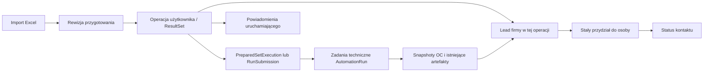

# Goldis — plan wdrożenia funkcjonalności MVP i całego projektu interfejsu

Data: 11 października 2026. Status: **zakres implementacyjny MVP jest zaimplementowany; odbiór wizualny wszystkich ekranów i kontrolowane uruchomienie pozostają otwarte**. Poniższy stan rozdziela funkcje potwierdzone testami od kroków operacyjnych, których nie wykonuje się na docelowej bazie bez uzgodnionego okna wdrożeniowego.

## Stan prac — 11 października 2026, aktualizacja końcowa implementacji

Domknięto funkcjonalności opisane w MVP: wspólne wyniki i kontakty ze źródła, operacje z leadami firmowymi, dokładne i idempotentne przydziały, status kontaktu edytowalny wyłącznie przez właściciela, konta pracowników i granty menedżera, osobiste powiadomienia, dashboardy, raport kontaktów oraz granice usuwania danych. Role i dane są pobierane z API; katalog narzędzi pokazuje tylko uprawnione działania.

Widoki obejmują dashboard, katalog narzędzi, historię i wyniki, pulę, „Moje wyniki”, szczegół firmy, zespół, dostępy, raporty, powiadomienia, przygotowanie importu, zadania, audyt, konto i administrację. Wspólny shell dodano również na istniejących trasach legacy. Sidebar zachowuje szerokość 300/60 px, przypinanie, rozwinięcie po najechaniu i mobilny drawer; nawigacja jest filtrowana według roli oraz możliwości z API.

Nowe migracje 052–053 i przepływy raportów/leadów przeszły test na jednorazowej, odizolowanej bazie PostgreSQL; migracje od 001 do 053 zastosowano i ponowiono bez duplikatów, a baza testowa została usunięta. Test potwierdził m.in. przydział bez wyścigu i z obsługą ponowienia, odmowę przy niedostatecznej puli, ochronę statusu właściciela, dostęp wspólny, agregaty, osobiste powiadomienia i stabilność migracji. Przy odbiorze naprawiono też porównanie UUID tombstone/import oraz grupowanie raportu kontaktów.

Końcowe `npm run build` i `npm test` przechodzą: core 13/13, API 197/197, worker 98 zaliczonych i 54 jawnie pominięte testy integracyjne, preflight 5/5. Smoke testy przeglądarkowe przeszły dla panelu menedżera, administracji, historii i usuwania, grantów, zadań, wzbogacania REGON, weryfikacji, audytu oraz obsługi SMS. Izolowane testy DB raportów i usuwania zastosowały migracje 001–053, sprawdziły ponowne zastosowanie bez duplikatów i usunęły tymczasową bazę.

Nie zarejestrowano kontrolowanego odbioru wizualnego każdego z 38 stanów z manifestu; porównanie zrzutów, sprawdzenie pustych/błędowych stanów i akceptacja produktu pozostają końcowym QA. Migracji nie zastosowano do lokalnej ani produkcyjnej bazy aplikacji, nie uruchomiono też rollout’u. Druga automatyzacja pozostaje wyłącznie kontrolowanym wpisem katalogu bez wymyślonego przepływu.

| Etap planu | Stan końcowy implementacji |
| --- | --- |
| 0–5: fundamenty, dane, kontakty, uprawnienia, wyniki i przydziały | Zaimplementowane; przepływy backendowe, ograniczenia ról i migracje 052–053 przeszły test odizolowanej bazy. |
| 6: dashboard, powiadomienia i raporty | Zaimplementowane; odbiór DB potwierdził osobiste alerty, raport kontaktów i agregaty ról. |
| 7–10: shell, narzędzia, wyniki, konto, zespół i administracja | Zaimplementowane; przebudowano wejście po logowaniu, wspólną nawigację, katalog i widoki ról. Produkcyjny build oraz smoke testy głównych przepływów UI przechodzą. |
| 11: usuwanie i regresje | Test izolowanej bazy potwierdził migracje i usuwanie; pełny zestaw core/API/workera/preflight oraz testy UI wymienione wyżej przechodzą. |
| 12: kontrolowane uruchomienie | Nie wykonano na docelowym środowisku. Wymaga uzgodnionego rollout’u, sprawdzonej kopii/odtworzenia i migracji poza jednorazową bazą testową. |

## 1. Cel i źródła wymagań

Przebudować platformę tak, żeby pracownik szybko uruchamiał dostępne narzędzia, odnajdywał wyniki i obsługiwał przydzielone firmy. Menedżer ma dzielić wspólną pulę leadów, zarządzać kontami pracowników i ich dostępami. Administrator zachowuje pełną administrację organizacją i automatyzacjami.

Wdrożenie obejmuje **funkcjonalności backendu, trwałe dane, uprawnienia, przepływy pracy oraz wszystkie 38 ekranów i stanów mockupu**. Makieta dostarcza wygląd i zachowanie interfejsu; produkcyjne liczby, statusy, formularze i pliki muszą pochodzić z rzeczywistych usług.

Źródła, w kolejności rozstrzygania rozbieżności:

1. Ustalenia użytkownika zapisane w [PRODUCT.md](design/goldis/mvp-2026-10-11/PRODUCT.md).
2. Zakres i przepływy w [SURFACE_BRIEF.md](design/goldis/mvp-2026-10-11/SURFACE_BRIEF.md).
3. Kierunek wizualny i tokeny w [DESIGN.md](design/goldis/mvp-2026-10-11/DESIGN.md).
4. [Manifest 38 ekranów](design/goldis/mvp-2026-10-11/screens.json), [galeria](design/goldis/mvp-2026-10-11/public/gallery.html), kod `src/app.tsx`, `src/sidebar.tsx`, `src/style.css` w tym samym katalogu.
5. Obecne kontrakty API, migracje i zabezpieczenia w repozytorium.

Plan korzysta z kierunku przygotowanego przy użyciu ui-ux-pro-max i impeccable. W zakresie wyglądu zastępuje sprzeczne założenia starszego `docs/PLAN_FRONTEND_CZARNO_ZLOTY.md`: nowy interfejs ma Hanken, matowy grafit i spokojne złoto, zamiast nagłówków Newsreader i dekoracyjnych efektów wcześniejszego projektu. Działające procesy i zabezpieczenia ze starszego wdrożenia pozostają wymaganiami regresji.

## 2. Zakres MVP, którego nie należy rozszerzać podczas implementacji

| Obszar | Docelowe zachowanie |
| --- | --- |
| Role | Pracownik = obecna rola API `operator`; menedżer = `manager`; administrator = `admin`. Istniejących `reviewer` i `auditor` nie usuwać. |
| Uruchamianie | Osobny grant do wykonania automatyzacji. Osoba uruchamiająca sama wgrywa Excel. |
| Wyniki OC | Wszyscy pracownicy widzą wspólne wyniki, szczegóły firm, źródłowy import i pobierają Excel. Widoczność wyniku nie daje prawa uruchamiania. |
| Druga automatyzacja | Osobne, kontrolowane uprawnienia; dostęp administratora. Brak specyfikacji jej procesu — nie budować fikcyjnej automatyzacji. |
| Przygotowanie | Zawsze analiza duplikatów. Opcjonalny przycisk uzupełnienia REGON z istniejącego NIP, w granicach zewnętrznego API. |
| Korekty | Uruchamiający poprawia dane przed startem; ponowna analiza po zmianie. Dane wejściowe rozpoczętej operacji pozostają zamrożone. |
| Start części danych | Poprawna część może wystartować. Ekran potwierdzenia podaje liczbę i przyczyny pominięcia pozostałych wierszy. |
| Kontakty | Telefon i e-mail z importu trafiają do szczegółów firmy oraz firmowego Excela. Nie giną przy deduplikacji. |
| Pula i przydziały | Wyniki tworzą wspólną pulę; menedżer/admin przydziela N wolnych leadów pracownikowi, sobie lub innemu menedżerowi. |
| Moje wyniki | Lista przydzielona zalogowanej osobie; tylko ta osoba zmienia status kontaktu swoich leadów. |
| Status kontaktu | Dokładnie: „Nie kontaktowano”, „Klient zgadza się na ofertę”, „Klient niezainteresowany”. |
| Stałość przydziału | Bez przenoszenia, odbierania i ponownego przydziału istniejącego leada w MVP. |
| Powtórzona firma | Nowe logiczne uruchomienie tworzy nowy lead tej firmy z początkowym statusem i bez przydziału. |
| Powiadomienia | „Wynik gotowy” i „Wymagane działanie” trafiają tylko do uruchamiającego; status operacji widoczny także w dashboardzie i zadaniach. |
| Menedżer | Zarządza kontami pracowników; nie edytuje kont menedżerów/admina, nie nadaje podwyższonych ról. Może przydzielać leady innemu menedżerowi. |
| Usuwanie | Zachować obecną kontrolę `canDeleteData`, potwierdzenie i dodatkowe uwierzytelnienie. Administrator może nadać to uprawnienie menedżerowi. |

Poza MVP: notatki i historia rozmów w interfejsie, oddzwonienia, dodatkowe statusy, CRM, automatyczne rotacje przydziałów, kontrola kolizji telefonów między różnymi uruchomieniami, e-mail/push jako kanał powiadomień. Techniczny audyt zmian pozostaje potrzebny, ale nie jest nową historią kontaktów w UI.

## 3. Co jest już w aplikacji i co trzeba dopisać

| Obszar | Stan kodu | Działanie |
| --- | --- | --- |
| Import, przygotowania, duplikaty, REGON | Istnieją parser, rewizje przygotowania, analiza i zadania enrichment. | Rozszerzyć dane kontaktowe i dopasować kolejność oraz widoki. |
| Uruchomienia | Istnieją `PreparedSetExecution`, fragmenty, `RunSubmission`, pojedyncze `AutomationRun`. | Dodać wspólną reprezentację operacji użytkownika i powiązanie z biznesowym wynikiem. |
| SMS, wznowienie, ręczne dane techniczne | Istnieją osobne procesy interwencji i zabezpieczenia. | Zachować; przebudować prezentację, nie zastępować demonstracyjnym formularzem. |
| Wyniki i pliki | Istnieją historia wyników, snapshoty OC i eksport per zadanie. | Dodać listę leadów i eksport firmy z kontaktami oraz kontekstem operacji. |
| Przydziały | Istnieją przydziały interwencji technicznych. | Dopisać osobne przydziały leadów; nie używać `ManualIntervention` jako leada. |
| Status rozmowy | Brak biznesowego modelu statusu kontaktu. | Nowe trwałe pole, walidacja, wersjonowanie i autoryzacja. |
| Wyniki innych pracowników | `operator` ma obecnie zakres właściciela importu oraz granty. | Udostępnić odczyt wyników OC w organizacji, nie rozszerzać wszystkich operacji zapisu. |
| Konta i granty | Kontroler `/admin` ma `AdminOnlyGuard`. | Osobne, ograniczone API zespołu dla menedżera. |
| Powiadomienia | Istnieje częściowy inbox interwencji, bez pełnego centrum ukończeń. | Nowe trwałe powiadomienia osobiste, spójne z operacją użytkownika. |
| Raporty | Istnieją raporty operacyjne administratora. | Dodać raport przydziałów i kontaktu; udostępnić właściwe raporty menedżerowi. |
| UI | Istnieją czarno-złoty motyw, duży `workspace.tsx`, historia i monolityczna administracja. | Nowy shell, podstrony i komponenty; stopniowo przełączać realne procesy. |

## 4. Model danych i operacji

### 4.1. Jednostką pracy użytkownika jest całe uruchomienie

Jedno kliknięcie „Uruchom” może dziś utworzyć wiele zadań dla firm, a duży import jest dzielony na fragmenty. Dashboard, zadania, wyniki i powiadomienia mają odnosić się do **całej operacji**, z możliwością zejścia do zadania technicznego firmy.



`AutomationRun.executionId` jest identyfikatorem wykonania workera i mechanizmem ochrony przed nieaktualnymi zapisami. **Nie jest identyfikatorem `PreparedSetExecution`**. Nowe powiązania muszą używać jednoznacznych nazw `preparedExecutionId`, `submissionId`, `runId`.

### 4.2. Nowe encje — minimalny zakres

| Encja / rozszerzenie | Pola i ograniczenia |
| --- | --- |
| `SourceRow` i snapshot wejścia V2 | Surowe i znormalizowane telefony/e-maile, pochodzenie wiersza; nowe pola opcjonalne. Walidator czyta także V1. |
| `ResultSet` / `result_sets` | `id`, `tenantId`, `toolId`, `batchId`, `preparationId`, `createdByUserId`, `preparedExecutionId` lub `submissionId`, `referenceDate`, daty, stan projekcji i podsumowanie. Jeden rekord na logiczne uruchomienie. |
| `BusinessLead` / `business_leads` | `id`, `tenantId`, `resultSetId`, stabilny klucz firmy w operacji, `canonicalEntityId` jeśli dostępny, zamrożone dane firmy i kontaktów, stan wyniku, `assignedToUserId`, `assignedByUserId`, `assignedAt`, `contactStatus`, `version`, daty. |
| `LeadRunLink` / `lead_run_links` | Związek leada z zadaniami technicznymi i źródłowymi wierszami. Firma może mieć kilka technicznych weryfikacji osób decyzyjnych. |
| `LeadAllocation` / `lead_allocations` | Zlecający, odbiorca, narzędzie, filtry zakresu, żądana liczba, przydzielone ID, klucz idempotencji i hash żądania. Brak operacji przeniesienia. |
| `AppNotification` / `app_notifications` | `tenantId`, `recipientUserId`, `operationId`, typ, klucz zdarzenia, link do kontekstu, `createdAt`, `readAt`. Unikalny klucz odbiorcy i zdarzenia. |
| Delegowanie grantów | Nowe pole uprawnienia narzędzia, np. `canManageEmployeeGrants`, ustawiane tylko przez admina dla menedżera. Dla OC menedżer może zarządzać execute pracowników zgodnie z briefem; dla narzędzia 2 domyślnie brak delegacji. |
| Profil użytkownika, jeśli potrzebny | Opcjonalne `displayName` dla nazw wyświetlanych w mockupie; login/username i istniejąca tożsamość pozostają bez zmian. |

Ograniczenia bazy: unikalne źródło `ResultSet`; unikalne `(resultSetId, companyOccurrenceKey)` dla leada; unikalny klucz idempotencji przydziału w organizacji; CHECK dla trzech statusów; spójność organizacji w relacjach. Indeksy na `(tenantId, toolId, createdAt, id)`, wolnej puli i `(tenantId, assignedToUserId, contactStatus, id)` oraz nieprzeczytanych powiadomieniach.

Lead jest **firmą do obsługi w danej operacji**, a nie pojedynczym wierszem ani PESEL-em/osobą decyzyjną. Istniejący `leadIdentityKey` w `canonical-run-service.ts` identyfikuje techniczną grupę firma + osoba decyzyjna; nie nadaje się bezpośrednio jako klucz nowej puli firm.

### 4.3. Ustalenia techniczne przyjęte do planu

To założenia implementacyjne, a nie dodatkowe funkcje uzgodnione z użytkownikiem:

- Wolne leady pobierać od najstarszych, ze stabilnym rozstrzygnięciem po ID. Przydział N jest atomowy: albo dokładnie N, albo komunikat o zbyt małej puli.
- Jedna firma po deduplikacji w jednej operacji daje jeden lead. Różne osoby decyzyjne i techniczne wyniki pozostają pod tym leadem.
- Wyniki zakończone poprawnie bez pasujących polis pokazywać z prawdziwym oznaczeniem tego rezultatu. Nie uznawać błędu/niezakończonego zadania za gotowy lead do kontaktu. Dla firmy z kilkoma zadaniami publikować gotowość po rozstrzygnięciu jej wymaganych weryfikacji; częściowy wynik opisać jawnie.
- Bieżąco pojawiające się gotowe leady mogą trafiać do puli przed końcem całej operacji. Powiadomienie „Wynik gotowy” oznacza zakończenie operacji z dostępnymi wynikami; przy częściowym błędzie tekst zawiera informację o częściowym wyniku.
- Eksport leada generować na żądanie z zamrożonych danych operacji i zweryfikowanego wyniku, używając istniejącego eksportera. Nie nadpisywać starego artefaktu innego zadania. Dla braku polis można wyeksportować wiersz danych firmy z opisem rezultatu; nie tworzyć pozornego artefaktu spełniającego stary warunek `policyCount >= 1`.
- Nieaktywne konto pozostaje właścicielem przydzielonych leadów. Wyłączenie konta nie zwalnia puli ani nie dodaje ukrytego mechanizmu przenoszenia; panel konta pokazuje liczbę istniejących przydziałów.
- Data odniesienia z mockupu wymaga spójnego kontraktu preview/start. Obecny start całego przygotowanego zbioru wyznacza ją automatycznie; jeśli pole pozostaje edytowalne, trzeba rozszerzyć backend i fingerprint, zamiast zapisywać zmianę tylko w UI.

### 4.4. Idempotencja i przeniesienie istniejących danych

Ponowne kliknięcie startu z tym samym kluczem, retry workera i powtórzenie projekcji mają zwrócić te same rekordy. **Nowe świadome uruchomienie z nowym kluczem** daje nowy `ResultSet` i nowe leady, nawet gdy firma istnieje już wcześniej.

Migracja historyczna: `PreparedSetExecution` jest rodzicem swoich fragmentów i submissions; nie tworzyć osobnej operacji dla każdego fragmentu. Samodzielny `RunSubmission` jest osobną operacją. Stare zadania bez tych rodziców otrzymują jawne powiązanie legacy oparte na rzeczywistych ID; nie łączyć ich arbitralnie po nazwie firmy lub przybliżonym czasie. Nieznany uruchamiający pozostaje nieznany — nie przypisywać go aktualnemu użytkownikowi. Nie wysyłać nowych powiadomień za stare wykonania. Kontakty, których stare snapshoty nie zawierają, pozostają puste; późniejszy import nie może uzupełnić historycznego wyniku cudzymi danymi.

## 5. Macierz uprawnień

Wszystkie decyzje egzekwować w API, również dla bezpośrednich ID, eksportów, liczników i wyszukiwania. Ukrycie przycisku jest tylko prezentacją tej samej decyzji.

| Czynność | Pracownik | Menedżer | Admin |
| --- | --- | --- | --- |
| Czytaj wyniki OC, firmę, źródłowy import; pobierz firmowy Excel | Cała organizacja | Cała organizacja | Cała organizacja |
| Wgraj / uruchom OC | Z grantem execute | Z grantem execute | Zgodnie ze stanem narzędzia i ustawieniami |
| Popraw przygotowanie przed startem | Własne przygotowanie i grant execute | Zakres menedżera i grant execute | Zakres administratora |
| Edytuj wejście rozpoczętej operacji | Nie | Nie | Nie; nowe przygotowanie/uruchomienie |
| Zmień status kontaktu | Tylko własny przydział | Tylko własny przydział | Tylko własny przydział w zwykłym flow kontaktu |
| Przydziel N wolnych leadów | Nie | Tak | Tak |
| Przenieś / odbierz lead | Nie | Nie | Brak funkcji w MVP |
| Utwórz / edytuj konto pracownika | Nie | Tak | Tak |
| Edytuj konto menedżera/admina lub nadaj wyższą rolę | Nie | Nie | Tak, z istniejącymi zabezpieczeniami |
| Nadaj execute pracownikowi | Nie | W delegowanym zakresie narzędzi | Tak |
| Nadaj dostęp do drugiej automatyzacji | Nie | Tylko jeśli administrator jawnie delegował to prawo | Tak |
| Raporty zespołu | Nie | Tak | Tak |
| Usuń dane | Nie | Z `canDeleteData` i istniejącym potwierdzeniem | Z istniejącym potwierdzeniem |
| Ustawienia automatyzacji / monitoring administracyjny | Nie | Nie | Tak |
| Powiadomienia ukończenia / wymaganej akcji | Własne uruchomienia | Własne uruchomienia | Własne uruchomienia |

Odczyt OC ma być stałym uprawnieniem aktywnych pracowników/menedżerów w organizacji. Zapisać tę regułę jednolicie w polityce i zapytaniach; ekran dostępów nie może sugerować skutecznego odebrania wymaganego wspólnego odczytu OC. Execute pozostaje niezależny. Wstrzymanie nowych uruchomień nie powinno ukrywać wcześniejszych wyników. Dla całkowicie wyłączonych narzędzi zachować jawną politykę administracyjną. Nie rozszerzać analogicznie dostępu do drugiej automatyzacji ani pozostałych ról.

Dostęp do źródłowego importu przez wynik udostępnia tylko odczyt. Nie daje prawa korekty, enrichment, SMS, anulowania ani wznowienia cudzej operacji. Obecne przypisania interwencji technicznych i uprawnienia menedżera do obsługi zadań nadal działają osobno.

## 6. Kontrakty API do przygotowania

Poniżej **proponowane nowe endpointy**, nie lista już działających tras. Nazwy zatwierdzić w pierwszym pakiecie kontraktów i utrzymać konsekwentnie w web/API.

| Metoda i endpoint | Kontrakt |
| --- | --- |
| `GET /operations` | Logiczne uruchomienia, filtry narzędzia/statusu, paginacja, liczby po autoryzacji. |
| `GET /operations/:id` | Źródło, uruchamiający, postęp, dostępne akcje, wyniki i techniczne zadania pod operacją. |
| `GET /result-sets` | Zestawy wyników z identyfikatorem automatyzacji/operacji i stanem gotowości. |
| `GET /leads` | Narzędzie, operacja, przydział, status kontaktu, wyszukiwanie, stabilna paginacja. |
| `GET /leads/mine` | Zakres zalogowanej osoby narzucony na serwerze, bez dowolnego `userId`. |
| `GET /leads/:id` | Firma, kontakty, rzeczywiste wyniki, źródłowa rewizja, właściciel i możliwości działania. |
| `PATCH /leads/:id/contact-status` | `{ status, expectedVersion }`; zapis tylko przez właściciela przydziału. |
| `POST /lead-allocations` | `{ toolId, resultSetId?, filters?, recipientUserId, count, idempotencyKey }`; zwraca liczbę i przydzielone ID. |
| `GET /lead-allocation-recipients` | Aktywni pracownicy i menedżerowie w tej organizacji uprawnieni do odczytu wyników danego narzędzia; bez prawa edycji ich kont. |
| `GET /leads/:id/export` | Excel firmy z kontaktami i właściwym kontekstem wyniku; istniejące zabezpieczenia pobierania. |
| `GET /notifications` | Tylko odbiorca z sesji, filtr przeczytania, paginacja. |
| `POST /notifications/:id/read` | Zapis `readAt` tylko we własnym powiadomieniu. |
| `GET /dashboard` | Ostatnie operacje, osobiste wymagane działania, dostępne narzędzia, własne przydziały; manager także wolna pula. |
| `GET/POST /team/users`, `GET/PATCH /team/users/:id` | Menedżer/admin; dla menedżera wyłącznie konta z rolą `operator`. |
| `GET/PATCH /team/users/:id/tool-grants` | Tylko uprawnienia, które dany menedżer może delegować; odczyt OC jako stała reguła. |
| `GET /reports/contacts` | Liczby przydzielonych/niekontaktowanych/zgód/braku zainteresowania, filtry okresu/narzędzia/osoby. |
| `GET /reports/operations` | Uprawniony odczyt istniejących raportów operacyjnych bez otwierania całego `/admin`. |

Listy zwracają `items`, parametry stronicowania oraz liczniki liczone w tym samym zakresie. Mutacje mają ochronę żądań obecną w aplikacji. `400` oznacza błędny format, `403` brak działania, `404` zasób niedostępny w organizacji, `409` konflikt wersji/zmianę puli/niezgodny retry. UI pokazuje polski komunikat i aktualne dane. Nie logować telefonów/e-maili w błędach lub audycie.

Istniejące API importów, przygotowań, workflows, submissions, zadań, interwencji, konta i usuwania wykorzystać dalej. Jeśli nowy ekran potrzebuje innego agregatu, dodać DTO/usługę, zamiast kopiować logikę workera do frontendu.

## 7. Kolejność implementacji krok po kroku

Każdy etap kończy się działającym, sprawdzalnym rezultatem. Nie łączyć wszystkich zmian w jeden duży pakiet. **Pierwszy pełny przekrój:** import → gotowy wynik firmy → wspólna pula → przydział → Moje wyniki → trwały status kontaktu. Dopiero potem szeroka przebudowa pozostałych widoków.

### Etap 0 — przygotowanie i punkt odniesienia

1. Zapisać aktualny stan zmian roboczych; oddzielić istniejące zmiany od implementacji. Nie resetować cudzej pracy.
2. Przejrzeć `apps/web/AGENTS.md` i właściwe lokalne instrukcje Next w `node_modules/next/dist/docs/`: layouts/pages, server/client components, route groups i authentication, przed zmianą kodu.
3. Zapisać wersjonowaną macierz uprawnień, diagram operacji i kontrakty DTO z rozdziałów 4–6.
4. Przygotować dane testowe: dwóch pracowników, dwóch menedżerów, admin, druga organizacja, OC z/bez execute, przygotowanie z duplikatami/błędami/kontaktami, operacja z wieloma fragmentami, SMS i wynik bez polis.
5. Sprawdzić aktualny build oraz istotne testy bazowe. Zapisać zastane błędy oddzielnie od regresji wdrożenia.
6. Zweryfikować kopię/odtworzenie bazy testowej przed pierwszą migracją; nie używać danych produkcyjnych w mockupie.

**Odbiór:** spis realnych tras i modeli, znany stan testów, ustalone kontrakty, brak nierozstrzygniętego utożsamiania operacji z pojedynczym zadaniem.

### Etap 1 — migracje i podstawy domeny

1. Dodać opcjonalne kontakty do typu core, `SourceRow`, serializacji przygotowań i snapshotu V2; zachować odczyt V1.
2. Dodać tabele `result_sets`, `business_leads`, `lead_run_links`, `lead_allocations`, `app_notifications` i wymagane indeksy/ograniczenia. Nazwy migracji ustalić od kolejnego wolnego numeru; w obecnym drzewie ostatnia ma numer 051.
3. Wprowadzić typy `ContactStatus`, `ResultSetDTO`, `LeadDTO`, `AllocationDTO`, `NotificationDTO` oraz mapowanie statusu technicznego na prezentację operacji.
4. Rejestrować nowe modele/usługi w API bez zmiany istniejących migracji i bez usuwania starych kolumn.
5. Przygotować idempotentny skrypt backfill z trybem dry-run, raportem liczników i punktami wznowienia; wykonać go najpierw na bazie testowej.

**Pliki:** `packages/core/src/index.ts`; `apps/api/src/db.ts`, `module.ts`, `migrations/*` oraz nowe pliki domeny, np. `business-lead-contract.ts`, `result-set-service.ts`.

**Odbiór:** migracja działa na pustej i istniejącej bazie; V1 nadal odczytywany; dwa uruchomienia tej samej firmy mogą mieć dwa leady; duplikat zapisu tej samej operacji blokuje unikalny indeks.

### Etap 2 — kontakty i rzeczywisty flow przygotowania

1. Rozszerzyć parser o rozpoznawane nagłówki telefon/e-mail i ich warianty. Nie usuwać zer, plusów ani surowego tekstu przy konwersji Excela.
2. Przenosić kontakty przez analizę, deduplikację i snapshot. Łączyć dostępne kontakty z odrzuconych duplikatów, zachowując pochodzenie; różne prawidłowe kontakty nie mogą znikać przez wybór jednego reprezentanta.
3. Rozszerzyć obecną korektę wiersza o dozwolone pola potrzebne przed startem; kontrolować właściciela, execute, `expectedVersion` i zmianę rewizji przygotowania.
4. Po korekcie ponowić walidację/deduplikację. Tożsamość uzgadniać po identyfikatorach; sama podobna nazwa nie może scalać różnych NIP/REGON. Zachować przegląd konfliktów.
5. Przycisk REGON uruchamia istniejący workflow/enrichment tylko dla brakującego REGON przy obecnym NIP. UI podaje liczbę uzupełnionych, pominiętych i niedostępnych przez limit/błąd; gotowe rekordy mogą wystartować mimo tych braków.
6. Start zawsze weryfikuje aktualną analizę i fingerprint. Pokazuje gotowe, duplikaty, błędne i oczekujące rekordy oraz powód pominięcia; nie bazuje na licznikach policzonych wyłącznie w przeglądarce.
7. Zamrozić wejście użyte przez operację, również jej kontakty. Próba zmiany uruchomionego wejścia nie zmienia historycznego wyniku. Istniejące ręczne dane techniczne portalu/SMS pozostają odrębnym procesem.
8. Jeżeli pozostaje wybór daty odniesienia, dodać datę do preview, startu, hash/idempotencji i kontroli aktywnego zadania, z kalendarzową walidacją i strefą Warszawy.

**Pliki:** `workbook.ts`, `imports.ts`, `import-preparations.ts`, `preparation-analysis.ts`, `preparation-workflows.ts`, `prepared-set-executions.ts`, `run-submissions.ts`, `canonical-run-service.ts`, `run-export-snapshot.ts`, `run-export.ts`, `export.ts` w `apps/api/src`; typy core.

**Odbiór:** źródłowy plik pozostaje dostępny; deduplikacja zawsze wykonana; poprawki przed startem działają; wynik/Excel zawiera wszystkie dostępne kontakty firmy; żaden historyczny snapshot nie zmienia się po późniejszej korekcie.

### Etap 3 — uprawnienia do wyników i kont pracowników

1. Dodać osobne działania polityki: odczyt leada/operacji, przydział, własny status, zarządzanie pracownikami i delegowanie grantów.
2. Ujednolicić odczyt OC w organizacji dla pracowników/menedżerów w listach, detalach, importach źródłowych, eksportach i countach. Właścicielski zakres działań zapisu pracownika pozostaje odrębny.
3. Ustawić wspólny odczyt OC również dla nowo zakładanych kont. Nie nadawać automatycznie execute ani dostępu do narzędzia 2.
4. Dodać kontroler/usługę zespołu z walidacją roli edytowanego konta i zakazem podwyższenia roli przez menedżera. Nie zdejmować `AdminOnlyGuard` z całego istniejącego kontrolera admina.
5. Rozdzielić uprawnienie delegowania dostępu od prawa wykonania. Menedżer nie może nadać dostępu poza zakresem delegowanym przez admina ani zmienić konta innego menedżera przez endpoint grantów.
6. Zwracać możliwości działania w DTO/session; po zmianie roli/grantu odświeżyć sesję/widoki i egzekwować istniejące cofanie uprawnień.

**Pliki:** `authorization-policy.ts`, `authorization-guard.ts`, `resource-scope.ts`, `tool-access.ts`, `session.ts`, `user-serialization.ts`, `history.ts`, `artifact-download.ts`, `admin.ts`; nowe `team.ts`, `team-service.ts`.

**Odbiór:** pracownik B widzi/pobiera wynik OC pracownika A, ale nie zmienia jego przygotowania ani nie uruchamia bez execute; menedżer edytuje pracownika, próba edycji manager/admin lub obcego tenanta jest blokowana.

### Etap 4 — wspólna pula, operacje i eksport firmy

1. Rejestrować `ResultSet` przy przyjęciu logicznego startu z rzeczywistym `actorUserId`; fragmenty odnoszą się do rodzica.
2. Zbudować idempotentną projekcję wyników na firmy w operacji. Zachować wszystkie powiązania techniczne i źródłowe, z jednym leadem firmy po deduplikacji.
3. Publikować gotowość dopiero po trwałym zapisie wyniku i wymaganych artefaktów. Nie zmieniać zabezpieczeń `export-finalizer.ts`, wykonania workera ani barier usuwania.
4. Dodać listy i detal operacji/leadów z filtrami, realnymi licznikami i paginacją. Wynik braku polis odróżnić od błędu i oczekiwania.
5. Dodać eksport leada na żądanie: snapshot firmy i kontaktów tej operacji + odpowiednie wyniki OC. Zachować ochronę przed formułami XLSX, autoryzację i bezpieczne nazwy plików.
6. Dodać okresową naprawę projekcji opartą na trwałych danych, w istniejącym środowisku zadań. Restart API po zapisie wyniku nie może zostawić go na stałe poza pulą.
7. Uruchomić kontrolowany backfill; porównać liczby firm, operacji i ich powiązań. Nie wygenerować zaległych alertów ukończenia.

**Pliki:** nowe `operations.ts`, `leads.ts`, `result-set-service.ts`, `lead-projection.ts`, `lead-export.ts`; istniejące `prepared-set-executions.ts`, `run-submissions.ts`, `worker-results.ts`, `export-finalizer.ts`, `oc-snapshot-store.ts`, `export.ts`, `module.ts`.

**Odbiór:** wynik firmy jest dostępny z zadania i wspólnej puli; 500-elementowe fragmenty nie stają się odrębnymi operacjami w dashboardzie; retry nie dubluje leadów; nowy start daje nowy lead; eksport odnosi się do właściwej operacji.

### Etap 5 — przydzielanie i trwały status rozmowy

1. Endpoint przydziału sprawdza rolę, narzędzie, organizację, aktywnego odbiorcę i jego dostęp do wyników. Odbiorcami mogą być pracownicy i menedżerowie, również zlecający menedżer.
2. W transakcji wybrać dokładnie N wolnych leadów z uzgodnionego zakresu, np. blokadą `FOR UPDATE SKIP LOCKED`; kolejność stabilna. Gdy wolnych jest mniej, wycofać transakcję i zwrócić `409` z aktualną liczbą.
3. Zapisać przydziały i `LeadAllocation` w tej samej transakcji. Powtórzenie identycznego żądania zwraca wcześniejszy rezultat; ten sam klucz z innymi parametrami daje konflikt.
4. Backend nie przyjmuje bezpośredniego dowolnego `assignedToUserId` w edycji leada. Nie dodawać endpointu przenoszenia/odbierania.
5. Status zapisuje właściciel przydziału. Obsłużyć trzy wartości, `expectedVersion` i `409` dla nieaktualnego rekordu; przed zapisem sprawdzić także bieżący dostęp do narzędzia.
6. Dodać serwerową listę „Moje wyniki”; użytkownik nie wybiera w niej obcego właściciela przez query param. Globalna lista nadal umożliwia wspólny odczyt.
7. Audytować ID przydziału, aktora, liczbę i zmieniony status bez kontaktów firmy. Zmiana statusu nie edytuje wejścia automatyzacji.

**Pliki:** nowe `lead-allocation-service.ts`, `lead-allocations.ts`, `business-lead-service.ts`; polityka autoryzacji, modele i audyt.

**Odbiór:** dwa równoległe przydziały nie mają wspólnych leadów; pracownik nie zmieni cudzego statusu nawet bezpośrednim żądaniem; odświeżenie zachowuje stan; menedżer może przypisać sobie i innemu menedżerowi bez uzyskania prawa edycji jego konta.

### Etap 6 — powiadomienia, dashboard i raporty

1. Dodać trwałe zdarzenia `result_ready` i `action_required`, ze stabilnym kluczem operacji/interwencji/rewizji. Odbiorcą jest zapisany uruchamiający, nie właściciel całego importu ani aktualnie zalogowany użytkownik.
2. Zapis powiadomienia wykonać atomowo z projekcją zdarzenia lub przez trwałą kolejkę z retry. Odczyt/polling nie może generować kolejnych alertów.
3. Zbudować osobiste centrum powiadomień: lista, przeczytanie, licznik, link do właściwej operacji. Zachować osobny inbox przypisanych interwencji technicznych.
4. Zbudować agregat dashboardu: ostatnie operacje, wymagane działania własnych uruchomień, własne leady, skróty do narzędzi/wyników. Menedżer otrzymuje także wolną pulę i statystyki zespołu.
5. Dodać raport kontaktu z trzema statusami i liczbą przydziałów. Okres filtruje datę utworzenia leadów, a liczby pokazują ich bieżący stan — ten opis umieścić przy filtrze. Nie prezentować tego jako historii liczby telefonów i nie utożsamiać ukończenia automatyzacji z sukcesem rozmowy. Raport operacyjny zachowuje własną, jawnie opisaną podstawę dat.
6. Udostępnić menedżerowi wymagane raporty operacyjne osobnym uprawnionym wejściem. Pozostałe funkcje admina pozostają chronione.

**Pliki:** nowe `notifications.ts`, `notification-service.ts`, `dashboard.ts`, `contact-reports.ts`; istniejące `interventions.ts`, `admin-reports.ts`, `audit.ts`.

**Odbiór:** alert dostaje tylko uruchamiający i tylko raz na zdarzenie; inny pracownik nadal widzi dostępny wynik we wspólnej puli; dashboard i raporty zgadzają się z faktycznymi rekordami.

### Etap 7 — wspólny shell, sidebar i system wizualny

1. Przenieść zatwierdzone tokeny do produkcyjnego systemu CSS. Bazowe kolory: tło `#111213`, sidebar `#0b0c0d`, powierzchnie `#191b1e` / `#202226`, tekst `#f1f0ec`, muted `#a8a9ae`, złoto `#d9b66f`.
2. Ustawić lokalny Hanken dla nagłówków/treści, liczby tabularne, hierarchię 30/26 px nagłówków i 14 px treści. Zachować pełne oficjalne logo z `GoldisLogo.tsx`.
3. Dodać produkcyjne `AppShell`, `PageHeader`, `Sidebar`, `StatusBadge`, `Button`, `Field`, `DataTable`, `EmptyState`, `LoadingState`, `ConfirmDialog` i wspólny komunikat błędu. Wygląd odtwarzać z projektu, nie przez kopiowanie całego CSS z makiety do globalnej przestrzeni.
4. Adaptować przesłany Sidebar: zachować provider/context, `DesktopSidebar`, `MobileSidebar`, `SidebarLink`, 300/60 px i przypięcie; przywrócić `next/link`, rzeczywiste trasy i aktualny stan aktywności.
5. Korzystać z istniejącego `motion`; jeśli potrzebne są ikony Lucide, dodać `lucide-react` do workspace web. Nie instalować Tailwind ani drugiej biblioteki animacji wyłącznie dla tego komponentu.
6. Układ zalogowany wydzielić przez route group i wspólny layout, bez tworzenia dwóch plików obsługujących ten sam URL. Logowanie oddzielić od `Workspace`; zachować `ActivitySignal`, wymuszoną zmianę hasła, sesje i nonce/CSP.
7. Menu zależy od możliwości z serwera. Pracownik: dashboard, narzędzia, zadania, wyniki, moje wyniki, powiadomienia, konto. Menedżer dodatkowo: pracownicy, dostępy, raporty. Admin dodatkowo: użytkownicy, ustawienia, monitoring, audyt.
8. Desktop: rozwijanie klawiaturą i wskaźnikiem. Mobile: drawer, trap fokusu, Escape, powrót fokusu, blokada przewijania; reduced motion, skip link i oznaczenie bieżącej strony.
9. Ograniczyć CSS starego i nowego layoutu do właściwych komponentów. Usuwać stare reguły dopiero po przeniesieniu ich odbiorców; nie wyłączać globalnie stylów używanych przez nieprzeniesione widoki.

**Pliki:** `apps/web/app/layout.tsx`, `styles/tokens.css`, `styles/theme.css`, `globals.css`, `activity-signal.tsx`, `apps/web/proxy.ts`; nowe `components/layout/*`, `components/ui/*`, `app/(platform)/layout.tsx`, `app/login/page.tsx`.

**Odbiór:** shell i menu odpowiadają mockupowi, działają na rzeczywistych trasach dla trzech ról, nie mają paska przełączania roli ani danych demonstracyjnych; CSP i istniejące konto/sesje nadal działają.

### Etap 8 — narzędzia, import, przygotowanie i zadania

1. Podłączyć katalog narzędzi i stan bez execute. Narzędzie z dostępnym odczytem może prowadzić do wyników, nawet jeśli nie można go uruchomić.
2. Przebudować wgranie pliku, kontrolę kolumn, przygotowanie, duplikaty, enrichment i potwierdzenie startu na realnych usługach etapów 2–4.
3. Wydzielić logikę z `workspace.tsx`, `import-preparation-panel.tsx`, `enrichment-review.tsx` i `run-submission-launcher.tsx` do komponentów przepływu; nie dublować wywołań i stanów.
4. Lista „Zadania” pokazuje operacje użytkownika, detal ich postęp, firmy i wymagane działania. Zachować wejście do technicznych zadań, pause/resume/cancel, retry i istniejących interwencji.
5. Widok „Wymagane działanie” korzysta z rzeczywistego challenge i reguł SMS, wygaśnięcia i retry. Nie zastępować go demonstracyjnym przyciskiem „Kontynuuj”.
6. „Wynik gotowy” prowadzi bezpośrednio do właściwej puli/operacji i szczegółów firm. Źródłowy import po starcie ma czytelne oznaczenie tylko do odczytu.
7. Zachować dotychczasowe URL `/imports`, `/imports/[id]`, `/runs`, `/runs/[id]`, `/submissions/[id]`, `/review` jako działające strony lub jednoznaczne przekierowania; nie utracić ID/filtrów w starych linkach.

**Pliki:** obecne komponenty procesu i `app/history/HistoryList.tsx`; nowe strony narzędzi/importu/zadań według mapy w rozdziale 8.

**Odbiór:** cały flow działa na API; niepoprawne rekordy nie blokują poprawnej części; brak execute blokuje również bezpośredni start; SMS i wznowienie przechodzą dotychczasowe regresje.

### Etap 9 — wszystkie widoki wyników i pracy z leadem

1. Przebudować `/results` na wybór automatyzacji z identyfikatorem i liczbami; historię techniczną zachować jako podwidok/link, zamiast usuwać ją bez zamiennika.
2. Zbudować wspólną pulę z filtrem operacji, firmy, przydziału i statusu. Pracownik ma odczyt całej puli, lecz edytowalny dropdown wyłącznie przy swoich leadach.
3. Zbudować `/my-results` z osobistą listą i trwałym zapisem dropdownu. Podczas zapisu zablokować powtórne żądanie; po błędzie nie pokazywać niezapisanego statusu jako sukcesu.
4. Zbudować detal firmy: identyfikatory, kontakty, wynik OC, osoba przydzielona, własny status, Excel, źródłowa rewizja, operacja i techniczne szczegóły potrzebne użytkownikowi.
5. Panel przydziału odwzorować z makiety: wybór osoby, liczba, podsumowanie, brak przenoszenia. Po `409` odświeżyć pulę i komunikat; nie przydzielać automatycznie mniejszej liczby.
6. Linki telefon/e-mail generować tylko z bezpiecznie zwalidowanych wartości; nietypowy kontakt nadal dostępny jako tekst. Więcej niż jeden kontakt firmy musi być osiągalne.
7. Mobile zamienia listę leadów w karty, zachowując dane i akcje. Pozostałe szerokie tabele przewijają się we własnym obszarze; nie powodują overflow całej strony.

**Pliki:** nowe `components/leads/*`, `app/(platform)/results/*`, `my-results/page.tsx`, `leads/[id]/page.tsx`; istniejące listy historii i narzędzia do pobierania.

**Odbiór:** mockupy 12–16, 20–21, 32–33, 35 i 38 pokryte prawdziwymi danymi; wszystkie osoby widzą uprawnione wyniki, tylko właściciel zmienia status, przydział/stan przetrwa odświeżenie i restart.

### Etap 10 — dashboardy, konto i administracja

1. Podłączyć pracowniczy i menedżerski dashboard do agregatów; pokazywać tylko realne liczby, daty i skróty do istniejących obiektów.
2. Podłączyć powiadomienia, licznik i wejście w kontekst; przebudować konto i sesje przy zachowaniu obecnych zabezpieczeń haseł.
3. Wydzielić pracowników/listę/formularz/create z admina. Menedżerski formularz ma rolę pracownika ustawioną przez backend; disabled select nie jest zabezpieczeniem.
4. Wydzielić ekran dostępów, pokazując niezależność execute od wspólnego odczytu OC i ograniczenia delegowania narzędzia 2.
5. Wdrożyć raporty kontaktów i dostępne raporty operacyjne; filtry i eksport raportu tylko jeśli jego kontrakt rzeczywiście powstanie — przyciski nie mogą zgłaszać fikcyjnego sukcesu.
6. Wydzielić administracyjne użytkowników, ustawienia automatyzacji i monitoring z `app/admin/page.tsx`; wykorzystać istniejące usługi ustawień/health/runtime. Przenieść audyt do wspólnego języka wizualnego.
7. Zachować funkcje istniejącej administracji niewidoczne w 38 makietach: sesje, interwencje, konflikty, uprawnienie usuwania, potwierdzenia i komunikaty techniczne; zapewnić im spójne podwidoki.

**Pliki:** `app/page.tsx`, `account/page.tsx`, `admin/page.tsx`, `admin/AdminConfirmDialog.tsx`, `audit/AuditPage.tsx`; nowe dashboard, notifications, team, access, reports i podstrony admina.

**Odbiór:** wszystkie ekrany administracyjne mają działający zapis/odczyt, role nie mogą wejść do cudzej administracji bezpośrednim URL/API, konta menedżerów nie są edytowalne przez menedżera.

### Etap 11 — integracja usuwania, regresje i pełny odbiór

1. Włączyć nowe encje i powiązania do preview/manifestów usuwania, jobów, tombstones i odtwarzania. Zidentyfikować współdzielone techniczne zadania przed fizycznym usunięciem.
2. Rozróżnić źródłowy import, operację, zadanie i artefakt w komunikacie usuwania. Usunięcie wyniku jednego zakresu nie może po cichu skasować danych innej operacji korzystającej z tego samego zadania.
3. Projekcja/backfill/repair respektują bariery usuwania i nie odtwarzają usuniętych leadów lub powiadomień.
4. Sprawdzić publiczną serializację kontaktów. Obecne maskowanie 11 cyfr może potraktować telefon `48` + 9 cyfr jako PESEL; rozwiązać to przez format/kontrakt kontaktu z zachowaniem ochrony PESEL, a nie wyłączenie sanitizera.
5. Wykonać testy domenowe, HTTP/autoryzacji i współbieżności z rozdziału 10 oraz właściwe regresje istniejących modułów.
6. Otworzyć realną aplikację dla każdej roli, odtworzyć 38 stanów i porównać z PNG makiety. Dodatkowo sprawdzić empty/loading/error/403/409, długie nazwy i większy zbiór danych.
7. Sprawdzić klawiaturę, focus, formularze, kontrast, komunikaty czytnika, touch 44 px, reduced motion oraz desktop/mobile. Różnice w danych nie są różnicami wizualnymi; układ i zachowanie muszą odpowiadać projektowi.
8. Zweryfikować czas list/agregatów i liczbę zapytań na reprezentatywnej bazie. Stosować serwerową paginację, brak N+1 i odpytywanie aktywnych operacji zamiast wszystkich zakończonych rekordów.

**Pliki:** `deletions.ts`, `deletion-jobs.ts`, `deletion-barrier.ts`, `deletion-journal.ts`, `deletion-restore.ts`, `public-output.ts`; nowe testy domeny i skrypty przeglądarkowe web.

**Odbiór:** pełna macierz uprawnień i flow zaliczone na API/DB, żadne dane nie wracają po usunięciu, 38 stanów ma udokumentowany odbiór, brak demonstracyjnych sukcesów i brak regresji istniejących procesów.

### Etap 12 — kontrolowane uruchomienie nowej wersji

1. Wdrożyć najpierw kompatybilne migracje i backend na środowisko testowe; uruchomić backfill oraz sprawdzić raport liczników.
2. Włączyć nowe funkcje dla kont testowych i nowy shell; wykonać pełny przekrój import → wynik → przydział → kontakt dla pracownika i menedżera.
3. Zapisać instrukcję operacyjną i procedurę wycofania. Jeżeli stosowany jest przełącznik rollout, rozdzielić prezentację nowego UI od dopuszczenia zapisów leadów; nie zastępować nim uprawnień.
4. Przed produkcją przygotować backup, kompatybilność API/web, migracje, backfill i wynik testów do konkretnego przeglądu. To osobna czynność wdrożeniowa, nie wykonana w ramach niniejszego planu.
5. Po uruchomieniu sprawdzić nowe wyniki, przydziały, alerty, pobieranie i błędy projekcji na kontrolowanym scenariuszu, z realnymi ID.
6. Wycofanie aplikacji nie usuwa danych nowych leadów ani przydziałów. Nie wykonywać destrukcyjnego down migration przy zwykłym rollbacku; starsze API musi tolerować dodatkowe kolumny i snapshot V2 albo pozostać na zgodnej wersji.
7. Usunąć przejściowy kod/stare style dopiero po potwierdzonym odbiorze; zachować historyczne linki i dokumentację migracji.

**Odbiór:** zgodna wersja API/web/worker, przeniesione dane, działające podstawowe flow, możliwość wycofania bez utraty kontaktów i przydziałów.

## 8. Mapa wszystkich 38 mockupów na aplikację

Adresy poniżej są docelowymi propozycjami dla produkcji. Nie używać hash routingu i przełącznika roli z prototypu. `operationId`, `leadId`, `batchId`, `userId` są realnymi identyfikatorami API; oznaczenia typu OC-1054 z makiety nie mogą być na stałe wpisane w kod.

| Nr / makieta | Docelowy URL lub stan | Dane i główne działanie | Etap |
| --- | --- | --- | --- |
| 01 Logowanie | `/login` | Istniejące auth; błędy, sesja, wymagane nowe hasło. | 7, 10 |
| 02 Dashboard pracownika | `/` | Dashboard osobisty, ostatnie operacje i własne leady. | 6, 10 |
| 03 Narzędzia | `/tools` | Katalog + capabilities; OC i uprawnione inne narzędzia. | 3, 8 |
| 04 Wgranie pliku | `/tools/oc-policy-verification/import` | Upload do istniejącego API; kontrola formatu. | 2, 8 |
| 05 Przygotowanie | `/imports/:batchId/preparation` | Rewizja, błędy, duplikaty, korekty przed startem. | 2, 8 |
| 06 REGON uzupełniony | Ten sam URL, wynik enrichment | Realny job, limity i nieuzupełnione rekordy. | 2, 8 |
| 07 Potwierdzenie startu | `/imports/:batchId/launch` | Preview/fingerprint, gotowe/pominięte, data odniesienia. | 2, 4, 8 |
| 08 Zadania | `/tasks` | Lista operacji użytkownika z drill-down do zadań. | 4, 8 |
| 09 Zadanie w toku | `/tasks/:operationId` | Postęp, firmy, dostępne kontrolowane akcje. | 4, 8 |
| 10 Wymagane działanie | Ten sam detal, interwencja | Aktualny SMS/challenge/ręczne działanie. | 6, 8 |
| 11 Wynik gotowy | Ten sam detal, zakończenie | Podsumowanie i przejście do wyników tej operacji. | 4, 8 |
| 12 Wyniki | `/results` | Automatyzacje, dostęp i liczby wyników. | 4, 9 |
| 13 Wspólna pula | `/results/oc-policy-verification` | Leady wszystkich uprawnionych operacji; filtry. | 4, 9 |
| 14 Moje wyniki | `/my-results` | Własny przydział; trwałe dropdowny trzech statusów. | 5, 9 |
| 15 Szczegóły firmy | `/leads/:leadId` | Kontakty, wynik OC, plik, źródło, własny status. | 4, 5, 9 |
| 16 Import źródłowy | `/imports/:batchId?operationId=…` | Oryginał i użyta rewizja; bez edycji uruchomionego wejścia. | 2, 3, 8 |
| 17 Powiadomienia | `/notifications` | Wyłącznie własne ukończenia i wymagane działania. | 6, 10 |
| 18 Moje konto | `/account` | Istniejące hasło, profil i sesje. | 7, 10 |
| 19 Dashboard menedżera | `/`, wariant uprawnień | Osobista praca, wolna pula, podsumowanie zespołu. | 6, 10 |
| 20 Przydzielanie | `/results/oc-policy-verification`, panel | N wolnych leadów, uprawniony odbiorca, transakcja. | 5, 9 |
| 21 Moje wyniki menedżera | `/my-results`, manager | Własne leady menedżera i te same trzy statusy. | 5, 9 |
| 22 Pracownicy | `/team` | Konta pracowników, liczby i dozwolone akcje. | 3, 10 |
| 23 Konto pracownika | `/team/:userId` | Edycja pracownika, stan konta i istniejące sesje/granty. | 3, 10 |
| 24 Nowy pracownik | `/team/new` | Utworzenie konta `operator`, walidacja, hasło tymczasowe. | 3, 10 |
| 25 Dostępy | `/access` | Execute vs odczyt; ograniczona delegacja grantów. | 3, 10 |
| 26 Raporty | `/reports` | Kontakt/przydziały + dostępne raporty operacyjne. | 6, 10 |
| 27 Użytkownicy admina | `/admin/users` | Pełna administracja rolami i kontami. | 3, 10 |
| 28 Ustawienia automatyzacji | `/admin/automations` | Rzeczywiste ToolSettings, walidacja i potwierdzenie zapisu. | 10 |
| 29 Monitoring | `/admin/monitoring` | Aktualny health/runtime/workery/kolejki. | 10 |
| 30 Audyt | `/audit` | Istniejące wyszukiwanie zdarzeń i właściwy zakres dostępu. | 10 |
| 31 Mobile dashboard | `/`, szerokość mobilna | Ten sam agregat, responsywny układ. | 7, 10, 11 |
| 32 Mobile Moje wyniki | `/my-results`, mobile | Karty leadów z danymi i dropdownem. | 9, 11 |
| 33 Mobile firma | `/leads/:leadId`, mobile | Te same kontakty/wynik/pliki/status. | 9, 11 |
| 34 Mobile menu | Drawer wspólnego shella | Rola z sesji, focus trap, zamknięcie i nawigacja. | 7, 11 |
| 35 Mobile przydział | Wspólna pula, panel mobile | Pełny kontrakt przydziału, responsywny formularz. | 5, 9, 11 |
| 36 Brak execute | `/tools`, stan capabilities | Odczyt wyników nadal możliwy; start niedostępny. | 3, 8, 11 |
| 37 Zablokowany start | Trasa import/start bez execute | Czytelne `403` i wyjście do uprawnionych wyników. | 3, 8, 11 |
| 38 Firma z kolejnej operacji | `/leads/:newLeadId` | Nowy lead, osobne źródło/status/przydział. | 4, 5, 9, 11 |

Dodatkowo objąć nowym systemem UI istniejące strony techniczne `/runs/:id`, `/submissions/:id`, `/review`, historię importów, enrichment i dialogi usuwania. 38 makiet nie jest powodem, żeby usunąć potrzebne już funkcjonalności platformy.

## 9. Docelowe komponenty i stany interfejsu

| Komponent / moduł | Odpowiedzialność i obowiązkowe stany |
| --- | --- |
| `AppShell` + przesłany `Sidebar` | Layout, rola/capabilities, breadcrumb, menu desktop/mobile, konto i wylogowanie. |
| `DashboardView` | Zwykły/menedżer, brak operacji, wymagane działanie, gotowe wyniki, błąd pobrania sekcji. |
| `ToolCatalog` | Execute dostępny, tylko odczyt wyników, maintenance, brak dostępu do drugiego narzędzia. |
| `ImportFlow` | Upload, przetwarzanie, analiza, błędy pliku, korekta, enrichment częściowy, ponowna analiza, podsumowanie, readonly. |
| `OperationList` / `OperationDetail` | Kolejka, praca, wymagane działanie, pause/resume/cancel, zakończenie częściowe, błąd, wynik. |
| `LeadList` / `LeadCard` | Pula wspólna vs własna, filtry, paginacja, pusta lista, brak kontaktu, więcej niż jeden kontakt. |
| `ContactStatusSelect` | Własny lead, zapis, sukces, błąd, konflikt wersji; obcy lead = statyczny status. |
| `AllocationPanel` | Odbiorca/liczba, brak wolnych leadów, walidacja, zapis, konflikt puli, powodzenie. |
| `LeadDetail` | Rzeczywiste OC, brak polis, kontakty/źródło/plik, firma z nowej operacji, niedostępny/usunięty rekord. |
| `NotificationCenter` | Nieprzeczytane/przeczytane, pusta lista, ukończenie/akcja, nieaktualny link po usunięciu. |
| `TeamForms` / `AccessView` | Tylko employee dla managera, walidacja, hasło tymczasowe, odwołane uprawnienia, brak delegacji. |
| `ReportsView` | Prawdziwe liczby, filtry, brak danych, jasno nazwany okres i sposób liczenia. |
| `AdminViews` | Pełna administracja użytkownikami, rzeczywisty zapis ustawień, monitoring, audyt, istniejące zabezpieczone usuwanie. |

Stany pusty/loading/error muszą mieć realny komunikat i sensowną następną akcję. Nie używać przykładowych metryk jako fallbacku. Wygląd desktop sprawdzić przy 1440 px, mobile przy 390 px oraz szerokościach pośrednich; projekt ma breakpoints 767/1250/1600 px. Touch i główne kontrolki mobilne mają co najmniej 44 px powierzchni działania.

## 10. Plan testów i kryteria końcowe

### 10.1. Nowe testy domenowe i HTTP

1. Parser zachowuje telefon/e-mail i nie interpretuje ich jako liczby lub formuły; eksport zabezpiecza wartości zaczynające się od `=`, `+`, `-`, `@`.
2. Kontakty wszystkich duplikatów firmy są dostępne po wyborze reprezentanta. Ta sama nazwa przy innych identyfikatorach nie scala firm bez rozstrzygnięcia.
3. REGON jest opcjonalnym enrichment z NIP, a deduplikacja obowiązkowa; część gotowych danych startuje mimo pozostałych braków.
4. Zmiana źródła po starcie nie zmienia input snapshotu ani danych historycznego leada/Excela.
5. Wiele fragmentów jednej operacji daje jeden `ResultSet`; firma z wieloma osobami decyzyjnymi ma jeden biznesowy lead i wszystkie techniczne powiązania.
6. Retry projekcji, callbacku lub tego samego startu nie dubluje rekordów. Kolejne świadome uruchomienie tej samej firmy daje niezależny lead.
7. Poprawny wynik, brak polis, częściowy wynik i błąd nie są mylone. Gotowość nie wyprzedza trwałego zapisu artefaktów.
8. Dwaj menedżerowie przydzielający równolegle nie dostają tych samych leadów. N większe od dostępnej puli nie powoduje częściowego przydziału.
9. Powtórzony klucz przydziału zwraca wcześniejszy rezultat; zmienione parametry z tym samym kluczem dają `409`.
10. Pracownik odczytuje wynik OC kolegi i pobiera plik, ale nie zapisuje jego statusu, nie modyfikuje przygotowania i nie wykonuje automatyzacji bez grantu.
11. Menedżer przypisuje sobie/innemu menedżerowi, lecz nie edytuje konta menedżera/admina ani nie deleguje nieuprawnionego narzędzia. Próby przez forged ID/body są blokowane.
12. Lista własna nie akceptuje obcego właściciela; obca organizacja nie jest widoczna w detalach, licznikach, raportach, eksportach ani recipients.
13. Zapis kontaktu z nieaktualną wersją daje konflikt; status zmieniony w jednej karcie jest widoczny po odświeżeniu w drugiej.
14. Powiadomienia otrzymuje tylko uruchamiający, z deduplikacją zdarzeń i poprawnym linkiem. Historyczny backfill nie wysyła alertów.
15. Usuwanie i restore uwzględniają leady/powiązania/alerty; repair ani backfill nie wskrzesza danych. Współdzielony run nie znika przez usunięcie innego zakresu.
16. Telefon z 11 cyframi jest czytelny przez pełny HTTP pipeline; PESEL, prywatne ścieżki i storage keys pozostają chronione.

Proponowane nowe pliki: `business-leads.http.test.ts`, `lead-allocation.db.test.ts`, `lead-projection.test.ts`, `notifications.http.test.ts`, `team.http.test.ts`, `contact-reports.test.ts` w `apps/api/src`; scenariusze przeglądarkowe w `apps/web/scripts/mvp-leads-ui-smoke.cjs` i `mvp-navigation-ui-smoke.cjs`. Testy współbieżności, tenant scope i migracji wymagają rzeczywistego PostgreSQL, a nie samego mockowania usług.

### 10.2. Istniejące komendy do użycia podczas realizacji

Dobierać moduły do zmiany; pełny zestaw wykonać przed odbiorem integracji. Nie powtarzać wszystkich testów po każdej drobnej korekcie stylu.

```powershell
npm run build
npm test
npm run test:module:migrations
npm run test:module:tenant-scope
npm run test:module:grouping
npm run test:module:registry-jobs
npm run test:module:submission
npm run test:module:results
npm run test:module:auth
npm run test:module:security-db
npm run test:module:run-control
npm run test:module:deletion
npm run test:module:deletion-step-up
npm run test:module:backup-restore
npm run test:module:audit-reports
npm run test:module:security-browser
```

Istniejące UI smoke uruchamiać przy skonfigurowanych wymaganych usługach/fixture'ach, zgodnie z ich kodem: `test:w3-sms-ui-smoke`, `test:w4-enrichment-ui-smoke`, `test:admin-ui-smoke`, `test:history-ui-smoke`, `test:deletion-history-ui-smoke`, `test:tool-grants-ui-smoke`, `test:audit-ui-smoke`, `test:review-ui-smoke`, `test:run-submission-ui-smoke` w workspace `@goldis/web`. Zaktualizować selektory po zmianie UI, zachowując sprawdzane zachowanie, zamiast osłabiać asercje.

### 10.3. Odbiór całości

- Wszystkie 38 wierszy mapy ekranów mają działający odpowiednik w aplikacji i wskazane dowody odbioru.
- Trwałe flow import → dedup → opcjonalny REGON → start → wynik → przydział → rozmowa działa dla rzeczywistych kont/API/DB.
- Dwa równoczesne przydziały są rozłączne; statusy i przydziały zachowują się po odświeżeniu/restarcie.
- Wspólny odczyt OC, osobisty zapis kontaktu i ograniczenia menedżera egzekwuje backend.
- Telefon/e-mail pozostają w szczegółach oraz Excelu firmy; nie wyciekają w logach i audycie.
- Brak nowych fikcyjnych funkcji drugiej automatyzacji, dodatkowych statusów lub przenoszenia leadów.
- Konto, SMS, retry/resume, eksport, konflikty, audyt i bezpieczne usuwanie nie tracą dotychczasowego działania.
- Nowy sidebar i wygląd odpowiadają projektowi na desktop/mobile; brak paska prototypu, stałych demonstracyjnych danych i pozornych zapisów.
- Migracje/backfill, backup/restore i rollback mają sprawdzoną procedurę. Wyniki testów makiety w `CHECKS.json` nie zastępują testów produkcyjnej aplikacji.

## 11. Pakiety pracy do kolejnych PR-ów

| Pakiet | Zawartość | Zależności / punkt odbioru |
| --- | --- | --- |
| A | Punkt odniesienia, kontrakty, macierz uprawnień, testowe przypadki. | Etap 0. |
| B | Kontakty, snapshot V2 i migracje domeny. | A; kompatybilny odczyt starej bazy. |
| C | Przygotowanie/korekty/dedup/REGON/start i data odniesienia. | B; poprawny start podzbioru. |
| D | Odczyt OC w organizacji i ograniczone API zespołu. | A–B; negatywne testy uprawnień. |
| E | Operacje, projekcja leadów, backfill, listy/detal/Excel. | B–D; wynik dostępny w puli. |
| F | Atomowy przydział, Moje wyniki, trzy statusy. | D–E; równoległe przydziały i trwały zapis. |
| G | Powiadomienia, agregaty dashboardu, raporty kontaktów. | E–F; osobiste alerty i prawdziwe metryki. |
| H | Tokeny, produkcyjny sidebar, shell, login i komponenty UI. | A; można rozwijać równolegle z B–G, integrować po kontraktach. |
| I | Strony narzędzi/importów/zadań i źródła. | C–E, H; pełny flow automatyzacji. |
| J | Pula/own/detail/allocation i mobile. | E–F, H; pierwszy kompletny przekrój biznesowy. |
| K | Dashboardy, powiadomienia, konta, dostęp, raporty i admin. | D, G, H; pozostałe ekrany. |
| L | Usuwanie/restore, regresje, 38 odbiorów wizualnych, rollout. | Wszystkie wcześniejsze; gotowość wydania. |

Krytyczna ścieżka: **dane i snapshot → uprawnienia → projekcja wyników → atomowy przydział → osobisty status → UI → odbiór i uruchomienie**. Największe ryzyko nie dotyczy kolorów, tylko pomylenia firmy z zadaniem technicznym, utraty kontaktów, rozszerzenia praw menedżera i zdublowania przydziału.

Na początku każdego pakietu sprawdzić, czy nazwy migracji i plików nadal są wolne oraz czy równoległe zmiany nie zmieniły kontraktów. Szacowanie terminów wykonać po etapie 0; bez punktu odniesienia i pomiaru migracji nie deklarować daty ukończenia całego wdrożenia.
