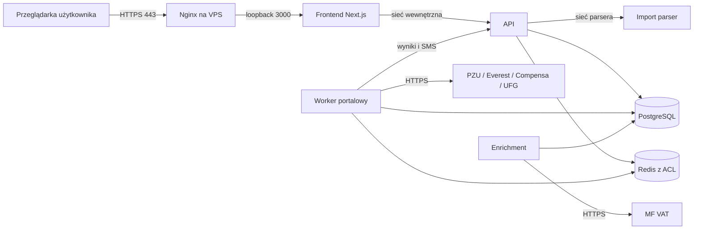

# Plan implementacji po audycie platformy i automatyzacji — 13.10.2026

## 1. Cel, ustalenia i sposób wykonania

Plan domyka problemy G01–G08 z [audytu z 13.10](AUDYT_PLATFORMY_I_AUTOMATYZACJI_2026-10-13.md). Jest instrukcją dla implementacji na aktualnym drzewie roboczym. **Żaden krok poniżej nie jest oznaczony jako wykonany tylko dlatego, że został opisany.**

Status rzeczywiście wykonanych zmian, testów i blokad środowiska jest prowadzony osobno w [rejestrze realizacji](REALIZACJA_PLANU_PO_AUDYCIE_2026-10-13.md).

Ustalenia użytkownika:

1. VPS nie został jeszcze wybrany ani kupiony. Najpierw przygotowujemy i odbieramy kod oraz pakiet wdrożeniowy lokalnie.
2. Dostęp będzie przez internet: domena → HTTPS na VPS → frontend → wewnętrzne API. Publiczne porty usług danych i workera pozostają zamknięte.
3. MFA/TOTP/recovery platformy jest odłożone. Plan nie dodaje tego wymagania do bieżącej implementacji. Portalowe SMS pozostają częścią automatu. Potwierdzanie wrażliwej operacji obecnym hasłem jest osobnym mechanizmem, opartym na istniejącym rozwiązaniu kasowania.
4. Dostawca backupu, miejsce kopii i docelowa retencja zostaną ustalone później. Teraz przygotowujemy mechanizm i testy na storage lokalnym/testowym; konfigurację zewnętrznego storage i harmonogramu odkładamy. Nie uruchamiamy automatycznego kasowania danych ani kopii.
5. Zachowujemy wcześniejszy plan produktu z 12.10: pierwsza organizacja i automat OC; lookup NIP → REGON przez **MF VAT**, bez wymagania klucza GUS BIR i bez automatycznego fallbacku.
6. Brak osoby lub bezpiecznie dopasowanego PESEL kończy dany wiersz z czytelnym powodem. Nie tworzy wyniku/leada gotowego do przydziału. Następne wiersze mają być przetwarzane dalej.
7. Zachowujemy aktualny kontrakt XLSX, oddzielne operacje dla nowych importów, limity SMS, uprawnienia uruchamiającego oraz zachowanie cudzych przydzielonych leadów po usunięciu importu.

Wykonawca najpierw czyta bieżące pliki i `AGENTS.md`. Nie resetuje istniejących zmian. Kolejne poprawki powinny mieć mały zakres i własny dowód odbioru. Nie należy przy okazji przebudowywać layoutu, modelu leadów ani całej automatyzacji. Przy zmianach Next.js obowiązuje lokalna dokumentacja wersji zainstalowanej w repo.

Wartości nowych limitów zasobów w tym planie są **parametrami startowymi do pomiaru**, nie udowodnioną pojemnością produktu. Przed utrwaleniem konfiguracji trzeba przepuścić reprezentatywny legalny arkusz. Nie kupujemy VPS na podstawie niezmierzonego zużycia RAM.

## 2. Kolejność i zależności

| Krok | Zakres | Audyt | Warunek rozpoczęcia |
| --- | --- | --- | --- |
| 0 | Punkt odniesienia i ewidencja wykonania | G08 | Od razu |
| 1 | Walidacja ekspansji XLSX | G01 | Krok 0 |
| 2 | Izolacja parsera i odporność API na jego awarię | G01 | Krok 1 |
| 3 | Terminalne braki danych, zestawy i stare zadania | G02 | Krok 0 |
| 4 | Macierz minimalnych praw PostgreSQL | G03 | Kroki 2–3 i znane nowe tabele |
| 5 | Oddzielenie migracji, kontenery i Redis ACL | G03 | Krok 4 |
| 6 | Walidacja production i szyfrowanie | G04 | Krok 5 |
| 7 | Potwierdzanie operacji hasłem, bez MFA | G04 | Krok 6 |
| 8 | Jednoznaczna konfiguracja MF VAT | G07 | Krok 0 |
| 9 | Pełna regresja i powtarzalny odbiór | G08 | Kroki 1–8 |
| 10 | Pakiet wdrożenia HTTPS i test topologii | G06 | Krok 9 |
| 11 | Health, monitoring i obsługa awarii | G06 | Krok 10 |
| 12 | Mechanizm kopii i pełnego restore | G05 | Kroki 5–6, bez wyboru dostawcy storage |
| 13 | Wydanie, manifest i rollback | G06/G08 | Kroki 9–12 |
| 14 | VPS, odbiór live i uruchomienie | Wszystkie | Dostępny VPS, domena i późniejsze ustalenia o kopiach |

Implementacje w krokach 1–8 można wykonać bez VPS i bez logowania do portali. Integracyjne odbiory wymagają uruchomionego Docker Engine. Brak usługi testowej oznacza `BLOCKED_ENVIRONMENT`, a nie zaliczony test. Nie łączymy tej informacji z błędem kodu.

## 3. Krok 0 — utrwalić punkt odniesienia

**Pliki:** istniejący katalog `docs/audit-production-2026-10-13/`; nowy `docs/REALIZACJA_PLANU_PO_AUDYCIE_2026-10-13.md`; `package.json`, `scripts/test-module.cjs`, `scripts/test-module.test.cjs`.

1. Zapisz HEAD, listę zakresów zmian i SHA-256 plików objętych implementacją. Nie zapisuj `.env`, danych klientów ani sekretów do dokumentacji. Stan roboczy jest szerszy niż obecny commit; późniejsze wydanie musi zawierać jego uzgodnioną implementację.
2. Utwórz ewidencję kroków: status `TODO / IN_PROGRESS / CODE_DONE / VERIFIED / BLOCKED_ENVIRONMENT`, zmienione pliki, komenda, wynik, log i pozostające ograniczenia.
3. Napraw oczekiwaną listę modułów w `test-module.test.cjs`: uwzględnij `leads`, zachowaj jawny manifest, brak szerokich globów i usuwanie flag live/poświadczeń z testowego env. Nie usuwaj testu, aby uzyskać zielony wynik.
4. Do zwykłej regresji dołącz test runnera oraz kryptografii kopii. Odbiory wymagające Docker/Chromium zachowaj w osobnych komendach, aby zwykły test nie uruchamiał portali ani usług produkcyjnych.
5. Prób audytowych nie uruchamiaj po poprawkach jako testów, które wciąż oczekują luki. Są historycznym dowodem. Właściwe regresje mają oczekiwać odrzucenia payloadu i poprawnego zakończenia wiersza.

**Odbiór:** `npm run test:module:runner`, `npm run test:backup-crypto`, `npm test` i build przechodzą albo dokument zawiera konkretną przyczynę blokady. Nie ma osłabienia izolacji modułów.

## 4. Krok 1 — zamknąć ekspansję arkusza przed ExcelJS

**Pliki:** `apps/api/src/workbook-archive.ts`, `workbook.ts`, `workbook.test.ts`, `imports.ts`; nowe testy struktur arkusza według potrzeby.

1. Rozszerz kontrakt `WorkbookArchiveLimits` o granice współrzędnych, liczbę definicji kolumn oraz sumę rozwijanych zakresów. Zachowaj obecne limity 16 MiB ZIP, 64 MiB dekompresji, 40 000 fizycznych wierszy, 800 000 komórek, liczby wpisów ZIP, XML i scalonych komórek.
2. W obsłudze `<col>` waliduj `min/max` jako pełne dodatnie liczby całkowite, bez tolerancyjnego `parseInt`. Wymagaj `min ≤ max ≤ 16 384`. Odrzuć `NaN`, ułamki, znaki, notację wykładniczą, sufiksy i przepełnienie. Sumuj `max - min + 1` dla każdej definicji w całym workbooku; liczenie unii zakresów nie może ukryć kosztu wielu nakładających się definicji.
3. Przyjmij startowy budżet 64 000 rozwijanych kolumn na cały workbook oraz maksymalnie 16 384 na arkusz. Limit liczby definicji ma osobno zapobiegać tysiącom małych/nakładających się zakresów. Zweryfikuj to na legalnych arkuszach przed zatwierdzeniem; limit nie ma odrzucać normalnego formatowania całej szerokości jednego arkusza.
4. Waliduj adresy `row.r`, `c.r` i `dimension.ref`, rozmiary i indeksy wierszy/kolumn. Wymagaj zgodności komórki z jej wierszem oraz ogranicz indeks wiersza do przyjętego zakresu importu. Sam licznik fizycznych `<row>` nie chroni przed jednym rekordem umieszczonym pod bardzo dużym indeksem.
5. Sprawdź wszystkie struktury, które zainstalowany ExcelJS rozwija w pętli: definicje kolumn, scalenia, indeksy komórek, style, shared strings i relacje. Zachowaj zakaz formuł i zewnętrznych relacji. Walidację arkusza oprzyj na rozpoznanych częściach workbooku, nie wyłącznie na założeniu nazwy `sheet\d+.xml`; nieobsługiwane ścieżki trzeba jawnie odrzucić.
6. Rozróżnij błędny format (`INVALID_WORKBOOK`) od przekroczenia budżetu (`IMPORT_LIMITS_EXCEEDED`). Nie zwracaj do HTTP treści XML, stosu wyjątku ani wartości komórek. Przekroczenie limitu nie tworzy częściowego importu w bazie.
7. Dodaj bounded regresje dla payloadu 25 000 kolumn z audytu, skrajnego `max`, zbyt wielu zakresów, nakładania zakresów, pustych/błędnych atrybutów, dalekiej współrzędnej, wielu arkuszy oraz obecnych scaleń. Nie używaj payloadu wyczerpującego pamięć jako zwykłego testu jednostkowego.

**Odbiór:** payload z audytu jest odrzucany przed wywołaniem ExcelJS. Legalny arkusz bliski rzeczywistej wielkości przechodzi z poprawnym zachowaniem kolumn, kontaktów i numerów wierszy. Dowód: testy archiwum i importu HTTP oraz brak nowego `ImportBatch` po odrzuceniu.

## 5. Krok 2 — wydzielić parsowanie poza proces API

**Rozwiązanie docelowe:** dedykowana wewnętrzna usługa `import-parser` z osobnym limitem zasobów; jeden krótko żyjący proces potomny na import. Usługa wykorzystuje istniejący build API i funkcję parsera, więc nie potrzebuje nowego frameworka ani osobnego modelu danych.

**Pliki:** nowe `apps/api/src/import-parser-main.ts`, `import-parser-child.ts`, `import-parser-client.ts`, testy kontraktu i izolacji; `workbook.ts`, `imports.ts`, `apps/api/package.json`, `apps/api/Dockerfile`, `compose.yaml`, skrypty lokalnego startu/preflight.

1. Zostaw walidację ZIP/XML i parsowanie w czystym module. Nie importuj do parsera `db.ts`, modułu Nest, sesji ani bootstrapu administratora. Normalizacja danych używana przez parser również ma pozostać bez zależności DB/sieci.
2. Dodaj wewnętrzne `POST /internal/parse-xlsx` dla surowych bajtów. API wybiera adres wyłącznie z walidowanej konfiguracji. Użytkownik nie może podać URL parsera. Limit 16 MiB jest egzekwowany także dla chunked body i przy nieprawdziwym `Content-Length`.
3. Połączenie API–parser wymaga osobnego losowego sekretu usługowego. Parser nie dostaje sekretów bazy, portali, sesji, PESEL ani artefaktów. Nie posiada eksportów, profilu Chromium ani dziennika kasowania. W produkcji należy do sieci współdzielonej wyłącznie z API, bez portu hosta.
4. Proces nadrzędny parsera przyjmuje maksymalnie jeden aktywny import. Nie trzyma nieograniczonej kolejki w pamięci: kolejna próba otrzymuje kontrolowane zajęcie usługi i `Retry-After`. Slot jest zwalniany dopiero po zakończeniu/posprzątaniu procesu potomnego.
5. Użyj asynchronicznego `fork/spawn` z tablicą argumentów, bez shella. Każdy child otrzymuje tylko własny bufor wejściowy i minimalne env. Deadline obejmuje preflight, ExcelJS i serializację wyniku. Timer zarządzany przez nadrzędny proces kończy child także wtedy, gdy pętla parsera blokuje własny event loop.
6. Parametry startowe: całość 60 s, child heap 512 MiB, kontener parsera 768 MiB RAM, 1 CPU, ograniczona liczba procesów; wynik JSON maksymalnie 64 MiB. Pomiar legalnego importu może uzasadnić zmianę tych wartości przed wydaniem. **Limit heap Node nie jest limitem całej pamięci procesu**; twardą izolację zapewnia oddzielny limit kontenera. Lokalny child bez cgroup nie jest dowodem produkcyjnej izolacji pamięci.
7. Gdy klient rozłączy upload, proces jest kończony i slot zwalniany. Obsłuż `error`, `exit`, `close`, timeout i uszkodzoną odpowiedź dokładnie raz. Wynik musi mieć limit rozmiaru i przejść walidację DTO w API, zanim utworzy się transakcja DB. Hasz pliku licz w API z oryginalnych bajtów.
8. API mapuje odrzucenie na stabilny błąd importu, timeout na `IMPORT_PARSE_TIMEOUT`, zajęcie na kontrolowany retry, a brak parsera/crash na chwilową niedostępność importu. Nie retransmituje błędów/stderr z procesu. Awaria parsera nie wyłącza loginu, wyników i obsługi już uruchomionych zadań. Gotowość importu może być osobnym stanem od gotowości całego API.
9. Dla Windows dodaj start lokalnej usługi parsera i jej zamknięcie razem z procesami uruchomionymi przez `Start-GoldisLocal.ps1`. Adres localhost dozwolony lokalnie; konfiguracja produkcyjna nie może po cichu wracać do parsowania w procesie API.
10. Dodaj testy: child bez końca jest przerwany, child kończy się błędem/OOM, odpowiedź jest za duża/uszkodzona, drugi import otrzymuje retry, disconnect zwalnia slot, po awarii następny legalny import działa. Destrukcyjną próbę limitu RAM wykonuj wyłącznie w osobnym kontenerze testowym.

**Odbiór:** podczas zatrzymania/OOM parsera proces API pozostaje żywy, login i pobranie syntetycznego wyniku działają, import nie zostawia wpisów częściowych. Dwa legalne równoległe żądania mają deterministyczny wynik „przyjęty / zajęty”, bez skoku liczby procesów. Test obejmuje cały łańcuch HTTP, nie tylko funkcję parsera.

## 6. Krok 3 — terminalizować braki danych i odblokować zestawy

**Pliki:** `packages/core/src/index.ts`, `index.test.ts`; `apps/worker/src/ports.ts`, `everest-identity-provider.ts`, `live-run.ts`, `pipeline.ts`, `pg-run-repository.ts` i ich testy; `apps/api/src/run-submissions.ts`, `prepared-set-executions.ts`, `business-leads.ts`, `runs.ts`, `manual-data.ts`, odpowiednie widoki statusów i smoke DB.

### Docelowa polityka

| Wynik identyfikacji | Status runu | Reason code | Dalsze działanie |
| --- | --- | --- | --- |
| Brak osoby w wejściu | Wykluczenie przed startem; defensywnie `failed`, jeśli dotarło do workera | `IDENTITY_EXPECTED_PERSON_MISSING` | Brak portalu/wyniku, następny wiersz |
| Brak klienta/osoby po wyszukaniu REGON | `failed` | `IDENTITY_NOT_FOUND` | Brak Compensy/UFG, następny wiersz |
| Jednoznaczna osoba, brak dostępnego PESEL | `failed` | `IDENTITY_PESEL_MISSING` | Brak Compensy/UFG, następny wiersz |
| Niedostępny dla automatu przypadek podmiotu | `failed` | `IDENTITY_UNSUPPORTED_TYPE` | Próba REGON pozostaje dozwolona, bez sztucznego sukcesu |
| PESEL odczytany, lecz nieprawidłowy | `failed` | `IDENTITY_PESEL_INVALID` | Bez użycia identyfikatora |
| Wielu kandydatów lub rzeczywiście naprawialna niezgodność | `identity_review` | `IDENTITY_AMBIGUOUS` / jawny kod niezgodności | Wymaga decyzji uruchamiającego |
| Zero polis po poprawnym procesie i filtrze daty | `no_matching_policies` | Zgodnie z obecnym kontraktem | Bez XLSX i gotowego leada |
| Niepewna akcja zapisu/UFG albo utrata sesji | Obecna bezpieczna ścieżka interwencji | Obecne kody portalowe | Nie powtarzać niepewnej akcji |

Nie dodajemy nowego statusu DB dla każdego rodzaju braku. Wykorzystujemy istniejący terminalny `failed` i precyzyjny kod przyczyny. `no_matching_policies` pozostaje wyłącznie wynikiem rzeczywistego odczytu polis.

1. Dodaj brakujące reason codes do wspólnego kontraktu i jego walidacji. Zweryfikuj ograniczenia DB/DTO/public-output; nowa migracja tylko wtedy, gdy istniejąca check constraint/typ wymaga rozszerzenia. Nie zmieniaj już zastosowanych migracji 001–058.
2. Wydziel jedną funkcję klasyfikacji wyniku identyfikacji. Wywołuj ją z live i syntetycznego pipeline, aby `not_found` nie był terminalny w jednym, a interwencyjny w drugim.
3. W `LiveRunProcessor` zastąp `pauseForReview` dla nienaprawialnych braków przejściem fenced do `failed`. Repozytorium zapisuje `finished_at`, reason, zdarzenie oraz domyka bieżący dispatch. Nie zapisuje identity, draftu, eksportu ani nowego otwartego zgłoszenia.
4. Zweryfikuj, że lease nadal chroni terminalizację: stary worker po utracie lease nie może nadpisać wyniku ani postawić interwencji. Bez zmian w barierach rozpoczęcia oferty, zapisu i UFG.
5. W submission uwzględnij te runy w zakończonych błędach. Operacja może mieć status `completed` jako zakończone przetwarzanie oraz niezerowe liczniki błędów. UI musi pokazać tę różnicę, zamiast sugerować pełny sukces.
6. W runnerze prepared set ukończony chunk z błędami dopuszcza kolejny chunk. Prawdziwy `identity_review`/SMS może nadal wymagać uwagi; nie należy globalnie uznawać wszystkich `waiting_attention` za zakończone.
7. Lead jest gotowy wyłącznie wtedy, gdy wszystkie powiązane runy są terminalne i istnieje dodatni ukończony wynik. Błąd jednej firmy nie blokuje poprawnych wyników innych po domknięciu zestawu. Ta sama firma z dodatnim i błędnym runem ma wynik częściowy widoczny w szczegółach.
8. Uzupełnij komunikaty statusów w API/UI. Użytkownik widzi konkretnie „brak osoby”, „brak PESEL” albo „typ niedostępny”, bez danych osobowych w logach. Interwencja nie jest oferowana dla terminalnego braku.
9. Przygotuj osobny skrypt porządkowania historycznych `identity_review`: domyślnie `--dry-run`, jawna lista run IDs, sprawdzenie checkpointów i aktywnego lease, transakcja i zdarzenie audytu. Konwertuj jedynie potwierdzony brak bez wykonanej akcji Compensy/UFG. Historycznego `IDENTITY_AMBIGUOUS` nie wolno masowo zamieniać na brak PESEL, ponieważ stary kod zatarł tę różnicę. Takie rekordy pozostają do indywidualnej oceny.
10. Dodaj odbiory jednostkowe i DB: sukces–brak osoby–sukces, brak PESEL, same błędy, sukces+zero polis, niejednoznaczność, restart po terminalizacji, utrata lease, brak drugiego dispatchu i przejście przez granicę 500 wierszy. Test granicy chunku używa syntetycznych terminalnych wyników, bez 500 wywołań portalu.

**Odbiór:** błędny wiersz nie pozostawia otwartej interwencji ani blokady capacity; następny chunk dochodzi do wyniku. Dodatni lead jest dostępny i ma właściwy kontakt, a brak danych nie daje pliku ani leada `ready`. Nie zmieniono reguł SMS i niepewnych akcji.

## 7. Krok 4 — zdefiniować i wyegzekwować prawa PostgreSQL

**Pliki:** `docker/postgres/ensure-runtime-roles.sh`; nowy `docker/postgres/apply-runtime-grants.sql` lub równoważny jawny moduł; `docs/DB_RUNTIME_PERMISSIONS.md`; skrypty smoke; `compose.yaml` i lokalny upgrade ról.

1. Zbuduj macierz **rola → tabela/sequence → SELECT/INSERT/UPDATE/DELETE**, na podstawie rzeczywistych SQL oraz wywołań modeli API i obu workerów. Nie nadawaj uprawnienia tylko dlatego, że model jest importowany do pliku.
2. Rozdziel role: `goldis_migrator` właściciel schematu; `goldis_api` runtime API; `goldis_worker` portal; nowa `goldis_enrichment` dla rejestru. Nie używaj jednej roli dla obu workerów.
3. Portalowy worker dostaje potrzebne prawa do runów, ich checkpointów, lease/outbox, challenge/interwencji, runtime status i staging metadata; odczyt wejścia/snapshotów tylko tam, gdzie rzeczywiście jest potrzebny. Brak praw do tabel haseł, sesji użytkowników, członkostw, grantów i potwierdzeń operacji.
4. Enrichment dostaje tylko tabele zadań rejestru, danych/korekt wymaganych przez wynik, budżetu/cache/pacingu i swojego heartbeat. Jeżeli jego obecny proces wykonuje grupowanie/audyt, dopisz minimalne prawa do tych konkretnych operacji i testuj je. Audyt nie może mieć swobodnego UPDATE/DELETE przez worker.
5. Przed nowymi grantami **cofnij obecne szerokie uprawnienia**, także inherited/default privileges. Samo dodanie allowlisty nie usuwa wcześniejszego `GRANT ALL DML`. Sprawdź PUBLIC, członkostwa ról, prawa CREATE w public i bazie oraz właścicieli obiektów.
6. Pozostaw konta runtime bez superuser/createdb/createrole/replication/bypassrls i bez prawa DDL. Zamiast domyślnego pełnego DML dla nowych tabel zastosuj brak automatycznych praw; po migracjach wykonaj jawne nadanie z wersjonowanej macierzy. Nowa tabela wymaga świadomego wpisu w tej macierzy.
7. Wersjonowany skrypt uprawnień ma być idempotentny i przenosić istniejące obiekty do migratora bez utraty danych. Obsłuż sequence, widoki i funkcje. Funkcje SECURITY DEFINER dodawaj tylko, jeśli są rzeczywiście potrzebne, z kontrolowanym `search_path` i odebranym PUBLIC EXECUTE.
8. Testuj nie tylko `rolsuper=false`: portalowy worker nie odczyta hashy haseł i nie zmieni członkostwa, API/worker nie wykona CREATE/ALTER/DROP, enrichment nie zmieni checkpointu Compensy. Następnie oba workery i pełny flow mają działać na tych samych ograniczonych rolach.

**Odbiór:** świeża i istniejąca baza przechodzą upgrade; negatywne operacje kończą się odmową DB. Migracje, full flow i kasowanie zachowanych leadów działają bez superusera runtime. Macierz jest dołączona do wydania.

## 8. Krok 5 — oddzielić migracje, sekrety i kontenery

**Pliki:** `compose.yaml`, nowy `compose.production.yaml`, Dockerfile API/web/workera; `apps/api/src/migrate.ts`, `bootstrap-admin.ts`, nowy entry point jednorazowego bootstrapu; czytnik sekretów; `docker/postgres/`; nowe `deploy/redis/` i smoke ACL; skrypty lokalnego startu i upgrade.

1. Podziel start na jednorazowe usługi: przygotowanie ról → `migrate` → zastosowanie macierzy grantów → inicjalizacja pierwszego administratora → runtime. API uruchamia wyłącznie `main.js`. Restart API nie wykonuje ponownie migracji ani nadawania praw.
2. Sekret właściciela DB trafia tylko do bootstrapu/administracyjnego zadania ról; sekret migratora tylko do `migrate`/zadania grantów. API ma własne konto, portal własne, enrichment własne. Hasła nie mogą pojawić się w `command`, argumentach procesu, logach ani obrazie.
3. Dodaj obsługę sekretów z plików montowanych tylko do właściwej usługi. Konfiguracja Compose wskazuje ścieżkę, a entry point/czytnik składa URL w pamięci. Hasła URL-encode; nie konkatenować niezakodowanych sekretów w connection string. Dla lokalnego Windows można zachować istniejący prywatny env, bez wypisywania jego wartości.
4. Kontener API po starcie nie ma dostępu do pliku sekretu migratora ani bootstrapu. Usuń długotrwałą potrzebę `GOLDIS_ADMIN_PASSWORD` w runtime: nowy one-shot bootstrap korzysta z istniejącej idempotentnej logiki. Pusta baza bez wykonanego bootstrapu daje jawny stan inicjalizacji, a nie uruchomienie niezabezpieczonej platformy.
5. Migrator używa blokady PostgreSQL obejmującej cały przebieg migracji. W razie drugiego migratora nie wykonuje konkurencyjnego DDL. Po błędzie zwalnia połączenie i kończy się kodem niezerowym. Publiczny ruch pozostaje zamknięty do zakończenia migracji i grantów.
6. Zbuduj obrazy etapowo: kompilacja z dev dependencies, runtime tylko z wymaganymi zależnościami i `dist`. Zachowaj poprawne symlinki workspace `@goldis/core`. API/parser/web działają jako użytkownik bez roota. Worker zachowuje `pwuser`, sandbox i profil seccomp.
7. Ogranicz kontekst obrazu: dokumentacja, screenshots, arkusze, profile, staging i raporty audytowe nie są potrzebne w runtime. Pozostaw jawnie skrypty niezbędne do migracji artefaktów/odbioru. Dodaj `no-new-privileges`, ograniczenie capability oraz osobne katalogi zapisu. Read-only filesystem włącz tam, gdzie test Next.js/Chromium potwierdzi wymagane zapisy w dedykowanym wolumenie/tmpfs.
8. Limity pamięci/CPU/PID w production obejmują każdą usługę. Suma budżetów musi pozostawiać RAM dla hosta i DB cache. Nie kopiuj arbitralnego limitu parsera do Chromium. Zweryfikuj faktycznie zastosowane `HostConfig.Memory/NanoCpus/PidsLimit`; sam poprawny YAML nie jest dowodem limitu.
9. Uruchom Redis z ACL file, bez aktywnego anonimowego `default`. Zdefiniuj użytkownika API dla jego kolejki i kluczy limiterów, użytkownika portal-workera tylko dla kolejki, oraz minimalny monitoring/health. Ustaw także uprawnienia kanałów pub/sub potrzebnych BullMQ. Bootstrap/admin Redis nie jest poświadczeniem runtime.
10. Allowlistę komend Redis ustal na podstawie BullMQ/ioredis/limiterów używanych w repo. Obsłuż skrypty Lua, blocking connection i wymagane `CLIENT`/`INFO`, jeżeli test wykaże ich użycie. Nie rozwiązuj pierwszego błędu ACL nadaniem `+@all ~* &*`. Worker nie dostaje dostępu do kluczy limitera logowania.
11. Sprawdź każdy sposób tworzenia klienta Redis: API limiter, queue producer/outbox, worker, probe i smoke. Parser URL workera już obsługuje username/password/TLS; zachowaj i przetestuj to. Nie uruchamiaj zdrowotności przez poświadczenie Redis-admin ani przez unauthenticated `redis-cli ping` po włączeniu ACL.
12. Dodaj świeży i upgrade smoke: migracje działają jedynie z migratorem, runtime startuje bez jego sekretu; Redis przyjmuje job/SMS/rate-limit, lecz odmawia bez hasła, złego użytkownika, obcego prefiksu oraz `FLUSHALL`, zmiany ACL i CONFIG.

**Odbiór:** pełny syntetyczny flow działa na finalnych obrazach, rolach i ACL. Inspekcja konfiguracji runtime nie zawiera sekretu migratora. Reboot/restart API nie wykonuje migracji. Chromium działa w sandboxie bez `SYS_ADMIN` i bez seccomp `unconfined`.

## 9. Krok 6 — jeden kontrakt konfiguracji production i szyfrowania

**Pliki:** nowy wspólny moduł walidacji środowiska (core lub odrębny czysty moduł współdzielony przez entry points); `apps/api/src/main.ts`, `http-bootstrap.ts`, `session.ts`, `artifact-crypto.ts`, `health.ts`, `health-probe.ts`; worker/enrichment/parser entry points; `scripts/preflight-contract.cjs`, przykłady env i Compose.

1. Ustal kanoniczny tryb wdrożenia `APP_ENV=development|test|production`. API/workery mają spójne `NODE_ENV`; frontend może używać produkcyjnego builda lokalnie bez uznawania go za publiczne wdrożenie. Walidator działa komponentowo: web/parser nie wymagają kluczy DB/PESEL, których nie powinny posiadać.
2. W production wymagaj poprawnego HTTPS `PUBLIC_APP_ORIGIN` bez ścieżki, query i danych logowania; cookies API mają `Secure`, `HttpOnly` dla sesji, obecne `SameSite` i CSRF/origin guard. Lokalny HTTP jest dopuszczony tylko dla jawnego trybu lokalnego i loopback.
3. Wymagaj jawnej listy adresów zaufanego proxy; bez `true`, wildcardu i automatycznego zaufania do całej sieci. Publiczne adresy API nie są alternatywnym wejściem aplikacji.
4. Zwaliduj klucze PESEL/artefaktów/stagingu, aktywne wersje, długości i kompletność. Sprawdź sekrety sesji, limiterów i komunikacji wewnętrznej, konta runtime i ich prawa. Błąd startupu pokazuje nazwę brakującego ustawienia/kod, nigdy jego wartość.
5. `ARTIFACT_REQUIRE_ENCRYPTION=1` jest obowiązkowe w production; jawne `0` lub pominięcie nie przechodzi startu. Dodatkowo funkcja odczytu artefaktu odrzuca legacy plaintext w production niezależnie od tego, czy ktoś ominął entry point. Kontrolowany tryb migracji narzędzia jest odrębny od pobierania HTTP.
6. Przed wejściem do nowego trybu wykonaj istniejący `migrate-artifacts-to-encrypted.cjs` na kopii magazynu. Najpierw dry-run/inwentaryzacja, kontrola SHA-256 i liczności; potem konwersja przy zatrzymanych zapisach. Zachowaj wszystkie stare wersje kluczy potrzebne do odszyfrowania istniejących plików i kopii. Nie konwertuj niczego automatycznie podczas startupu API.
7. Gotowość API obejmuje zgodność schematu, właściwą rolę DB, Redis, dopuszczenie journalu oraz wymagane magazyny/klucze. Nie ustawiaj health `ready` tylko dlatego, że `SELECT 1` i PING działają. Probe nie zapisuje przykładowych danych osobowych ani nie odpytuje portali.
8. Dla live workera production wymagaj `WORKER_CHROMIUM_SANDBOX=1`, prawidłowej konfiguracji portali, sekretów i stagingu. `WORKER_LIVE_PORTALS=0` pozostaje prawidłowym bezpiecznym stanem platformy: automation readiness pokazuje `off`, a platforma może służyć do odbioru bez portali.
9. Windows preflight i Compose korzystają z tego samego kontraktu/wyeksportowanych reguł. Test kontraktowy porównuje wymagane ustawienia, aby reguły nie rozjeżdżały się ponownie.
10. Dodaj negatywne testy startupu: HTTP origin production, brak klucza, nieznana wersja klucza, flaga szyfrowania 0, DB superuser, brak sandboxu w live, wildcard proxy, błędne credentials Redis, niezastosowany journal. Test legacy plaintext sprawdza również bezpośrednią funkcję decrypt z production env.

**Odbiór:** niewłaściwa konfiguracja nie otwiera portu/gotowości komponentu. Poprawne ustawienia uruchamiają pełny flow. Nowe i zmigrowane artefakty można pobrać po autoryzacji, zmieniony ciphertext albo zła wersja klucza jest odrzucana. Development nadal działa lokalnie.

## 10. Krok 7 — świeże potwierdzenie wrażliwych zmian obecnym hasłem

**MFA jest poza zakresem tego kroku.** Nie dodajemy TOTP, dodatkowego urządzenia, recovery codes ani wymagań zewnętrznej bramy. Używamy hasła już istniejącego konta, tylko przy operacjach zmieniających dostęp.

**Pliki:** nowe `apps/api/src/privileged-action-confirmation.ts`, testy i tabela grantów potwierdzenia; `session.ts`, `admin.ts`, `team.ts`, `audit.ts`, `login-rate-limiter.ts`, kontrakty DTO; UI admin/team/access oraz wspólny mały formularz potwierdzenia. Migrację numeruj po aktualnej najwyższej, nie według z góry wymyślonego numeru.

1. Zinwentaryzuj mutacje zmieniające hasło innego użytkownika, rolę, status konta, uprawnienie uruchomienia/pobierania i grant kasowania. Uwzględnij **obie ścieżki** `/admin/...` oraz `/team/...`; zabezpieczenie wyłącznie starego panelu admina zostawi obejście.
2. Zbuduj token potwierdzenia dla konkretnej operacji: tenant, user, session, credential revision, action, target, expected version, fingerprint żądania, created/expires/consumed. TTL 5 minut, losowy token co najmniej 32 bajty, DB przechowuje tylko jego hash. Nie wykorzystuj tokenu kasowania do innych operacji.
3. Endpoint potwierdzenia wymaga sesji, CSRF/origin, aktualnego hasła i limiterów reauth. Ponownie sprawdza status konta, rolę i uprawnienia przed wydaniem tokenu. Nie wystarcza samo wskazanie przez frontend `action=admin`.
4. Fingerprint licz z kanonicznego, zwalidowanego kontraktu operacji; nowego hasła nie przechowuj w rekordzie ani audycie. Dla operacji zawierającej sekret użyj serwerowego HMAC związania treści, z oddzielnym przeznaczeniem klucza. Odrzuć podmianę targetu/body/expectedVersion po potwierdzeniu.
5. Mutacja konsumuje token atomowo w tej samej transakcji co zmiana i audyt, po ponownym sprawdzeniu sesji i członkostwa. Zmiana uprawnień/podmiotu wygasza ważność. Rollback nie pozostawia zużytego tokenu bez wykonanej operacji.
6. Obsłuż niepewną odpowiedź: idempotency key i fingerprint operacji zwracają wcześniej zapisany wynik tej samej operacji po uwierzytelnieniu. Replay nie powoduje drugiej zmiany ani błędu tylko dlatego, że token został prawidłowo zużyty. Zmieniony payload z tym samym kluczem daje konflikt.
7. UI prosi o obecne hasło po wybraniu konkretnej zmiany, pokazuje jej cel i czyści hasło/token po zamknięciu lub wykonaniu. Nie umieszcza ich w URL, localStorage, telemetry ani powiadomieniach. API egzekwuje regułę także bez UI.
8. Zachowaj istniejące potwierdzenie kasowania oraz zmianę własnego hasła; nie łącz tych tokenów w uniwersalne pozwolenie na wszystkie operacje admina. Rozszerz czyste helpery weryfikacji, unikając dwóch rozbieżnych implementacji limiterów i kontroli sesji.
9. Testy: zła rola, złe hasło, obca sesja/tenant/target, expiry, zmiana credential revision, odebranie roli między potwierdzeniem a użyciem, dwa równoległe użycia tokenu, rollback i retry po utraconej odpowiedzi. Osobny smoke dla `/team` i `/admin`.
10. W tej samej zmianie uaktualnij macierz grantów z kroku 4 dla nowych tabel potwierdzenia/idempotencji: dostęp wyłącznie dla właściwej usługi API, bez praw obu workerów. Każda następna migracja w planie musi aktualizować tę macierz, zanim przejdzie odbiór integracyjny.

**Odbiór:** zwykła aktywna sesja nie wykonuje chronionej zmiany bez potwierdzenia; ta sama zatwierdzona operacja wykonuje się najwyżej raz. Dotychczasowe logowanie hasłem i portalowy SMS działają bez nowych etapów MFA.

## 11. Krok 8 — domknąć ścieżkę MF VAT i odłożyć GUS

**Pliki:** `registry-provider-factory.ts` i testy, `scripts/preflight-contract.cjs` i testy, `Start-GoldisLocal.ps1`, przykłady env, Compose, health i dokumentacja uruchomienia.

1. Dla pierwszego wydania określ publicznie wspierane opcje `disabled` oraz `mf-vat`. GUS BIR pozostaje eksperymentalnym adapterem/testami poza produkcyjną ścieżką konfiguracji. Nie dopisuj GUS do preflight tylko po to, żeby ukryć brak wyboru dostawcy.
2. Usuń niespójne deklaracje wsparcia GUS z aktywnego startu lokalnego albo oznacz osobny jawny tryb eksperymentalny, którego production validator nie dopuszcza. Zachowaj kod adaptera, jeżeli nie przeszkadza; usunięcie nieużywanego kodu nie jest celem tego zadania.
3. W Compose enrichment dostaje `GOLDIS_ENRICHMENT_PROVIDER`, `MF_VAT_ENVIRONMENT`, pacing i cache HMAC oraz własne konto DB. Brak klucza GUS nie blokuje MF. W produkcyjnym profilu wskazujemy MF; konfiguracja lokalna może świadomie pozostawać `disabled`.
4. Zachowaj istniejący budżet, pacing i cache. Nie podnoś limitów ani nie obchodź wyczerpania budżetu dodatkowym procesem. Dokumentacja ma odróżniać „provider disabled”, „offline”, „limit”, „no result” i „niejednoznaczność”. Przed odbiorem live zweryfikuj aktualny kontrakt/limity u dostawcy.
5. Testy przekazania env porównują Compose i validator bez odczytu sekretów. Izolowany HTTP fixture sprawdza MF hit/no-result/timeout/429/cache oraz restart zadania. Run bez nowego poprawnego REGON nie wchodzi do portalu z wartością zastępczą.

**Odbiór:** produkcyjny wariant konfiguracji MF uruchamia enrichment i pokazuje poprawną gotowość. Świadome `disabled` ma czytelny stan. GUS nie jest deklarowany jako odebrana funkcja pierwszego wydania. To zamyka niespójność G07 zgodnie z wcześniejszym wyborem produktu.

## 12. Krok 9 — ustanowić kompletną regresję wydania

**Pliki:** `package.json`, `scripts/test-module.cjs` i testy, nowe `scripts/release-checks.cjs`, runner integracyjny dla Windows/Linux; skrypty smoke API/web/worker; dokument ewidencji.

1. Zdefiniuj jawne komendy: zwykła regresja, fixture-browser, DB/Redis, UI oraz odbiór obrazu/topologii. Mogą otrzymać nazwy `test:release:unit`, `test:release:browser`, `test:release:integration`, `test:release:ui`, `test:release:containers`. **To nazwy nowych skryptów do implementacji, nie istniejące już komendy.**
2. Unit uruchamia core/API/worker/preflight/runner i kryptografię backupu. Browser uruchamia wszystkie wymagane fixture PZU/Everest/Compensa/UFG z `PLAYWRIGHT_INTEGRATION=1`, własnymi katalogami i zerową flagą live. W głównej regresji celowe SKIP zapisuj; w dedykowanym odbiorze fixture nie mogą udawać PASS.
3. Integration tworzy własne jednorazowe DB/Redis, migruje świeży schemat i kopię starszego schematu, stosuje realne role i ACL. Obejmuje tenant scope, odwołanie dostępu, submissions, chunk boundary, leady, run control, SMS, kasowanie i replay. Nie używa URL z produkcyjnego env.
4. Nowe testy grantów/confirmation/migracji włącz do manifestu oraz odbioru maksymalnego numeru migracji. Zaktualizuj seed/asercje zamiast zmniejszać zakres sprawdzania.
5. UI utrzymuje szybkie scenariusze ze stubami, lecz dodaj jeden pełny scenariusz web → API → DB/Redis → syntetyczny worker → XLSX → lead/przydział → usunięcie źródła/zachowany cudzy wynik. Nie kieruj syntetycznego workera do kont portalowych.
6. Nie ustawiaj flagi portal-live globalnie w CI. Własność zasobów testowych ma być potwierdzona przed cleanup. Każdy test ma timeout i kończy wyłącznie swoje procesy/kontenery.
7. Runner zapisuje JSON: commit/hashes, wersje runtime, test counts, pominięcia, PASS/FAIL/BLOCKED i paths do logów. Błąd jednego etapu nie może być przykryty kodem wyjścia późniejszego udanego polecenia.
8. Skan zależności zachowaj jako osobną bramkę: brak high/critical; moderate mają właściciela, uzasadnienie osiągalności, termin ponownego przeglądu i odniesienie do konkretnego lockfile. Nie stosuj `npm audit fix --force` jako sposobu domknięcia planu.
9. Powtarzalny pipeline lokalny/Linux CI pracuje na zamkniętym snapshotcie kodu. Platformę CI i registry można podłączyć później; teraz przygotuj runner niezależny od wybranego dostawcy.

**Odbiór:** jeden raport wydania pokazuje wszystkie wymagane etapy, a nie wyłącznie `npm test`. Brak Docker Engine jest jawną blokadą integracji. Kod produktu nie jest uznany za odebrany na podstawie samych mocków.

## 13. Krok 10 — przygotować docelową topologię bez kupowania VPS

**Pliki:** `compose.production.yaml`, `deploy/nginx/goldis.conf.example`, instrukcja deploymentu, skrypt walidacji production, `apps/web/next.config.ts` i ewentualnie proxy; nowy smoke topologii HTTP/HTTPS.

1. W produkcyjnym wariancie Compose publikuj tylko frontend na `127.0.0.1:3000`. PostgreSQL/Redis/API/parser/worker nie mają portów hosta. Porty loopback DB z lokalnego wariantu nie mogą zostać dodane do production przez scalanie plików Compose; walidator sprawdza efektywną konfigurację.
2. Nginx obsługuje domenę i TLS oraz redirect HTTP → HTTPS. Ścieżki certyfikatu i domena pozostają parametrami, dopóki VPS nie istnieje. Przygotuj procedurę wystawienia/odnowienia certyfikatu, nie placeholder udający działający HTTPS.
3. Zachowaj zastępowanie `X-Forwarded-For/Host/Proto/Port` i usuwanie `Forwarded`/alternatywnych nagłówków. Ustal faktyczny łańcuch Nginx → Next → API i konkretne adresy zaufanych hopów. API ma rozpoznawać prawdziwy adres klienta, a nie wspólny adres Nginx, i nie ufać wartości dodanej przez użytkownika.
4. Z zewnątrz zablokuj `/api/internal/` niezależnie od istniejącej autoryzacji sekretami workerowymi. Worker łączy się z API bezpośrednio po prywatnej sieci. Parser ma oddzielny endpoint wewnętrzny i nigdy nie jest celem publicznego rewrite.
5. Uzgodnij upload: API/pliki 16 MiB, Nginx całe multipart początkowo 20 MiB. Przy przekroczeniu API ma zwrócić właściwy limit pliku, a proxy musi przepuścić legalne 16 MiB plus narzut multipart. Ogranicz czas/body buffering i prywatny katalog tymczasowy bramy, żeby upload nie zapełniał dysku bez kontroli.
6. Przeczytaj lokalny guide `proxyClientMaxBodySize` z zainstalowanego Next.js i sprawdź, czy buforowanie Proxy dotyczy `/api` przy obecnym matcherze. Nie zakładaj, że ustawienie limitu Server Actions naprawia rewrite HTTP. Test pliku >10 MiB i bliskiego 16 MiB ma przejść przez finalny frontend; ewentualne ustawienie limitu w Next zmieniaj zgodnie z faktyczną ścieżką tej wersji.
7. Ogranicz sieci: web–API osobno, API–parser osobno, data dla wymaganych usług. Web/parser nie widzą DB/Redis. Ochrona ruchu wychodzącego parsera obejmuje brak połączenia do portali/internetu; worker i enrichment potrzebują własnych wyjść HTTPS. Nie oznacz sieci workera jako pozbawionej egress, jeżeli ma korzystać z portali.
8. Lokalny staging uruchamia tę samą topologię z syntetycznymi sekretami i testowym TLS zaufanym przez runner. Testy obejmują host/origin/cookie, wygaśnięcie sesji, CSRF, spoofing XFF i limiter. Różne wartości sfałszowanego XFF nie odnawiają budżetu; dwa rzeczywiste adresy klienta nie współdzielą przypadkowo jednego IP Nginx.
9. Negatywnie sprawdź osiągalność DB/Redis/API/parser/worker z sieci reprezentującej klienta publicznego. Sam zapis `127.0.0.1` w pliku nie wystarcza do odbioru.

**Odbiór:** syntetyczny użytkownik pracuje przez HTTPS/domenę testową, upload/download działają, forwarding i limiter rozpoznają właściwego klienta, ścieżki wewnętrzne i usługi danych nie są publiczne. Ten wynik oznacza gotowy pakiet topologii; odbiór zapory/DNS na VPS pozostaje w kroku 14.

## 14. Krok 11 — gotowość usług, monitoring i awarie

**Pliki:** `health.ts`, `health-probe.ts`, `health-readiness.ts`, `enrichment-worker-health.ts`, `run-worker.ts`, parser entry point; healthcheck Compose; nowe `scripts/runtime-check.cjs`, `deploy/monitoring/`, runbook.

1. Rozdziel liveness od readiness. Liveness potwierdza działanie procesu, readiness zgodność konfiguracji i wymaganych zależności. Dostępność importu, portali live i enrichment pokazuj jako osobne możliwości; wyłączenie live jest czytelnym stanem, nie awarią web.
2. Dodaj healthcheck web, parsera i workera. Dla workera użyj świeżego heartbeat powiązanego z bieżącą instancją, nie samego istnienia procesu/portu SMS. Nie odpytuj realnego portalu w healthchecku.
3. Monitoruj: świeżość heartbeat, najstarszy dispatch i zaległość outbox, wiek aktywnego runu, lease, oczekiwanie SMS, otwarte interwencje, błędy parsera/MF/portali, niezgodny artefakt, dostępne miejsce i zużycie RAM oraz stan journal/replay.
4. Zdefiniuj progi początkowe i czas podtrzymania: heartbeat według istniejącego limitu 30 s, alert po utrwalonej niedostępności; kolejka/interwencja według zmierzonego normalnego czasu. Nie wysyłaj alertu za każdy pojedynczy retry. Deduplicacja ma zamknąć alarm po odzyskaniu stanu.
5. Kanał powiadomień i odpowiedzialną osobę ustawimy później. Teraz runner zapisuje zdarzenie/status lokalnie i ma testowy sink. Nie tworzy sam kont ani integracji mail/Slack.
6. Logi mają request/run/dispatch/execution ID i bezpieczny kod błędu, bez PESEL, kontaktów, haseł, OTP, cookies, body dostawcy ani connection strings. Diagnostyczne screenshots z portali nie trafiają do zwykłych logów i obrazów wydania.
7. Wykonaj fault tests wyłącznie na izolowanej instalacji: zanik Redis/DB, restart workerów/API/parsera, utrata połączenia do API po snapshot, sztuczny disk-full małego testowego wolumenu, timeout, utrata lease i reboot. Weryfikuj snapshot/artefakt/audyt oraz brak drugiej akcji zewnętrznej na syntetycznym adapterze.
8. Runbook opisuje: jak zatrzymać nowe przyjęcia, rozpoznać run niepewny, obejrzeć checkpointy, wznowić wyłącznie bezpieczną dostawę wyniku i kiedy pozostawić interwencję. Nie zawiera instrukcji „ustaw completed w DB” ani kasowania checkpointu żeby ponowić ofertę.

**Odbiór:** każda awaria ma widoczny stan i kontrolowany sposób powrotu; runtime-check nie ujawnia danych. Alarmy działają na testowym sinku. Wybór zewnętrznego kanału i dyżuru pozostaje elementem uruchomienia, nie pozornie gotową integracją.

## 15. Krok 12 — przygotować kopie i pełne odtworzenie; decyzje storage odłożyć

**Teraz:** implementacja i odbiór mechanizmu na lokalnym/testowym katalogu. **Później:** dostawca zewnętrznego storage, harmonogram produkcyjny, retencja, escrow/posiadacz kluczy i kanał alertów. Nie ustawiamy samodzielnie dostawcy ani kasowania po określonej liczbie dni.

**Pliki:** istniejące `goldis-backup-crypto.cjs` i testy; nowe skrypty Linux `deploy/backup/backup.sh`, `restore.sh`, `verify.sh`, szablony timer/service; istniejący journal/replay/admission; nowy pełny smoke restore. Windows backup pozostaje narzędziem lokalnym z prawdziwą informacją o jego zakresie.

1. Zdefiniuj format manifestu: schema/release, moment spójności, checksumy, wersje potrzebnych kluczy, zakres danych, format journalu i oczekiwany head. Nie zapisuj sekretów jawnym tekstem w manifestach/logach. Payload zawierający sekrety jest szyfrowany; klucz do otwarcia kopii pozostaje osobno.
2. Przyjmij pierwszy sprawdzalny mechanizm spójności: brama maintenance zatrzymuje nowe żądania mutacji i przyjmowanie runów; procesy wykonujące zapisy są spokojnie zatrzymane, a PostgreSQL pozostaje aktywny do dumpu. Nie kopiuj plików i dumpu w różnym czasie przy swobodnych zapisach.
3. Backup obejmuje DB, zaszyfrowane eksporty, staging wymagany do niedostarczonych wyników, klucze/config konieczne do odtworzenia i manifest wydania. Redis jest rekonstruowany z trwałego outbox/checkpointów, a nie traktowany jako jedyna kopia kolejki. Decyzję o kopii profilu portalu ujawnij w manifeście; brak profilu oznacza jawne ponowne uwierzytelnienie, nie utratę danych klienta.
4. Journal kasowań i jego signing key mają **osobne, aktualne zabezpieczenie poza historycznymi kopiami DB**. Odtwarzanie starej kopii nie może nadpisać nowszego journalu. Przygotuj eksport/import, sprawdzenie podpisu/łańcucha i adapter storage; po wyborze zewnętrznego miejsca dojdzie trwała synchronizacja aktualnego head. Brak aktualnego journalu zamyka dopuszczenie do odtworzonej usługi.
5. Skrypt jest bezobsługowy: sekret z pliku, bez `Read-Host`, prywatny workdir, brak wypisywania kluczy. Najpierw tworzy lokalny pełny zaszyfrowany plik, weryfikuje go, dopiero potem publikuje atomowo do skonfigurowanego celu. Częściowo wysłany plik nie jest poprawną kopią. Cleanup sprawdza własność ścieżek i nie usuwa nieznanych katalogów.
6. Pierwszy storage adapter to katalog testowy; interfejs ma operacje publish/verify/list/status, aby później podłączyć wybrane miejsce. Nie dodawaj domyślnej polityki purge. Szablon harmonogramu pozostaje wyłączony do późniejszych ustaleń.
7. Restore zawsze odbywa się na pustych dedykowanych wolumenach: weryfikacja kopii → role i zgodny schema/release → DB/files/keys → najnowszy journal → replay kasowań → odbudowa kolejki i stagingu → readiness → syntetyczny smoke. Brama nie otwiera ruchu przed replay.
8. Pełny smoke tworzy syntetyczne konta, import, wynik i cudzy przydzielony lead; robi kopię; następnie usuwa dane; odtwarza wcześniejszą kopię z najnowszym journalem. Sprawdza brak powrotu skasowanych danych, zachowanie cudzego leada, jego download, poprawne klucze oraz kontynuację staging/outbox bez drugiego zapisu/UFG.
9. Testuj złe hasło/klucz, brak wersji klucza, zmieniony ciphertext, uszkodzony dump, brak pliku eksportu, brak signing key, journal starszy od wymaganej historii i przerwanie restore. Każdy przypadek pozostawia usługę zamkniętą, zamiast pozwalać na częściowy start.
10. Zmierz czas kopii/restore w środowisku testowym. Cele RPO ≤ 24 h i RTO ≤ 8 h z poprzedniego planu pozostają celami do potwierdzenia. Nie deklaruj RPO produkcyjnego bez harmonogramu i zewnętrznej kopii.

**Odbiór lokalny:** odzyskiwana jest działająca platforma, nie tylko lista obiektów dumpu. **Pozostaje odłożone:** konfiguracja kopii poza VPS, harmonogram, retencja i końcowy cold restore na drugim hoście. G05 ma wtedy status „mechanizm odebrany lokalnie; produkcja oczekuje na ustalenia”, a nie „zamknięte”.

## 16. Krok 13 — identyfikowalne wydanie i rollback

**Pliki:** `runtime-manifest.ts`, Dockerfile, production Compose, nowy release manifest/runner, `docs/RELEASE_AND_ROLLBACK.md`.

1. Po domknięciu zmian przygotuj commit zawierający całą implementację objętą wydaniem, bez env, danych, profili i wygenerowanych sekretów. Nie taguj starego HEAD jako wersji obejmującej nowe pliki.
2. Zbuduj obrazy z tego commita, oznacz wersją/commit OCI labels i zapisz digest każdego komponentu. W production Compose używaj zapisanych digestów, nie lokalnego `build` ani ruchomego `latest`. Registry/dostawcę można podłączyć później; lokalny manifest nie może udawać zdalnie opublikowanych obrazów.
3. API raportuje właściwe `GOLDIS_BUILD_VERSION`, `GOLDIS_BUILD_COMMIT`, `GOLDIS_IMAGE_DIGEST`; manifest wydania obejmuje też web, parser i oba workery, najwyższą migrację, wersję grantów/ACL oraz checksums konfiguracji bez sekretów. Digest jest znany po buildzie, więc nie wbudowuj self-digest do obrazu w sposób tworzący błędne koło.
4. Wydanie zawiera protokół testów z kroku 9, odbiór topologii, kopii i fault tests. Stary historyczny live record nie jest protokołem aktualnego release.
5. Dla rollbacku zapisz zgodność aplikacji ze schematem i formatem danych. Rozszerzające migracje powinny, gdzie możliwe, pozostawiać poprzednią wersję sprawną. Migracji kasującej/przekształcającej danych nie cofaj przez samo przełączenie obrazu; procedura wskazuje compatible previous release lub kontrolowany restore/replay.
6. Przed zmianą: zamknij nowe runy, wykonaj spójną kopię, sprawdź możliwość odtworzenia, uruchom migracje/granty, runtime smoke i dopiero otwórz przyjęcia. Po problemie wyłącz przyjęcia i zachowaj checkpointy/journal — nie przywracaj starej kopii bez nowych kasowań.
7. Test rollbacku na syntetycznych danych obejmuje istniejący wynik, nadany dostęp, run oczekujący na dostawę oraz usunięcie po backupie.

**Odbiór:** można wskazać dokładnie, jaki kod i obrazy działają, ponownie zbudować/uruchomić release oraz wykonać sprawdzony rollback bez utraty wymaganych wyników i historii kasowań.

## 17. Krok 14 — czynności po wyborze VPS i odbiór automatu live

Ten krok nie jest wykonywalny w całości dziś, ponieważ VPS nie istnieje. Nie blokuje pisania ani lokalnego odbioru poprzednich kroków.

1. Wybierz wielkość VPS po pomiarze łącznego RAM/CPU/dysku dla DB, parsera i Chromium oraz oczekiwanej partii. Ustal domenę, operatora hosta i dostęp do dozwolonych kont portalowych. Nie deklarujemy z góry dostawcy, ceny ani pojemności.
2. Przygotuj host, Docker Engine, firewall i prywatne katalogi/sekrety. Domena kieruje na bramę HTTPS. Sprawdź IPv4 i IPv6; publikacja kontenera nie może omijać reguł zapory.
3. Wdróż digesty release i certyfikat. Pierwszy start ma `WORKER_LIVE_PORTALS=0`; wykonaj migracje/granty/bootstrap i zewnętrzny smoke HTTPS/ról/upload/download/XFF.
4. Po późniejszych decyzjach uruchom kopie poza VPS, potwierdź miejsce kluczy, harmonogram, retencję i alerty. Wykonaj cold restore na drugim odseparowanym hoście; zapisz checksumy, head journalu i zmierzone RPO/RTO.
5. Użytkownik odbiera 3–5 syntetycznych rekordów przez prawdziwy panel, API, DB/Redis i syntetyczny worker. Odbiór obejmuje operację z błędem w środku, poprawny nowy XLSX, przydział i zachowany cudzy wynik po usunięciu importu.
6. Przygotuj uprawnione rzeczywiste rekordy i profil portali. Włącz live na tym środowisku do nadzorowanego odbioru. Nie uruchamiaj pełnego istniejącego importu po samym ustawieniu flagi.
7. Sprawdź kilka różnych rekordów: sukces, brak osoby, brak PESEL, brak polis i niejednoznaczność. Zapisz odebrany zakres podmiotów bez filtrowania typu przed próbą REGON. Brak danych nie tworzy zastępczego PESEL/wyniku.
8. Odbierz rzeczywisty SMS PZU/Compensa: poprawny/wygasły kod, timeout, limit dwóch dodatkowych wysłań, restart i uprawnienia uruchamiającego. Sama pamięć profilu nie jest gwarancją braku kolejnego SMS.
9. Kontrolowane awarie przy nieodwracalnych akcjach najpierw przejdź na fixture; na live wykonuj tylko dopuszczone nadzorowane scenariusze. Weryfikuj checkpoint/intencję, pojedynczy draft/zapis/UFG, brak przejęcia poprzedniej osoby/sprawy i ponowną dostawę wyniku do API.
10. Sprawdź ręczną pracę na tych samych kontach portali, utratę sesji i zmianę formularza. Przy niepewnej akcji automat zatrzymuje dany run i pokazuje powód, nie resetuje cudzej sprawy ani nie tworzy drugiej oferty.
11. Porównaj każdą komórkę aktualnego XLSX z wejściowym snapshotem i odczytem OC; sprawdź lead/przydział/pobranie po kasowaniu importu. Dokumentację wyników zapisuj bez wartości danych osobowych.
12. Przejdź reprezentatywną partię i kilku użytkowników. Zmierz czas na rekord, kolejkę, pamięć i dysk; portalowy worker pozostaje pojedynczy, dopóki architektura i konta nie mają osobnego odbioru współbieżności.
13. Zapisz protokół biznesowy i techniczny dla tego release. Rozpocznij od ograniczonej liczby rekordów, a kolejne zwiększenia opieraj na zmierzonej stabilności. Monitoruj błędy, stan kopii i checkpointy; rollback wykonuj według kroku 13.

**Odbiór produkcyjny:** aktualny release działa przez domenę/HTTPS, role i izolacja są odebrane, poprawne i błędne rekordy kończą się zgodnie z kontraktem, wynik odpowiada portalowi, kopia poza hostem została rzeczywiście odtworzona, a operator ma działający sposób wykrywania/obsługi awarii. MFA pozostaje świadomie odłożone zgodnie z decyzją użytkownika.

## 18. Mapa zamknięcia audytu i odłożonych decyzji

| Problem | Poprawka lokalna | Dowód końcowy | Co pozostaje później |
| --- | --- | --- | --- |
| G01: XLSX | Kroki 1–2 | Złośliwe struktury odrzucone, crash parsera nie zabija API | Pomiar na finalnym VPS |
| G02: braki danych | Krok 3 | Terminalne reason codes, kolejny chunk i poprawne leady | Reprezentatywne live przypadki |
| G03: prawa usług | Kroki 4–5 | Realne role/ACL, runtime bez migratora | Weryfikacja finalnego hosta |
| G04: konfiguracja/admin | Kroki 6–7 | Production startup fail-closed, potwierdzenie hasłem | **MFA odłożone**, ochrona magazynów hosta do wdrożenia |
| G05: kopie | Krok 12 | Pełny restore lokalny z replay | **Storage, harmonogram i retencja odłożone**, cold restore drugiego hosta |
| G06: operacje | Kroki 10–11 i 13 | HTTPS topology/fault tests/release/rollback | **VPS jeszcze nie istnieje**, DNS/TLS/alert sink/operator do uruchomienia |
| G07: rejestr | Krok 8 | Spójna wspierana ścieżka MF | GUS poza pierwszym wydaniem |
| G08: regresja | Kroki 0 i 9 | Jawny raport całej macierzy | Aktualny raport release po wszystkich zmianach |

Nie można oznaczyć infrastruktury, MFA ani konfiguracji backupu jako wykonanych przez dodanie placeholderów. Status „kod gotowy lokalnie” jest osobny od „produkcja odebrana”. Odłożenie decyzji o kopiach nie zatrzymuje pracy nad kodem; wyznacza późniejszy etap uruchomienia.

## 19. Oczekiwane rezultaty implementacji

1. Zmiany produktu zamykające odtworzone błędy i właściwe regresje.
2. Osobny parser, ograniczone role, migrator poza runtime, ACL Redis i walidator środowiska.
3. Potwierdzanie wrażliwych operacji hasłem bez implementacji MFA.
4. Spójne MF VAT, finalne obrazy i bezpieczna topologia publicznego frontendu.
5. Runner pełnego odbioru, raporty testów i pomiary zasobów.
6. Testowalny mechanizm backup/restore z journalem, bez narzuconego dostawcy i retencji.
7. Manifest wydania, runbook awarii, procedura rollbacku i protokół go-live po wyborze VPS.
8. Ewidencja statusu kroków z dowodami oraz jawna lista prac zależnych od środowiska/decyzji użytkownika.

## 20. Źródła techniczne do wykonania

Kod i wersje zainstalowane w repo są punktem odniesienia. Przy zmianie wersji trzeba ponowić właściwy odbiór.

- Zewnętrzny proces pozwala sterować zakończeniem parsera z procesu nadrzędnego; sposób uruchamiania i IPC: [Node.js child_process](https://nodejs.org/api/child_process.html#child_processforkmodulepath-args-options). Przy implementacji wybierz dokumentację wersji Node używanej w obrazie.
- Twarde limity pamięci i CPU dotyczą kontenera, a nie samego heap Node: [Docker resource constraints](https://docs.docker.com/engine/containers/resource_constraints/).
- Redis rozdziela użytkowników, komendy, klucze i kanały: [Redis ACL](https://redis.io/docs/latest/operate/oss_and_stack/management/security/acl/).
- Limity uploadu i konfiguracja bramy: [Nginx client_max_body_size](https://nginx.org/en/docs/http/ngx_http_core_module.html#client_max_body_size).
- Dla Next.js czytaj lokalne `node_modules/next/dist/docs/`, zwłaszcza `proxyClientMaxBodySize` i `rewrites`, zgodnie z `apps/web/AGENTS.md`. Nie przenoś bez sprawdzenia ustawień ze starszej wersji Next.
