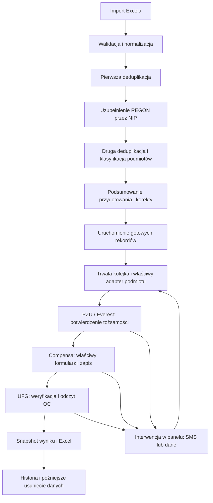

# Goldis — szczegółowy plan ostatecznego domknięcia platformy i automatyzacji

Data: 8 października 2026. Podstawa: aktualny kod, [audyt całej platformy](AUDYT_CALOSCI_PLATFORMY_2026_10_08.md), [dowody audytu](audit-platform-2026-10-08/evidence-summary.json) oraz ostatnie odpowiedzi właściciela projektu.

To plan przyszłej implementacji, testów i przekazania. Opisane nowe funkcje nie zostały jeszcze wykonane. Dokument zastępuje wcześniejszy projekt pytań i zakresu z 8 października. Zachowuje ustalenie z [rewizji 2 planu z 7 października](PLAN_DOMKNIECIA_PLATFORMY_AUTOMATYZACJI_2026_10_07.md): agent sprawdza moduły osobno, a pełny proces i próby na prawdziwych portalach pozostają pod kontrolą użytkownika. Nie dodawać ukrytego pełnego przepływu do runnera ani CI.

Szczegółowe instrukcje krok po kroku dla punktów 1–7 podsumowania znajdują się w [indeksie osobnych planów implementacji](plany-implementacji-domkniecia/README.md). Każdy plan ma własne założenia, kontrakty, kroki i kryteria odbioru; numeracja 1–7 nie zastępuje numerów pakietów P00–P13 poniżej.

## 1. Ustalony cel i granice ukończenia

| Obszar | Ustalenie docelowe |
| --- | --- |
| Organizacja | Jedna firma korzystająca z platformy. Nie oznacza to jednej przetwarzanej firmy dziennie. |
| Użytkownicy | Maksymalnie pięciu jednocześnie; rzeczywisty wolumen wierszy nie został jeszcze podany. |
| Dane | Wszystkie rekordy z Excela, także spółki i inne formy działalności. Każdy wiersz otrzymuje jednoznaczne rozliczenie. |
| Przygotowanie | Oczyszczenie, walidacja, uzupełnienie REGON z NIP i usunięcie duplikatów z zestawu przeznaczonego do automatyzacji. |
| Brak identyfikatorów | Jeśli nie ma REGON ani NIP, pomijamy rekord, zapisujemy przyczynę i kontynuujemy. |
| Obsługa | Admin i Menedżer wprowadzają SMS, poprawiają dane i sterują automatyzacją przez platformę. |
| Środowisko | Najpierw kompletna, uruchamialna lokalnie wersja platformy: web/API/workery na komputerze, PostgreSQL i Redis lokalnie (np. przez Docker Desktop), lokalny profil przeglądarki. VPS jest późniejszym, osobnym etapem wdrożenia i nie blokuje lokalnego domknięcia. |
| Przechowywanie | Importy i wyniki pozostają do świadomego usunięcia przez uprawnionego użytkownika; potrzebna funkcja usuwania. |
| Pełna automatyzacja | Wszystkie uzgodnione kroki wykonywane przez system, z obsługą SMS i wyjątków w panelu. Ręczny SMS jest częścią tego modelu. |

**Warunek końcowy:** użytkownik wgrywa plik, przygotowuje dane, uruchamia cały przygotowany zestaw, obsługuje ewentualne interwencje, pobiera kompletne wyniki i może później usunąć dane. Restart, duplikat żądania, brak identyfikatora i awaria portalu mają przewidywalny wynik oraz czytelny stan w panelu.

Istotna zmiana zakresu: obecny resolver tożsamości obsługuje głównie JDG z potwierdzonym PESEL. Wcześniejsza ocena 80–85% kompletności kodu automatyzacji nie jest miarą gotowości rozszerzonego zakresu „wszystko z Excela”. Rozszerzenie na inne podmioty jest osobnym, krytycznym pakietem prac. Nie uznajemy obsługi spółek za zakończoną tylko dlatego, że program potrafi oznaczyć je jako nieobsługiwane.

## 2. Docelowy proces użytkownika

Schemat przedstawia cel biznesowy; dokładna kolejność ekranów zależy od potwierdzonej ścieżki danego typu podmiotu. SMS może być potrzebny podczas logowania do różnych portali. Spółka wymaga własnej zweryfikowanej ścieżki, a nie automatycznego użycia PESEL osoby decyzyjnej.

W panelu powinny być dwie czytelne czynności: **„Przygotuj dane”** i **„Uruchom automatyzację”**. Pierwsza nie tworzy ofert ani nie uruchamia UFG. Druga pokazuje podsumowanie, datę odniesienia polis, wybrany profil oraz liczbę gotowych, pominiętych i oczekujących rekordów. Uruchomienie jest idempotentne i nie wymaga ręcznego wybierania kolejnych paczek po 500 wierszy.

Rekord oczekujący na korektę nie blokuje poprawnych rekordów. Wspólna awaria dostawcy lub sesji blokuje zadania zależne od tego dostawcy/profilu. Przy wspólnym koncie oczekiwanie na SMS może zatrzymać jego kolejkę; nie obiecywać równoległej pracy na tej samej sesji.

## 3. Reguły przygotowania danych

### 3.1. Kontrakt Excela i oczyszczenie

1. Zachować zgodność z aktualnym arkuszem `Realizacja` i jego kolumnami. Nazwy nagłówków normalizować przez trim i wielkość liter; zgłaszać brakujące oraz powtarzające się nagłówki. Przygotować przykład poprawnego pliku i raport odrzuconego importu.
2. Obecny parser wymaga kolumn `Nazwa` i `REGON`. Docelowo dopuścić `Nazwa` oraz co najmniej jedną kolumnę identyfikatora: `NIP` lub `REGON`. Brak obu wartości w konkretnym wierszu prowadzi do pominięcia, a nie błędu całego pliku.
3. NIP/REGON traktować jako identyfikatory tekstowe. Usuwać dopuszczalne separatory, sprawdzać długość i sumę kontrolną, zachowywać oryginalną wartość. Nie dopisywać brakujących cyfr na podstawie domysłu. Komórki numeryczne i utrata zera wymagają jawnej reguły lub korekty.
4. Oczyścić białe znaki nazw i adresów. Nie zmieniać automatycznie znaczenia nazwy, formy prawnej ani osoby decyzyjnej. Nie wykonywać formuł i makr; komórki z formułą identyfikatora oznaczać do korekty.
5. Nie pomijać niepustego wiersza tylko dlatego, że brakuje nazwy lub identyfikatora. Całkowicie puste wiersze liczyć osobno jako techniczne odstępy. Zachować numer oryginalnego wiersza.
6. Przechować surowy import oraz wersjonowany zestaw przygotowany. Automatyzacja korzysta z zamrożonej wersji danych; późniejsza korekta nie zmienia już rozpoczętego sprawdzenia.
7. Ograniczenia uploadu, rozpakowanego XLSX i zużycia pamięci pozostają jawne. „Cały Excel” oznacza cały zaakceptowany plik, a nie usunięcie zabezpieczeń rozmiaru. Przekroczenie limitu ma być błędem przed częściowym importem.

### 3.2. Rozstrzygnięcia dla rekordów

| Dane / zdarzenie | Działanie | Wynik widoczny w panelu |
| --- | --- | --- |
| Poprawny REGON, brak NIP | Dalsze przygotowanie i identyfikacja przez REGON. | Gotowy albo konkretna interwencja. |
| Brak/wadliwy REGON, poprawny NIP | Lookup rejestru; zaakceptować wyłącznie jednoznaczne dopasowanie. | Uzupełniono, nie znaleziono lub potrzebna weryfikacja. |
| Brak REGON i NIP | Bez wywołań portali/rejestru; kontynuacja pozostałych. | Pominięto: brak identyfikatorów. |
| Brak poprawnego identyfikatora, ale wpisana błędna wartość | Nie traktować jej jako poprawnej; korekta albo świadome pominięcie. | Wymaga korekty identyfikatora. |
| REGON i NIP wskazują różne podmioty | Zatrzymać ten rekord przed portalami. | Konflikt identyfikatorów. |
| Rejestr zwraca kilka podmiotów/jednostkę lokalną | Nie wybierać automatycznie pierwszego wyniku. | Weryfikacja identyfikacji i typu jednostki. |
| Rejestr nie znajduje REGON dla NIP | Korekta lub jawne pominięcie tego rekordu; brak wpisu MF nie oznacza nieistnienia firmy. | Nie znaleziono w danym źródle. |
| Rejestr niedostępny / limit wyczerpany | Trwałe odroczenie lookup, pokazanie terminu kolejnej próby. | Oczekuje na dostawcę/budżet. |
| Brak adresu/powiatu | Użyć potwierdzonych danych portalu/rejestru, jeśli ścieżka na to pozwala; w przeciwnym razie interwencja dla tego rekordu. | Wymaga konkretnych pól. |
| Niejednoznaczna osoba / brak PESEL przy JDG | Weryfikacja tożsamości; zakaz zgadywania osoby. | Wymaga potwierdzenia tożsamości. |
| Typ inny niż JDG | Właściwa ścieżka podmiotu po wdrożeniu i odbiorze adaptera. | Jawny typ i status obsługi. |
| Brak polis spełniających filtr | Poprawny wynik zerowy, a nie błąd automatyzacji. | Zakończono: brak pasujących polis. |

### 3.3. Deduplikacja — co dokładnie znika

**Usuwamy zbędny wiersz z zestawu roboczego automatyzacji.** Oryginalny import pozostaje do późniejszego świadomego usunięcia. Panel pokazuje, który wiersz zachowano i do którego przypisano wykluczony duplikat; dostępny jest eksport oczyszczonego zestawu.

1. Pierwszy przebieg deduplikacji wykonuje się po normalizacji, przed kosztownym lookup. Drugi po uzupełnieniu identyfikatorów; oba korzystają z tych samych zasad.
2. Poprawny NIP służy do znalezienia kandydatów na duplikaty; poprawny REGON jest drugim kluczem. Sam wspólny klucz nie wystarcza do automatycznego usunięcia, jeśli pozostałe dane ujawniają konflikt.
3. Usuwać automatycznie tylko powtórzenia tej samej tożsamości i zgodnych danych potrzebnych do flow. Wybrać najpełniejszy niesprzeczny wiersz, a przy remisie wcześniejszy numer wiersza. Dopełnienie pustego pola ma zachować źródło wartości.
4. Ten sam NIP przy różnych REGON jednostek lokalnych, różna potwierdzona osoba albo sprzeczne identyfikatory oznaczają konflikt do rozstrzygnięcia. Nie scalać ich automatycznie.
5. Sama podobna nazwa/adres nie powoduje usunięcia. Wiersze bez obu identyfikatorów mają status pominiętych; nie trzeba zgadywać ich tożsamości w celu deduplikacji.
6. Deduplikacja dotyczy wybranego zestawu przygotowania. Historycznego importu innej daty nie usuwa się jako duplikatu. Istniejące aktywne sprawdzenie tej samej tożsamości można współdzielić lub jawnie zablokować, z informacją dla użytkownika.
7. Domyślna propozycja: świadome nowe uruchomienie tworzy nowy snapshot wyniku; retry tego samego uruchomienia korzysta z checkpointów. Cache rejestru ma własną datę/TTL i nie jest cachem aktualnych polis.

Rozliczenie wejścia: **liczba wierszy danych = gotowe + wymagające interwencji + pominięte bez identyfikatorów + wykluczone duplikaty + pozostałe jawne wykluczenia + oczekujące na rejestr**. Kategorie są rozłączne. Zbiorczy raport zachowuje powiązania duplikatów z wynikiem reprezentanta. Liczba źródłowych wierszy, unikalnych podmiotów i faktycznych sprawdzeń to trzy odrębne liczniki.

## 4. Admin i Menedżer

W aktualnym kodzie występują role `admin`, `operator`, `reviewer`, `auditor`. Należy dodać rzeczywistą rolę `manager` w modelu, ograniczeniach DB, sesjach, politykach, zapytaniach i UI. Samo przemianowanie etykiety roli nie wystarczy.

Proponowana macierz dla jednej organizacji:

| Czynność | Admin | Menedżer |
| --- | --- | --- |
| Import, przygotowanie, korekty i rozstrzyganie konfliktów | Tak | Tak, z grantem narzędzia |
| Podgląd operacyjnych danych całej firmy | Tak | Tak, z prawem podglądu; niezależnie od autora importu |
| Uruchomienie, pauza, wznowienie i anulowanie | Tak | Tak, z prawem wykonania |
| SMS i interwencje dla całej firmy | Tak | Tak, z odpowiednim grantem i aktualnym przydziałem |
| Pobieranie eksportu | Tak | Osobny grant pobrania, niezależny od podglądu |
| Usunięcie wybranego importu/wyników | Tak, po ponownym uwierzytelnieniu | Proponowane osobne prawo usuwania + ponowne uwierzytelnienie |
| Usunięcie wszystkich danych organizacji | Tak, z potwierdzeniem zakresu | Nie w proponowanej konfiguracji |
| Użytkownicy, role, granty, sekrety, limity techniczne | Tak | Nie; operacyjne sterowanie kolejką pozostaje dostępne |
| Dziennik operacji biznesowych | Tak | Tak w zakresie operacyjnym |
| Dziennik bezpieczeństwa i administracji | Tak | Bez pełnego dostępu administracyjnego |

Macierz usuwania jest propozycją projektu uprawnień, ponieważ właściciel wskazał potrzebę funkcji, ale nie nadał jeszcze szczegółowych praw. Powinna być konfigurowalna poprzez grant, nie ukryty warunek właściciela importu. Istniejących ról nie usuwać bez migracji kont; dotychczasowym użytkownikom nie nadawać automatycznie szerszych uprawnień.

Prawa sprawdzać ponownie po oczekiwaniu na SMS, pacing i interwencję oraz przed skutkiem zewnętrznym. Cofnięcie grantu lub blokada konta musi działać także dla już otwartej karty i oczekującego zadania. Liczenie, filtrowanie i paginacja muszą stosować ten sam scope co pobieranie pojedynczego zasobu.

## 5. Pakiety implementacyjne z kryteriami zakończenia

Każdy pakiet kończy się zmianą kodu, właściwymi testami modułu i wpisem: wersja/commit, komendy, wynik, ograniczenia dowodu. Wszystkie poniższe pakiety są pracą do wykonania; aktualne funkcje stanowią bazę do rozszerzenia.

### P00 — ustalenie sprawdzonej bazy technicznej

**Prace:** zapisać stan zmian w repozytorium; sprawdzić izolowany PostgreSQL/Redis; potwierdzić upgrade do 033 z 030 i nową instalację od zera; sprawdzić poprawki credential revisions, niezależnych grantów pobrania i idle sesji. Zablokować dziedziczenie flag live i pełnego flow w nowych zestawach testów.

**Punkty startowe:** `scripts/test-module.cjs`, `scripts/Test-GoldisDatabase.ps1`, `scripts/Test-GoldisSecurityRedis.ps1`, `apps/api/src/migrations/031–033`, testy session/grants/security.

**Odbiór:** migrations/security-db/security-redis PASS na zasobach utworzonych przez test, po cleanup bez obcych zmian. Historyczny test schematu 030 nie zastępuje tego sprawdzenia. Obecna niedostępność Docker Desktop nie oznacza błędu aplikacji; izolowany runtime trzeba przywrócić lub przygotować na osobnym środowisku.

### P01 — rola Menedżera i spójne uprawnienia

**Prace:** dodać `manager`, scope całej organizacji dla operacji biznesowych, nowe akcje przygotowania/pauzy/usuwania, przydziały interwencji i widoczność elementów panelu. Rozdzielić zarządzanie biznesowym wykonaniem od administracji bezpieczeństwem. Dodać migrację wartości roli i jawny sposób aktualizacji wybranych kont.

**Punkty startowe:** `authorization-policy.ts`, `authorization-guard.ts`, `resource-scope.ts`, `tool-access.ts`, `admin.ts`, `review-service.ts`, `interventions.ts`, `db.ts`, web account/admin/workspace.

**Odbiór:** macierz grantów dla obu ról; pięciu użytkowników o różnych prawach; działania na cudzym imporcie w tej samej organizacji zgodne z polityką; druga organizacja w fixture zawsze odizolowana; cofnięcie praw natychmiast skuteczne. Zakaz samodzielnego nadania admina przez Menedżera.

### P02 — trwałe przygotowanie całego pliku

**Prace:** rozszerzyć parser i walidację z sekcji 3; utworzyć wersjonowany proces przygotowania z postępem i raportem każdego wiersza; wykonać obie fazy deduplikacji; utrwalić źródło wzbogacenia i mapę duplikatów. Dodać podsumowanie, filtry problemów i eksport oczyszczonych danych. Korekty tworzą nową wersję przygotowania lub unieważniają tylko odpowiedni fragment.

**Punkty startowe:** `workbook.ts`, `workbook-archive.ts`, `imports.ts`, `entity-grouping.ts`, `entity-grouping-service.ts`, `registry-result.ts`, `review-service.ts`, core `SourceRow`, web enrichment/review/workspace. Nowa usługa przygotowania rozszerza obecne grupowanie i review.

**Odbiór:** arkusz z duplikatem przed lookup, duplikatem ujawnionym po lookup, wierszem bez identyfikatorów, sprzecznym NIP/REGON i brakującą nazwą. Każdy wiersz rozliczony raz; kolejność/numer źródłowy zachowany; restart wraca do utrwalonego etapu. Powtórzenie polecenia nie tworzy drugiego przygotowania tej samej wersji.

### P03 — REGON przez API oraz wspólne limity

**Prace:** wykorzystać istniejące adaptery MF/GUS; dodać limiter na rzeczywistym transporcie, wspólny cooldown i odroczenia. Preferowana docelowa ścieżka: GUS BIR po pozyskaniu klucza; MF jako skonfigurowane źródło pomocnicze. Wybór/fallback jawny, bez traktowania braku wpisu w MF jako braku firmy. Brak klucza GUS nie blokuje implementacji i testów fixture.

**Punkty startowe:** `registry-provider-factory.ts`, `registry-lookup.ts`, `registry-request-budget.ts`, `registry-cache.ts`, `gus-bir-provider.ts`, `mf-vat-provider.ts`, `enrichment-jobs.ts`, `enrichment-worker.ts`.

**Odbiór:** dokładnie jeden zaakceptowany podmiot; konflikty idą do review; cache nie wywołuje HTTP; login/relogin/retry liczone osobno; dwa procesy nie przekraczają wspólnego limitu. 429, reset doby, awaria Redis/DB i restart mają bezpieczny wynik. Podczas awarii wspólnego limitera nie przechodzić na nieograniczony lokalny limiter.

### P04 — uruchomienie wszystkich gotowych wierszy i orkiestracja paczek

**Prace:** rozszerzyć istniejące submission/outbox o nadrzędne uruchomienie całego zestawu przygotowania. Obecny limit wyboru i enrichment to 500 wierszy na żądanie; obsłużyć większy plik poprzez trwałe paczki, bez podnoszenia body do nieograniczonego rozmiaru. Deduplikacja musi być globalna dla zestawu, a nie oddzielna dla każdej paczki.

Zamrozić fingerprint i wersje wierszy. Dwuklik lub retransmisja używa tego samego klucza idempotencji. Po korekcie panel wymaga aktualnego preview. Nowe rekordy po korekcie dołączają jako jawna, audytowana kontynuacja; nie modyfikują już wykonanych wyników. Dodać postęp całego zestawu, aktualną paczkę oraz wznowienie bez ponownego wysyłania ukończonych paczek.

**Punkty startowe:** `run-submissions.ts`, `canonical-run-service.ts`, outbox/dispatcher, `apps/web/app/run-submission-launcher.tsx`, detail submission. Nie budować drugiej kolejki obok istniejącego mechanizmu.

**Odbiór:** plik 501 i 1201 wierszy; duplikat na granicy paczek; crash po utworzeniu paczki przed dispatch; równoczesny start przez dwie osoby; cały zestaw rozliczony bez pominięć i podwójnych runów. Te próby kończą się na DB/outbox i kontrolowanym odbiorniku kolejki.

### P05 — obsługa wszystkich wymaganych typów podmiotów

**Prace:** przygotować macierz typów rzeczywiście występujących w danych: JDG, osoby prawne/spółki, jednostki lokalne i pozostałe. Dodać typ podmiotu oraz dowód klasyfikacji z rejestru/portalu. Zweryfikować możliwości Everest/Compensy dla każdej grupy i wybrać właściwy identyfikator oraz formularz.

JDG: jednoznaczne powiązanie przedsiębiorstwa i osoby, poprawny PESEL tam, gdzie jest wymagany. Spółka: tożsamość firmy przez potwierdzony identyfikator; dane reprezentanta tylko wtedy, gdy dany proces rzeczywiście je wymaga i zostały potwierdzone. Osoba decyzyjna z Excela nie staje się automatycznie ubezpieczającym ani przedstawicielem.

Uzupełnić kontrakty core, stany review i adaptery. Potwierdzić przeznaczenie konfigurowanego numeru rejestracyjnego używanego do wejścia w formularz; nie przenosić testowej wartości do produkcji. Zweryfikować zachowanie prefilled identity, adresu i powiatu dla każdego typu.

**Punkty startowe:** `apps/worker/src/identity.ts`, `everest-identity-provider.ts`, `compensa-form.ts`, `portal-runtime-config.ts`, `live-run.ts`, core i API run payload.

**Odbiór:** oddzielne fixture oraz kontrakty dla każdego wymaganego typu, w tym podobna nazwa dwóch firm, dwie osoby i REGON jednostki lokalnej. Zero błędnych powiązań. Jeśli portal nie oferuje właściwej ścieżki, zapisać konkretną blokadę i uzgodnić alternatywny proces; do jej rozwiązania szeroki zakres automatyzacji pozostaje niedomknięty.

### P06 — niezawodne portale i odzyskiwanie po awarii

**Prace:** rozszerzyć istniejące lease, checkpointy i bramki akcji. Potwierdzać właściwy podmiot i numer sprawy przed odczytem/zapisem/UFG. Obsłużyć stary wynik wyszukiwania, wolny AJAX, overlay, wygaśnięcie sesji, niepełną tabelę, paginację/wirtualizację i nieoczekiwany ekran.

Obecne uzgadnianie zapisu w Compensie bazuje na widocznym potwierdzeniu bieżącej sprawy. Potrzebna jest ścieżka odnalezienia utrwalonej sprawy po utracie strony/profilu i świeżym zalogowaniu. Gdy wyniku wcześniejszej akcji nie da się potwierdzić, pokazać interwencję „wynik niepewny” zamiast ponowić tworzenie/zapis/UFG.

**Punkty startowe:** `run-worker.ts`, `live-run.ts`, `execution-lease.ts`, `portal-action-gate.ts`, `compensa-offer-checkpoint.ts`, `compensa-offer-saver.ts`, `compensa-ufg.ts`, browser/session adapters.

**Odbiór:** awaria tuż przed akcją, po wysłaniu akcji przed potwierdzeniem i po potwierdzeniu przed lokalnym zapisem; utrata lease i dwa procesy. Liczniki zewnętrznych akcji pozostają zgodne z dowodem wykonania. Nie deklarować gwarancji exactly-once dla portalu bez obsługi idempotencji; lokalnie wymuszamy brak automatycznego ponowienia niepewnej akcji.

### P07 — SMS, korekty i sterowanie przez platformę

**Prace:** zapewnić centralną listę interwencji dla Admina/Menedżera, przejęcie zadania, pola korekty, datę ważności SMS i aktualny portal/profil/run. Kod przekazywać jednorazowo przez prywatny kanał API–worker, bez zapisu treści w historii i logach. Wygaśnięcie lub niepewne zużycie tworzy nowy challenge dopiero zgodnie z limitem ponowień.

Rozdzielić **pauzę przyjmowania nowych zadań**, **pauzę zestawu** i **zatrzymanie aktywnego rekordu na bezpiecznym punkcie**. Anulowanie uniemożliwia kolejne akcje, ale nie cofa akcji już wysłanej do portalu. Nie dodawać prostego statusu `paused` bez aktualizacji całej maszyny stanów; można utrwalić sterowanie na poziomie schedulera i checkpointu.

**Punkty startowe:** API/worker `auth-challenges.ts`, `sms-retry-policy.ts`, `interventions.ts`, `runs.ts`, `admin.ts`, `code-inbox.ts`, workspace i widoki SMS/operacji.

**Odbiór:** dwa równoczesne zgłoszenia SMS dają jedno przyjęcie; kod nie trafia do innego portalu/runu; wygaśnięty challenge odrzucony; cofnięcie grantu podczas oczekiwania; pauza w trakcie pacing i anulowanie przed kliknięciem. Ponowne otwarcie panelu pokazuje prawdziwy stan z serwera.

### P08 — poprawne wyniki i kompletne eksporty

**Prace:** ustalić i utrwalić datę odniesienia; odczytać wszystkie wymagane rekordy OC, zachować kolejność źródłową i regułę filtracji. Zapisany snapshot pozostaje podstawą eksportu. Oddzielić wynik zerowy, brak danych i błąd odczytu. Dodać raport całego zestawu: wynik, pominięcie, duplikat, interwencja, błąd.

Zachować istniejący kontrakt 12 pól OC i jego walidację. Sprawdzić liczniki portalu versus parser, daty graniczne i puste pola. Excel ma identyfikować źródłowy rekord; duplikaty są w raporcie, bez ponownego sprawdzania. Chronić tekst eksportowany przed interpretacją jako formuła.

Domknąć przypadek plik opublikowany przed zatwierdzeniem metadanych DB oraz uszkodzony/brakujący plik po ukończeniu. Uzgadnianie orphanów uruchamiać operacyjnie, z okresem ochronnym dla publikacji w toku; obecna funkcja wykrywania sama nie tworzy takiej usługi. Ponowna finalizacja nie publikuje pliku dla usuniętego runu.

**Punkty startowe:** `compensa-ufg.ts`, core policy contracts/filter, `worker-results.ts`, `result-staging.ts`, `result-forwarder.ts`, `export-finalizer.ts`, `private-artifact-store.ts`, historia/pobrania UI.

**Odbiór:** porównanie snapshotu i odczytanego XLSX pole po polu; zero OC; niepełna tabela; dokładna granica dat; brak/disk-full pliku; przerwany commit; błędny klucz stagingu; cofnięty grant pobrania. Test eksportu otrzymuje syntetyczny snapshot, bez odpytywania portali.

### P09 — świadome usuwanie danych

**Prace:** wdrożyć cykl opisany w sekcji 6, preview zakresu, osobne prawo usuwania, ponowne uwierzytelnienie, trwały proces purge i stan widoczny w panelu. Obsłużyć pliki, staging, zadania, wyniki oraz powiązania, nie tylko usunięcie wiersza w DB. Dodać kontrolę kolizji z aktywnym runem i opóźnionym wynikiem workera.

**Punkty startowe:** `imports.ts`, `runs.ts`, `run-submissions.ts`, modele DB i zależności FK, artifact store, staging/forwarder, audyt, uprawnienia i UI historii. Nowa usługa usuwania musi znać właściciela zasobu oraz referencje współdzielone.

**Odbiór:** usunięcie importu z ukończonymi i aktywnymi runami; awaria między DB a plikiem; duplikat żądania; restart; współdzielona tożsamość; restore starszego backupu. Brak pobrania i odtworzenia danych po skutecznym usunięciu. Status „usunięto” dopiero po wykonaniu purge danych aktywnych.

### P10 — bezpieczeństwo docelowej instalacji

**Prace:** MFA TOTP/recovery dla uprzywilejowanych kont i step-up dla kasowania/administracji; HTTPS, właściwe cookies, Origin/CSRF/CSP, zaufanie proxy tylko do znanej topologii. Rozdzielić konto migratora od runtime DB, wdrożyć Redis ACL, uruchomić API/web bez roota, odizolować komunikację workera i chronić klucze/profile.

Przejrzeć siedem umiarkowanych ustaleń zależności z audytu i ścieżkę aktualizacji bez wymuszonego niezgodnego downgrade. Skan ma dotyczyć końcowego lockfile/obrazów. Nie przedstawiać historycznie poprawionych błędów jako aktualnych podatności bez dowodu.

**Punkty startowe:** session/auth/admin/bootstrap, konfiguracja HTTP/proxy, `.env.example`, Dockerfiles, `compose.yaml`, migracje grantów DB i deployment/runbook.

**Odbiór:** próby obejścia każdej uprzywilejowanej akcji, cofnięcie sesji/hasła/MFA, recovery bez eskalacji, spoofing nagłówków, niezależne granty, brak dostępu do DB/Redis/odbiornika SMS z Internetu. Testy na docelowej topologii staging, nie tylko mock HTTP.

### P11 — wykończenie UI i diagnostyka użytkownika

**Prace:** naprawić potwierdzony kontrast panelu enrichment; ujednolicić kolory przez istniejące tokeny; dopracować stany pustej listy, przygotowania, pauzy, oczekiwania na budżet/SMS, kasowania i błędów. Nie zmieniać projektu całego dashboardu bez potrzeby.

Komunikat ma wskazywać rekord, przyczynę i możliwą czynność. Zabezpieczyć ponowne klikanie, spóźnione odpowiedzi, powrót po utracie sieci i dostęp klawiaturą. Pokazać rozliczenie zestawu i osobno interwencje; użytkownik nie musi znać wewnętrznych statusów kolejki.

**Punkty startowe:** `enrichment-jobs.css`, theme/layout, workspace, enrichment-review, submission detail, admin i nowy widok usuwania. Przed zmianami Next przeczytać `apps/web/AGENTS.md` i wskazaną lokalną dokumentację.

**Odbiór:** 320/768/1920 px, focus, czytnik/etykiety, poprawne kontrasty i cele interakcji, 401/403/409/429/503, pusta lista i utrata sieci. Ostrzeżenia estetycznego detektora nie są automatycznie błędami dostępności.

### P12 — VPS, utrzymanie i powtarzalne wydanie

**Prace:** przygotować instalację z sekcji 8, monitoring, backup/restore, manifest wydania i procedury start/reboot/rollback. Pierwsza instalacja ma przyjmowanie nowych zadań wyłączone do odbioru; brak sekretu/adaptora daje jawny stan konfiguracji, nie pozorną gotowość.

**Odbiór:** restart VPS i wszystkich usług, odzysk kolejki, jedna własność profilu, alarm o nieaktywnym workerze, brak miejsca, odtworzenie na drugim środowisku i poprawne pobranie odtworzonego eksportu. Wyniki benchmarku określają zasoby VPS i końcowy limit partii.

### P13 — przekazanie i kontrolowany odbiór użytkownika

**Prace:** przygotować protokół z sekcji 10, zestaw reprezentatywnych danych, oczekiwane wyniki, zakres skutków zewnętrznych, instrukcję obsługi SMS/korekt/kasowania oraz lista znanych ograniczeń. Najpierw oddzielnie sprawdzić rzeczywiste konfiguracje adapterów w zleconym zakresie. Pełny proces użytkownik uruchamia i odbiera świadomie.

**Odbiór:** podpisany lub jawnie zaakceptowany protokół biznesowy dla wymaganych typów podmiotów; zgodność wyników i eksportu; brak nieuzgodnionych pominięć; właściwe odtworzenie po awarii. Bez tego końcowy status automatyzacji to `DO_ODBIORU_UZYTKOWNIKA`, nawet gdy cały kod modułów jest gotowy.

## 6. Usuwanie i przechowywanie — dokładny cykl

Nie wdrażać automatycznego kasowania importów/wyników po wieku. TTL technicznego cache, czas ważności SMS i rotacja backupów są innymi mechanizmami i nie zastępują decyzji użytkownika o kasowaniu danych biznesowych.

1. **Wybór zakresu:** osobno „usuń plik eksportu”, „usuń uruchomienie i jego wyniki”, „usuń import wraz z zależnymi danymi” oraz administracyjne „usuń wszystkie dane firmy”. Samo usunięcie pliku nie usuwa snapshotu; panel musi to wyjaśniać. Przy pełnym usuwaniu nie pozwalać później wygenerować eksportu z pozostawionego snapshotu.
2. **Preview:** wyliczyć liczbę wierszy, przygotowań, runów, interwencji i plików; wskazać aktywne zadania i referencje współdzielone. Po zmianie wersji danych odrzucić nieaktualny preview.
3. **Autoryzacja i potwierdzenie:** uprawnienie, bieżąca sesja, step-up i jasne potwierdzenie zakresu. Trwały klucz idempotencji zapobiega dublowaniu purge.
4. **Bariera w DB:** oznaczyć zakres jako `deletion_pending` i zamknąć admission; unieważnić aktywne challenge i możliwość download/writes. Worker ma otrzymać sygnał zatrzymania i nową wersję/fencing token. Po utracie lease stary worker nie może zapisać wyniku.
5. **Aktywna operacja:** poczekać na bezpieczny checkpoint/wygaśnięcie własności; nie twierdzić, że da się cofnąć wysłaną ofertę/UFG. Przy nierozstrzygniętej akcji zachować nieosobowy marker kontroli, a stan purge pokazywać jako oczekujący. Kasowanie lokalne nie usuwa automatycznie sprawy z zewnętrznego portalu.
6. **Trwałe zadanie purge:** usuwać zależne wyniki, osobowe dane tożsamości, dane źródłowe/korekty, pliki importu jeśli są przechowywane, eksporty, zaszyfrowany staging i elementy kolejki/outbox. Nie kasować rekordu kanonicznego/pliku używanego przez inny pozostawiony import; rozstrzygać referencje w tym samym tenant scope.
7. **Kolizja z finalizacją:** finalizator i forwarder sprawdzają tombstone/wersję. Opóźniony wynik ani retry nie może odtworzyć danych. Usuwanie plików ma zweryfikowany katalog bazowy i literalną ścieżkę; brak pliku jest idempotentnym sukcesem.
8. **Awaria:** checkpoint każdego etapu, ograniczone retry i alert. Transakcja DB nie obejmuje długo trwających operacji plikowych. Zakończenie wymaga uzgodnienia obu stanów; błąd usunięcia pliku nie daje zielonego komunikatu.
9. **Audyt:** zachować minimalny dowód kto/kiedy/jaki zakres i wynik operacji; nie powielać skasowanych NIP/REGON/PESEL/nazw w treści audytu, logach i payloadach retry. Przejrzeć także historyczne payloady audytu objęte zakresem, zamiast kasować tylko dane domenowe.
10. **Backup:** aktywne dane usuwamy po poleceniu, ale starsze kopie nie znikają magicznie. Przyjąć skończone okno rotacji backupów, opisać je w UI/instrukcji i utrzymać minimalny rejestr usuniętych wewnętrznych identyfikatorów poza odtwarzaną kopią. Przy restore zastosować go przed udostępnieniem systemu i uruchomieniem workerów. Rejestr nie przechowuje tożsamości podmiotu; pozostaje co najmniej do wygaśnięcia wszystkich kopii, które mogą odtworzyć dane.

Można wdrożyć zlecenie kasowania przez API jako operację asynchroniczną `202 + deletionJobId`, z odczytem postępu i końcowego statusu. Proponowane nazwy endpointów/modeli należy dopasować do istniejącej konwencji. Nie zakładać, że te endpointy już istnieją.

## 7. Odstępy między requestami

### 7.1. Co wymaga poprawienia

Obecny budżet dobowy, pojedynczy worker i batch/cache są przydatne, ale nie zastępują globalnego tempa rzeczywistych wywołań. Enrichment może przejść od razu do kolejnego lookup; BIR może wykonać login, search, relogin i retry w ramach jednej operacji logicznej. Limiter musi widzieć każde wywołanie transportu.

| Dostawca | Potwierdzony limit / stan | Proponowana konfiguracja startowa |
| --- | --- | --- |
| GUS BIR | 08:00–16:59: 3/s, 120/min, 6000/h; poza pasmem obowiązuje oficjalna tabela. | Co najmniej 1 s między startami rzeczywistych SOAP, bez burstu; wspólne okna i konserwatywny budżet aplikacji. |
| MF search | 100 zapytań/dobę, maksymalnie 30 podmiotów w zapytaniu; dodatkowe progi szybkiego odpytywania nie są opublikowane. | Batch i cache; konfigurowalny odstęp, początkowo 1–2 s między batchami jako hipoteza pomiarowa; Retry-After i budżet mają pierwszeństwo. |
| PZU/Everest/Compensa/UFG | Nie potwierdzono liczbowych limitów dla konkretnych kont. | Jeden aktywny run na profil; oczekiwanie na stan ekranu i zakończenie operacji; konfigurowalne 2–5 s między istotnymi akcjami jako punkt startowy, nie gwarancja dostawcy. |
| Własne API | Limity sesji i endpointów aplikacji; pięciu użytkowników plus otwarte karty. | Statusy zwykle co 10–20 s, bez nakładania requestów; interwencje z osobnym rozsądnym interwałem, backoff po błędzie i zatrzymanie polling ukrytego widoku. |

Źródła: [oficjalna tabela GUS BIR](https://api.stat.gov.pl/Home/RegonApi), [opis API MF](https://www.gov.pl/web/kas/api-wykazu-podatnikow-vat), sprawdzone 8 października 2026. Wewnętrzne `6000/dobę` w aktualnym kodzie jest dodatkowym budżetem aplikacji, a nie oficjalnym limitem godzinowym GUS. MF `check` i plik NIP–rachunek nie są zamiennikiem pobrania REGON.

Wartości startowe są propozycjami konfiguracji. Nie zapewniają, że portal nigdy nie ograniczy konta; uwzględnić inne narzędzia/ręczną pracę korzystające z tego samego klucza, konta lub IP. Docelowy odstęp zatwierdzić po legalnie dostępnych warunkach dostawcy i obserwacji normalnych prób, bez testowania produkcyjnej blokady przez przeciążenie.

### 7.2. Mechanizm i scenariusze awarii

1. Atomowa rezerwacja slotu/budżetu wspólna dla procesów w zakresie właściwym dla dostawcy: klucz, konto albo wyjście sieciowe. Stan cooldown i dziennych budżetów trwały; start po restarcie nie resetuje limitu.
2. Limiter bez burstu umie czekać krótkotrwale, a dłuższe odroczenie zapisuje jako `nextAttemptAt`, zwalniając slot wykonania. Przed requestem/kliknięciem ponownie sprawdzić anulowanie, prawa i lease.
3. `Retry-After` obsłużyć jako sekundy i datę HTTP; wspólny cooldown obejmuje nowe zadania i drugiego użytkownika. Brak nagłówka prowadzi do ograniczonego backoff, nie natychmiastowej pętli.
4. Rozdzielić błędy danych, odmowę uwierzytelnienia i chwilową awarię. Retry tylko tam, gdzie ma sens; po serii błędów wstrzymanie dostawcy i kontrolowana próba powrotu. BIR ma respektować nagłówki przy 429 również na relogin/retry.
5. Nie opóźniać mechanicznie obrazków, skryptów i każdego AJAX portalu. Mierzyć ruch, ale sterować akcjami biznesowymi i gotowością ekranu. Stały sleep nie zastępuje sprawdzenia, czy wynik należy do aktualnego REGON/sprawy.
6. Nie ponawiać niepewnego Zapisz/UFG automatycznie. Najpierw odzyskać sprawę i uzgodnić wykonanie; jeśli brak dowodu, interwencja.

## 8. Późniejsze wdrożenie VPS i utrzymanie

Ta sekcja opisuje etap po ukończeniu i odbiorze wersji lokalnej. Wybór ani zakup VPS, domena, HTTPS i monitoring serwera nie są warunkiem zakończenia obecnego zakresu. Najpierw lokalny start, migracje, worker przeglądarki, backup/restore i odbiór funkcji mają działać powtarzalnie.

### 8.1. Architektura

Przeglądarka użytkownika → HTTPS/reverse proxy → web/API. PostgreSQL i Redis w prywatnej sieci. Osobny worker rejestru i jeden portal worker z trwałym prywatnym profilem na start. Trwały magazyn eksportów, stagingu i kluczy; backup także poza VPS.

Pięciu użytkowników nie wymaga pięciu workerów portali. Dodatkowe profile/workery wdrożyć dopiero po potwierdzeniu wolumenu i osobnych kont/izolacji. Konto używane równocześnie ręcznie wymaga jawnych zasad własności sesji.

Wybrać Linux VPS umożliwiający działanie potrzebnego Chromium/Playwright, trwałe dyski i sieć do portali. Parametry dobrać benchmarkiem: RAM przeglądarki przy rzeczywistym ekranie, CPU przy XLSX, miejsce na dane/backupy i czas kolejki. Sam limit pięciu osób nie wyznacza zasobów. Nie podawać czasu wykonania całego pliku bez jego wielkości i pomiaru rekordu.

### 8.2. Kolejność uruchomienia infrastruktury

1. Wybrać VPS, domenę i sposób dostępu; przygotować SSH i firewall. Publicznie udostępnić wyłącznie warstwę web/HTTPS, bez DB/Redis/odbiornika SMS.
2. Zbudować wersjonowane obrazy zgodne z używaną wersją Playwright i zapisać ich digests. Skonfigurować sieci, trwałe wolumeny i prawa plików.
3. Skonfigurować sekrety poza repozytorium: DB, Redis, klucze stagingu, konto bootstrap, dostawca rejestru, portale. Panel pokazuje tylko stan konfiguracji. Klucze nie trafiają do odpowiedzi użytkownika ani logów.
4. Uruchomić migracje osobnym krokiem wydania; API nie powinno potrzebować praw DDL do zwykłej pracy. Włączyć health/readiness dla API, kolejki i workerów.
5. Zweryfikować HTTPS/proxy/cookies oraz headless/SSO na docelowej sieci. Dostęp serwisowy do przeglądarki, jeśli potrzebny, wyłącznie prywatny; normalne SMS pozostają w panelu.
6. Skonfigurować monitoring, alarmy i backup poza serwerem. Sprawdzić restore zanim system otrzyma dane produkcyjne.
7. Przeprowadzić odbiór użytkownika. Dopiero po zaliczeniu bramek włączyć przyjmowanie zadań produkcyjnych.

### 8.3. Backup, alarmy i wydanie

- Backup obejmuje DB, eksporty, zachowane importy, staging potrzebny do wznowienia, konfigurację i zgodne klucze szyfrowania. Same dumpy DB nie odtworzą prywatnych plików. Kopia spójna z manifestem; klucze dostępne przy restore, chronione osobno.
- Propozycja operacyjna do zatwierdzenia: dzienna pełna kopia poza VPS i przed wydaniem; skończona rotacja np. 30 dni. Jeśli dopuszczalna utrata pracy jest mniejsza niż doba, potrzebne częstsze kopie lub PITR. RPO/RTO potwierdzić pomiarem, nie samym wpisem w dokumentacji.
- Alarmy: brak heartbeat, stara kolejka, zbyt długi lease/SMS/interwencja, wielokrotne 429/503, niepewna akcja, błąd eksportu/purge/backup, brak miejsca i wygasający certyfikat. Deduplikacja alarmów; lista zdarzeń w panelu. Kanał zewnętrzny skonfigurować przed odbiorem, jeśli jest wymagany.
- Manifest wydania: commit, brak nieopisanych lokalnych zmian, schema, build time, image digests, wersje adapterów/parsera, aktywna konfiguracja limitów bez sekretów i wyniki testów.
- Rollback: wyłączyć admission, zatrzymać nowe skutki, zabezpieczyć stan; ocenić zgodność starszego kodu ze schematem. Przy nieodwracalnej migracji potrzebny plan forward-fix albo restore, a nie samo cofnięcie obrazu.
- Instrukcje serwisowe: restart, odzyskanie profilu, ponowne logowanie, błąd klucza, niespójny plik, awaria dostawcy, niepewna akcja, purge i restore z rejestrem usunięć.

## 9. Migracje i kontrakty do zaplanowania

Numerację ustalić z aktualnym repozytorium podczas implementacji; obecny kod kończy się na 033. Poniższe pozycje są projektowanymi zmianami, nie istniejącymi migracjami:

| Zmiana | Wymagane dane / zabezpieczenie |
| --- | --- |
| Menedżer i nowe prawa | Dopuszczalna rola, zakres akcji i jawna aktualizacja wybranych członkostw. |
| Przygotowania | batch/tenant, wersja, etap, konfiguracja reguł, fingerprint, liczniki i źródła wartości. |
| Wiersze przygotowania | sourceRow, status/przyczyna, representativeRow, klasyfikacja, effective identity, expected version. |
| Cały zestaw i paczki | przygotowanie, klucz idempotencji, zakres/paczki, kursor, sterowanie pauzą/anulowaniem. |
| Limiter | provider scope, rezerwacje rzeczywistych prób, okna, budżet i cooldown. Można rozszerzyć istniejące tabele zamiast dublować. |
| Nowe typy podmiotów | wersjonowany kontrakt tożsamości i adaptera, bez nadpisania historycznego wyniku JDG. |
| Usuwanie | cel/wersja zakresu, actor, stan purge, checkpointy, minimalny tombstone i fencing. |
| MFA | bezpiecznie przechowywany sekret, recovery hashes, stan włączenia i step-up. |
| Utrzymanie | stan reconcile/backup i rzeczywiste identyfikatory wydań, o ile wymagają trwałego modelu. |

Wymagane: indeksy tenant/status/due, unikalność idempotency keys, atomowe przejścia i brak dużych pełnych skanów przy każdej paczce. Migracje najpierw na syntetycznym schemacie oraz odizolowanej kopii, bez testowania na istniejącej bazie użytkownika. API nie przyjmuje tenant/role od klienta jako źródła uprawnień.

## 10. Testy i bramki odbioru

### 10.1. Co już wiadomo, a co trzeba dopiero zaliczyć

Audyt z 8 października potwierdził build core/API/worker/web, testy jednostkowe i kontraktowe oraz osobne testy browser fixture/UI. To dowód bazowych modułów. Nie potwierdza nowej roli Menedżera, przygotowania całego pliku, szerokiego zakresu podmiotów, usuwania, finalnego VPS ani pełnego live.

Aktualny odbiór PostgreSQL/Redis dla zmian 031–033 oraz nowych migracji jest osobną bramką. Testy UI z mock API nie zastępują integracji prawdziwych uprawnień/DB. Nowe lub zmienione moduły wymagają testów odpowiednich do ryzyka; nie powtarzać bez potrzeby całego audytu po każdej kosmetycznej zmianie.

### 10.2. Macierz scenariuszy obowiązkowych

| ID | Próba | Oczekiwany dowód |
| --- | --- | --- |
| T01 | Import istniejącego formatu i wariantu tylko z NIP | Poprawna liczba wierszy, jawne błędy kolumn, identyfikatory bez cichej utraty cyfr. |
| T02 | Brak REGON/NIP, brak nazwy, formuła, wadliwy checksum | Dokładny status każdego wiersza; brak nieuprawnionego lookup i pomijania bez raportu. |
| T03 | Duplikaty przed i po enrichment | Jeden reprezentant i jedna praca; zachowana mapa źródeł oraz oczyszczony eksport. |
| T04 | Ten sam NIP z jednostkami lokalnymi / sprzeczne osoby | Brak automatycznego scalenia błędnej tożsamości; review. |
| T05 | GUS/MF: not found, wiele wyników, mismatch, cache | Tylko zweryfikowany identyfikator zasila prepared dataset. |
| T06 | Limiter: granice sek/min/h/doby, dwa procesy, restart | Suma rzeczywistych HTTP/SOAP w limitach, stan trwały. |
| T07 | 429 z sekundami/datą Retry-After, timeout/503 | Wspólny backoff, brak requestów przed terminem, anulowanie nadal działa. |
| T08 | 501/1201 wierszy i duplikat między paczkami | Żaden wiersz nie ginie; globalna deduplikacja, idempotentne paczki. |
| T09 | Równoczesny start, nieaktualny preview, crash dispatch | Jeden właściwy submission/run; nieaktualna wersja odrzucona. |
| T10 | JDG, spółka i pozostałe wymagane typy | Właściwy adapter, prawidłowy podmiot, kompletne wymagane dane. |
| T11 | Stary wynik REGON, wolny ekran, brak powiatu, SSO expiry | Właściwy wynik albo jawna interwencja; brak kliknięcia na obcym podmiocie. |
| T12 | Save/UFG timeout po wysłaniu i restart przeglądarki | Reconcile albo interwencja; brak automatycznej drugiej akcji. |
| T13 | Dwa workery i utrata lease tuż przed akcją | Jeden właściciel, stary worker odcięty od skutków i zapisów. |
| T14 | SMS: dwie osoby, zły portal, expiry, cofnięte prawa | Jednorazowe właściwe przekazanie; brak kodów w logach. |
| T15 | Pauza/anulowanie na różnych checkpointach | Brak nowych skutków po skutecznym zatrzymaniu; stan i już wykonane akcje widoczne. |
| T16 | Wynik zerowy, wiele polis, daty graniczne, niepełna tabela | Liczniki i pola zgodne; niepełny odczyt nie jest wynikiem zerowym. |
| T17 | Snapshot/XLSX, formula-like text, brak pliku, disk-full | Spójny eksport albo jawny błąd; grant i prywatność download zachowane. |
| T18 | Usuwanie aktywnego/importu/wyniku, crash i opóźniony forwarder | Trwały purge; brak odtworzenia danych; pozostałe importy nietknięte. |
| T19 | Scope roli/grantów + dwie organizacje w fixture | Zero niedozwolonych odczytów/mutacji, także przez liczniki i pliki. |
| T20 | MFA, recovery, step-up, proxy/cookies/CSRF/CSP | Zaliczone próby obejścia na topologii staging. |
| T21 | UI mobile/desktop, klawiatura, 409/503, utrata sieci | Czytelne stany, kontrast i brak nadpisania nowszego wyboru. |
| T22 | Pięciu użytkowników i dodatkowe karty | Spójny SMS/sterowanie, brak lawiny polling, kolejka bez zagubionych zadań. |
| T23 | Reboot, utrata DB/Redis/API, brak miejsca | Kontrolowana niedostępność, trwałe odzyskanie, dostarczony alarm. |
| T24 | Restore na drugiej instalacji + rejestr usunięć | Pliki/klucze/wyniki spójne, usunięte dane nie wracają, zmierzone RPO/RTO. |
| T25 | Wydanie, migracja, rollback/forward-fix | Rzeczywisty manifest i sprawdzona procedura bez podwójnych operacji. |
| U01 | Pełny odbiór biznesowy przez użytkownika | Właściwe firmy, akcje, polisy, eksport i obsługa interwencji na docelowej instalacji. |

T01–T25 realizować jako osobne zestawy o jawnych granicach. Fixture portali są lokalne, dane syntetyczne, profile oddzielne. Obciążenie i fault injection odbywają się na fixture/staging. U01 pozostaje osobnym protokołem użytkownika i nie jest automatycznie wykonywany przez agenta.

### 10.3. Komendy i dowody

Wykorzystać istniejące polecenia `npm run build`, `npm test`, `test:module:runner`, `test:module:migrations`, `security-db`, `security-redis`, `grouping`, `registry`, `registry-jobs`, `review`, `submission`, `auth`, `sms`, `results`, `audit-reports`, `runtime`, `backup-restore` oraz osobne `everest-browser`, `compensa-browser`, `ufg-browser`, `security-browser`. Każda nazwa modułu jest prefiksowana `test:module:`.

Nowe moduły przygotowania, paczek, limitera i purge dodać jawnie do izolowanego manifestu. Komendy `test:automation-e2e` i `test:platform-e2e` pozostają poza automatycznym wykonaniem. Nie kierować testów do prywatnych sekretów, istniejącej DB lub profilu portalowego.

Raport wyniku obejmuje: commit/schema, typ środowiska, fixture, komendę, expected/actual, log, screenshot jeśli dotyczy UI, czas, cleanup i status PASS/FAIL/SKIP/BLOCKED. Pominięty test nie jest zaliczony; historyczny wynik opisuje historyczną wersję.

### 10.4. Mierzalne warunki wydania

- Zero błędnych powiązań firmy/osoby w zestawie odbiorowym.
- Zero nieautoryzowanych odczytów lub skutków; role/granty skuteczne po cofnięciu.
- Zero zgubionych wierszy; rozliczenie wejścia i mapy duplikatów zgodne.
- Brak automatycznie powtórzonej niepewnej oferty/UFG; każda niepewność jawna.
- Wszystkie wymagane typy podmiotów mają działającą, odebraną ścieżkę albo zatwierdzoną zmianę zakresu. Sam status unsupported nie zalicza pierwotnego celu.
- Wynik, snapshot i XLSX zgodne pole po polu; wynik zerowy jawny.
- SMS, korekty, pauza, wznowienie i usuwanie dostępne przez panel.
- Restart i restore nie gubią kolejki ani nie przywracają skutecznie usuniętych danych.
- Wspólny pacing/cooldown i dostarczone alarmy mają dowody testowe.
- Brak otwartych krytycznych błędów poprawności/bezpieczeństwa; ważniejsze bramki nie są pomijane przez wysoki procent gotowych funkcji.

Proponowany cel wydajności do pomiaru: zwykłe odczyty panelu p95 poniżej 2 s przy pięciu użytkownikach, bez wliczania długich zadań; potwierdzenie zlecenia zadania przed rozpoczęciem jego wykonania. Czas całej partii, RAM/CPU i dopuszczalny czas interwencji ustalić po benchmarku. Nie deklarować „X firm/min” na podstawie samej współbieżności workera.

## 11. Kolejność realizacji i zakończenie etapów

| Etap | Pakiety | Efekt dla użytkownika / bramka |
| --- | --- | --- |
| A — fundament | P00, P01; projekt kontraktów P02/P05/P09 | Sprawdzona baza, rola Menedżera, uzgodnione stany i migracje. |
| B — dane przed portalami | P02, P03, P04 | Cały Excel przygotowany, duplikaty wykluczone, REGON uzupełniony, poprawne paczkowanie. |
| C — pełny wymagany zakres automatyzacji | P05, P06, P07, P08 | Właściwe ścieżki podmiotów, odzyskiwanie, SMS/sterowanie, wiarygodne wyniki. |
| D — trwałość i produkt | P09, P10, P11 | Kasowanie, bezpieczeństwo i czytelny panel gotowe modułowo. |
| E — lokalny odbiór | P13 / U01 oraz pełne lokalne sprawdzenia P00–P11 | Lokalna instalacja, backup/restore, API, workery i wymagany proces biznesowy działają powtarzalnie; użytkownik odbiera wersję lokalną. |
| F — późniejsze wdrożenie | P12; T20/T22–T25 w osobnym środowisku VPS | Dopiero po lokalnym odbiorze: instalacja serwerowa, HTTPS, monitoring, backup poza serwerem i osobny protokół wydania. |

P05 należy rozpoznać już w etapie A: brak możliwości obsługi spółek na portalu może zmienić zakres pracy, dlatego nie odkładać tej wiedzy na koniec. P09 projektować razem z P02/P04/P08, aby nowe dane od początku były możliwe do usunięcia. Pacing, UI i przygotowanie infrastruktury można rozwijać niezależnie, ale wspólne kontrakty/migracje muszą pozostać spójne.

Nie ma jeszcze wiarygodnej daty końcowej: nieznane są możliwości portali dla wszystkich form działalności, docelowa konfiguracja i wolumen pliku. Po P00 i rozpoznaniu P05 przygotować estymację z konkretnymi pakietami; największa niepewność leży w adapterach różnych podmiotów i odzyskiwaniu sprawy po utracie sesji. Nie przypisywać arbitralnie „kilku dni” całej pracy.

## 12. Dane potrzebne dopiero do konfiguracji i odbioru

Te informacje nie blokują przygotowania kodu i testów syntetycznych. Należy zebrać je przed docelową konfiguracją:

1. Reprezentatywny, zanonimizowany zestaw formatów i typów podmiotów oraz największa przewidywana liczba wierszy. Nie ograniczać zakresu do JDG w oczekiwaniu na próbkę.
2. Dostępność klucza GUS BIR, kont/profili portalowych i testowych ścieżek dla wymaganych podmiotów. Sekrety podawać przez konfigurację, nie treść czatu.
3. Wybór VPS/domeny i sposób dostępu są potrzebne dopiero przed późniejszym wdrożeniem serwerowym. Ograniczenia SSO/IP portali oraz zasady ręcznej pracy na kontach sprawdzić dla lokalnego odbioru tych portali.
4. Potwierdzenie daty/reguły filtra OC i przeznaczenia numeru rejestracyjnego w formularzu. Regułę zapisać jako wersjonowaną konfigurację z testami granic dat.
5. Potwierdzenie proponowanego grantu usuwania Menedżera, okna backupów, docelowego RPO/RTO i kanału alarmów. Powtórne świeże sprawdzenie ma jawnie odróżniać się od retry.

Przekazanie końcowe obejmuje kod i migracje, manifest wydania, wyniki T01–T25, instrukcję użytkownika/administratora, runbook awarii/restore, politykę usuwania oraz protokół U01. Statusy mają znaczyć osobno: **kod gotowy modułowo**, **instalacja odebrana technicznie**, **pełna automatyzacja odebrana biznesowo**.
