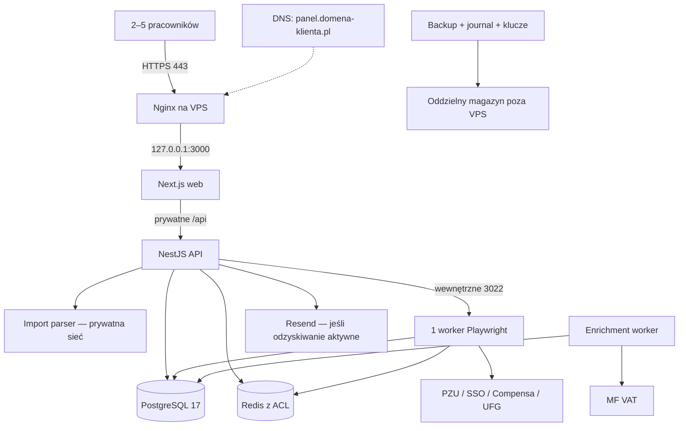

# Goldis — plan wdrożenia na VPS i utrzymania instalacji klienta

**Główny plan wykonania i zapisu odbioru:** [pełny odbiór działania i cyberbezpieczeństwa](PLAN_PELNEGO_ODBIORU_PLATFORMY_2026-11-05.md), z [checklistą przypadków](acceptance/2026-11-05/CHECKLISTA.md) i [protokołem](acceptance/2026-11-05/PROTOKOL_ODBIORU.md). Poniższa analiza powstała dla wcześniejszego snapshotu OC. Bieżący kod zawiera także porównywarkę prowizji: migrację066, 6 obrazów i 12 usług. Wartości 065/5 obrazów/10 usług w dalszych opisach są stanem tego wcześniejszego audytu; zakres aktualnego release potwierdza bramka G0 nowego planu. Parametry zasobów i backupu trzeba odebrać z obiema usługami prowizji.

Data analizy: **5 listopada 2026**, strefa Europe/Warsaw. Zakres potwierdzony przez właściciela: **jedna firma, 2–5 pracowników**. Domena i VPS będą dopiero kupione; liczba wierszy automatyzacji dziennie nie została określona.

Uzupełnienie z pogłębionego [audytu biznesowego i rozwoju platformy](AUDYT_ODBIORU_BIZNESOWEGO_I_ROZWOJU_PLATFORMY_2026-11-05.md): punktem odniesienia dla retencji i odzyskiwania są zapisane ustalenia z 12.10 — brak automatycznego wygaśnięcia do uprawnionego usunięcia, RPO ≤24 h i RTO ≤8 h. Wcześniejsze propozycje 4 h oraz rotacji 14+4 nie stanowią zaakceptowanej zmiany tych reguł.

**Rekomendacja:** osobna instalacja dla tej firmy: Linux VPS x86_64, początkowo **8 vCPU, 16 GB RAM, 160–200 GB SSD/NVMe**, Docker Compose, Nginx i HTTPS pod `panel.domena-klienta.pl`. Jedna instancja API i jeden sekwencyjny worker portalowy. Obrazy budowane poza produkcją, zaszyfrowane kopie poza VPS i okresowy test odtworzenia na drugim hoście.

**Stan na dziś: aplikacja nadaje się do przygotowania stagingu, ale nie ma podstaw do oznaczenia jej jako odebranej produkcyjnie.** Kod i konfiguracja wdrożeniowa istnieją. Przed udostępnieniem klientowi trzeba zamknąć konkretne problemy opisane poniżej, uzyskać zielone kontrole końcowego wydania i przeprowadzić odbiór rzeczywistej instalacji. Zakup domeny i VPS sam nie zamyka tych prac.

Ten dokument jest planem i audytem. W ramach jego przygotowania nie wdrażano aplikacji, nie zmieniano działającej bazy, nie uruchamiano portali ani nie wysyłano wiadomości.

## 1. Co dokładnie zostało sprawdzone

Źródłem oceny jest **obecne drzewo robocze**, a nie sam ostatni commit. Gałąź: `codex/backend-feature-modules`; HEAD: `af512e9502218d336b4b73df0c5f612905c6ac7b`. Na początku audytu było 169 zmodyfikowanych i 79 nieśledzonych pozycji Git. Liczby dotyczą pozycji raportowanych przez Git, nie liczby pojedynczych plików w nieśledzonych katalogach. Zmian użytkownika nie cofano.

Odczytano kod API/core/workera, frontendową konfigurację produkcyjną, Compose, Dockerfile, Nginx, sekrety, migracje, CI, backup/restore oraz dokumenty odbiorowe. Wartości prywatnych plików `.env` nie były odczytywane ani kopiowane do planu. Konfigurację oceniano na podstawie przykładów i kodu.

Świeże wyniki i logi są w [katalogu dowodów](production-readiness/vps-2026-11-05/), w tym [checks.json](production-readiness/vps-2026-11-05/checks.json) oraz [hashach wybranych źródeł](production-readiness/vps-2026-11-05/source-hashes.json). Hash wybranych plików dokumentuje zakres odczytu; nie zastępuje identyfikatora kompletnego release.

| Sprawdzenie wykonane 5.11 | Wynik i granica dowodu |
| --- | --- |
| `npm run build` | **PASS**, core/API/worker/web; Node 24.11.1, obecne zależności lokalne. Nie wykonywano świeżego `npm ci`. |
| `npm test` | **FAIL** na `test:architecture`, po zaliczeniu 2 testów runnera. Dalsze kroki łańcucha nie zostały uruchomione przez tę komendę. |
| Przyczyna kontroli architektury | `business-leads.service.ts`: 42 wykryte operacje persistence wobec dopuszczonych 36. Brak zgłoszonych cykli; to nie jest sam w sobie dowód podatności ani niedziałającego SQL. |
| Core z aktualnego `dist` | **20 PASS, 0 FAIL, 0 SKIP**. |
| API z aktualnego `dist` | **INCOMPLETE**: osobny runner nie zakończył się przez ok. 16 minut i został przerwany. Brak pełnego wyniku; nie przypisano PASS ani FAIL. |
| Worker z aktualnego `dist` | **118 PASS, 6 FAIL, 85 SKIP**. Cztery błędy to `connect EACCES` na loopback w ograniczonym środowisku wykonania; dwa to `WORKER_STAGING_WRITE_FAILED`. Przyczyny dwóch błędów stagingu nie rozstrzygnięto. Potrzebny retest w docelowym harnessie Linux; wynik nie dowodzi sześciu błędów produkcyjnych. |
| `node scripts/test-production-compose.cjs` | **PASS**, rozwiązywanie konfiguracji z syntetycznymi sekretami/digestami; bez startu usług. |
| Testy crypto/backup-manifest/runtime-check/release-manifest | **10 PASS, 0 FAIL, 0 SKIP**, wykonane jako osobny zestaw statyczny/fixture. |
| Docker | CLI 29.2.0 dostępne; Linux Engine niedostępny, brak pipe `dockerDesktopLinuxEngine`. Kontenery produkcyjne, sandbox i restore nie zostały uruchomione. |
| HTTPS, DNS, mail, portale z VPS | **NOT RUN** — brak docelowej instalacji i domeny. |

Build i nowe przebiegi testów wykonano z usuniętymi odziedziczonymi zmiennymi usług/sekretów, portalami live off i providerem disabled. Worker uruchomiono z limitem czasu. Nie próbowano obejść ograniczeń sieciowych środowiska ani podłączać lokalnej bazy klienta. Wyniki szczegółowe są w `checks.json` i `worker-tests.log`.

Wyniki październikowe są dowodami historycznymi. `verification-matrix.json` pochodzi z 16.10; formularz OC ma częściowy odbiór z 21.10, a UX z 22.10. Nie należy ani przenosić ich PASS na dzisiejszy kod, ani traktować dawnych BLOCKED jako dowodu aktualnego defektu. Po poprawkach potrzebne są wyniki końcowego SHA i obrazów.

## 2. Faktyczny stan aplikacji

### 2.1. Technologia i procesy

Wersje zapisane w obecnym `package-lock.json`: Next.js **16.4.0**, React **19.3.0**, NestJS **11.2.6**, Sequelize **6.37.8**, pg **8.23.0**, BullMQ **5.81.5**, Playwright **1.63.0**. Dockerfile używają Node 24; worker ma odpowiadający Playwright obraz `v1.63.0-noble`. PostgreSQL jest obecnie oparty na linii **17-alpine**, Redis na **7-alpine**. Nie wykonywać jednocześnie pierwszego wdrożenia i nieuzasadnionej aktualizacji głównych wersji DB/bibliotek.

| Element | Obecna rola | Co należy utrzymywać |
| --- | --- | --- |
| `web` | Next.js, panel pracowników, proxy `/api` | Jedna instancja, publicznie dostępna tylko przez Nginx. |
| `api` | NestJS, konta, role, importy, przygotowania, leady, zadania, wyniki, audyt | Jedna instancja; wykonuje też procesy w tle, m.in. outbox, przygotowania, usuwanie i opcjonalny mail. |
| `import-parser` | Oddzielny parser XLSX przez prywatne HTTP | Obowiązkowy produkcyjnie; bez DB i bez publicznego portu. |
| `worker` | BullMQ + Chromium: PZU/Everest → Compensa/UFG → wynik | Jeden proces, jeden profil, jedna konfiguracja kont portali. |
| `enrichment-worker` | Trwałe lookupy NIP → REGON | Osobna rola PostgreSQL, wybrany i odebrany provider. |
| `postgres` | Główne dane i trwały stan procesów | Wolumen, role, migracje, kopie i monitoring. |
| `redis` | Kolejka, limity i stan krótkotrwały | Własny obraz z ACL; jest zależnością również zwykłego API. |
| `db-roles`, `migrate`, `bootstrap-admin` | Etapy administracyjne, kończące pracę | Nie są stale działającymi usługami biznesowymi. |

Razem: **7 usług długotrwałych i 3 administracyjne**. Istniejący Compose już to opisuje. Nie trzeba przepisywać aplikacji na Kubernetes ani kupować zwykłego hostingu współdzielonego.

### 2.2. Co już jest zaimplementowane

- Konta, logowanie, sesje, role, granty, zespoły, administrator i menedżer, wymuszona zmiana pierwszego hasła.
- Import XLSX, przygotowanie danych, korekty i konflikty, wyszukiwanie, leady i przydziały, zgłoszenia, wyniki, eksporty, historia i audyt.
- Ośmiokrokowy formularz OC, interwencje/SMS, pauza/wznowienie/anulowanie oraz kontrola wersji i idempotencji.
- Osobne role runtime DB, migrator, prywatny parser, zabezpieczenia Origin/CSRF, ograniczenia żądań, CSP.
- Szyfrowanie PESEL, eksportów i stagingu; trwały dziennik usunięć potrzebny przy odtwarzaniu.
- Produkcyjna nakładka Compose, szablon Nginx, skrypty kopii/restore, generator manifestu wydania i część CI.

Obecność funkcji w kodzie nie oznacza odbioru każdego scenariusza. Najnowsze dokumenty nadal opisują częściowy odbiór integracji i użytkowników.

### 2.3. Ograniczenia istotne dla tej firmy

1. **2–5 osób może korzystać z panelu, ale portalowy automat działa sekwencyjnie.** BullMQ ma `concurrency: 1`, a globalny advisory lock blokuje drugiego workera. Więcej CPU nie zmieni tego modelu; `--scale worker=2` nie jest sposobem zwiększenia przepustowości.
2. Konta portalowe i profil Chromium są wspólne dla instalacji. Dla jednej firmy to właściwy punkt startu. Druga niezależna firma powinna dostać osobną instalację albo wcześniej zaprojektowaną izolację konfiguracji i workerów.
3. Jedna instancja API jest zamierzonym zakresem pierwszego wdrożenia; dziennik usunięć ma synchronizację w pamięci procesu, bez wykazanej obsługi wielu zapisujących replik.
4. Wyniki OC mają w kodzie reguły współdzielenia w ramach tenanta. Klient musi zaakceptować macierz podglądu/pobierania; nie zakładać, że każdy pracownik widzi wyłącznie własne rekordy.
5. Portalowe SMS/MFA nie oznacza MFA logowania do Goldis. Nie znaleziono implementacji aplikacyjnego TOTP/WebAuthn. Ustalić, czy klient wymaga MFA przed dostępem produkcyjnym; jeśli tak, wdrożyć i odebrać je albo uzgodnić ograniczenie dostępu sieciowego.
6. MF VAT ma w kodzie budżet **100 żądań/dobę** i batch do **30 unikalnych NIP**. To nie jest ani 100 firm/dobę, ani gwarancja 3000 skutecznych lookupów. Cache, błędy, pokrycie rejestru i limity usługi mają znaczenie. Produkcyjnie wspierane są `mf-vat` i `disabled`; `gus-bir` jest jawnie odrzucany.
7. Nie ma potwierdzonej globalnej automatycznej retencji wszystkich importów/wyników/audytu. Istniejące kasowanie trzeba powiązać z uzgodnioną polityką danych.
8. Jeden VPS jest pojedynczym punktem awarii. Restart lub kopia zatrzymująca usługi może być widoczna dla pracowników. Wysokiej dostępności nie należy obiecywać w tym wariancie.

## 3. Zadania blokujące wydanie

Priorytet **P0** oznacza warunek technicznego wydania lub bezpiecznego odtworzenia. **P1** oznacza warunek odbioru operacyjnego przed zwykłą pracą klienta. Zakres portali można włączyć dopiero po osobnym odbiorze live.

| ID | Priorytet | Ustalenie w obecnym kodzie | Działanie i dowód zamknięcia |
| --- | --- | --- | --- |
| VPS-01 | P0 | `npm test` zatrzymuje kontrola architektury: 42/36 operacji w `apps/api/src/features/leads/business-leads.service.ts`. | Przejrzeć nowe operacje i ich transakcje/scope, wydzielić właściwe persistence lub świadomie uzasadnić zmianę reguły. Nie zwiększać progu wyłącznie dla zielonego testu. Potem pełne `npm test` na końcowym SHA. |
| VPS-02 | P0 | `root:root 0600` z instrukcji sekretów jest sprzeczne z odczytem jako `node`/`pwuser`. | Ustalić rzeczywiste UID/GID obrazów, prawa per sekret oraz ACL/uprawnienia bind mountów. Test `test -r` w każdym non-root kontenerze, bez `cat` wartości. Nie rozwiązywać globalnym `0644`. |
| VPS-03 | P0 | `compose.yaml:402–408` używa nazw `*_activation_20261017`; backup i instrukcja wymagają `pzu_login`, `pzu_password`, `compensa_login`, `compensa_password`. | Ujednolicić źródła sekretów w Compose, generatorach i backupie; start i backup na tym samym zestawie plików. |
| VPS-04 | P0 | `deploy/backup/restore.sh:134–144` wykonuje `cp/chown` helperem z obrazu non-root. W `:126–128` role są ustawiane przed `pg_restore --no-owner` jako `goldis`, a następnie migracje startują jako `goldis_migrator`. | Poprawić inicjalizację wolumenów: ograniczony helper administracyjny, bez sieci, właściwe mounty i właściciele. Po imporcie ustawić także właścicieli odtworzonych obiektów DB przed migracjami — wcześniejszy reassignment nie obejmie nowych obiektów. Test dostępu do `SequelizeMeta`, ALTER i pełny cold restore na Linux. |
| VPS-05 | P0 | Restore pod inną nazwą projektu nadal ma stałą sieć `172.30.10.0/24`; może kolidować z produkcją. | Pierwszy odbiór restore na drugim hoście. Wariant na tym samym Dockerze wymaga parametryzacji sieci, IP, trust-proxy oraz walidatorów/testów; sama nazwa projektu nie wystarczy. |
| VPS-06 | P0 | Brudne drzewo, nowe migracje 063–065 i istotne pliki nieśledzone. | Przejrzeć diff i dane, uwzględnić wszystkie potrzebne pliki, utworzyć kontrolowany commit i release. Nie resetować zmian użytkownika. |
| VPS-07 | P1 | Wszystkie Dockerfile mają `COPY . .`; `.dockerignore` nie odrzuca np. całego `output/` i raportów audytowych. | Ograniczyć kontekst/warstwy runtime do potrzebnych plików; skan finalnych obrazów pod kątem sekretów i danych. Sprawdzić zawartość, nie zakładać poufności każdego raportu. |
| VPS-08 | P1 | `.env.production.example` jest lokalny, ignorowany i nieśledzony. | Dodać bezpieczny, kompletny wzorzec do release pod świadomie śledzoną nazwą/wyjątkiem; żadnych prawdziwych sekretów. |
| VPS-09 | P1 | Po SIGKILL/reboocie może pozostać `.goldis-worker.lock`; brak obsługi osierocenia. Compose nie ma `stop_grace_period`, kod shutdown przewiduje 30 s. | Dodać np. 60 s na zatrzymanie i odebrać drain. Dodać bezpieczne odzyskiwanie osieroconej blokady lub zweryfikowany runbook. Nigdy bezwarunkowe kasowanie locka przy starcie. |
| VPS-10 | P1 | Healthcheck workera uznaje samo HTTP 200; `/automation` może dać 200 przy workerze offline. Tempo `WORKER_PORTAL_MIN_ACTION_INTERVAL_MS` nie jest mapowane w Compose. | Sprawdzać JSON/heartbeat, doprowadzić healthcheck do właściwej semantyki i dodać mapowanie tempa. Test awarii workera musi wywołać alarm. |
| VPS-11 | P1 | Brak offsite, timerów, retencji i alarmów kopii. Osobny `current` journal odświeża się przy pełnym backupie. | Wdrożyć upload i kontrolę kompletności obu plików; osobno zabezpieczyć nowszy journal kasowań. Test utraty hosta i kasowania po backupie. |
| VPS-12 | P1 | Runbook każe zatrzymać workerów przed kopią, backup wymaga startujących API/workera. Bootstrap secret ma być usunięty, ale plik jest nadal wymagany. | Ujednolicić maintenance/backup i bootstrap. Rozdzielić pauzę przyjmowania pracy od stopu procesów. Bootstrap jako etap jednorazowy lub zachowany pusty plik po usunięciu wartości, z testem startu i kopii. |
| VPS-13 | P1 | Brak pełnego CI obrazów/rejestru/deploy, rotacji logów i alarmów zewnętrznych. | Przygotować pipeline i runbook, limity logów, odbiorcę alertów i test faktycznej dostawy alarmu. |
| VPS-14 | P1 / live | Brak odbioru nowego IP Linux VPS, aktualnego MFA i pełnego procesu portali. | Nadzorowany odbiór konkretnego release, kont i reprezentatywnego przypadku na VPS; stan portali osobno od gotowości panelu. |

Istotne źródła: `deploy/docker/load-runtime-secrets.sh:13`, `apps/api/Dockerfile:10`, `apps/worker/Dockerfile:8`, `deploy/backup/backup.sh:139–155`, `apps/worker/src/infrastructure/browser/browser.ts:68–93`, `apps/worker/src/application/worker-shutdown.ts:17`, `apps/api/src/features/health/health.controller.ts:30`.

Nie ma potrzeby warunkować hostingu ukończeniem całej historycznej przebudowy backendu. Trzeba natomiast naprawić aktualnie nieprzechodzące kontrole i zweryfikować bezpieczeństwo rzeczywistych operacji. Duże refaktoryzacje bez związku z ryzykiem wydania mogą mieć osobny harmonogram.

## 4. Docelowa architektura



- Publiczne porty: **80/443**. SSH tylko dla operatora, najlepiej przez VPN lub listę adresów; niezależna konsola ratunkowa dostawcy.
- `web` opublikowany wyłącznie na `127.0.0.1:3000`. Brak publicznych `3001`, `3010`, `3022`, `5432`, `6379`.
- Frontend i API pod jednym originem: `https://panel.domena-klienta.pl` i `/api/...`. Kod ma wyłączone CORS, SameSite Strict i kontrolę Origin — nie rozdzielać domen bez dodatkowej pracy.
- `goldis_frontend`: web i API; web ma stałe `172.30.10.10`.
- `goldis_data`: API, DB, Redis i workery. API i worker potrzebują wyjścia do usług zewnętrznych.
- `goldis_parser`: sieć `internal: true`, wyłącznie API i parser.
- Nginx działa na hoście i wysyła ruch do Next; to Next jest bezpośrednim zaufanym proxy dla API.

Kod produkcyjny twardo wymaga **`TRUST_PROXY_IPS=172.30.10.10`** i **`IMPORT_PARSER_URL=http://import-parser:3010`** (`runtime-startup-config.ts:43–48`). Najmniej zmian wymaga zachowanie tej topologii. Nginx ma nadpisywać forwarding headers i blokować `/api/internal/`; nie przekazywać bezkrytycznie nagłówków dostarczonych przez klienta.

Zweryfikować z zewnętrznej sieci zarówno IPv4, jak i IPv6. Sam UFW nie stanowi dowodu zamknięcia portów publikowanych przez Docker; dokumentacja opisuje jego oddzielne reguły przekazywania ruchu. [Docker — firewall](https://docs.docker.com/engine/network/packet-filtering-firewalls/).

## 5. Zakup VPS, domeny i usług

| Element | Rekomendacja dla 2–5 pracowników | Uzasadnienie |
| --- | --- | --- |
| System | Ubuntu **24.04 LTS**, x86_64, aktualizacje bezpieczeństwa | Stabilna baza zgodna z obecnymi obrazami; wspierana instalacja Docker Engine. [Docker — Ubuntu](https://docs.docker.com/engine/install/ubuntu/). |
| CPU | 8 vCPU na start; 4 vCPU tylko po pomiarze | Chromium, XLSX i koszt logowania scrypt konkurują o CPU. Nie jest to zmierzona minimalna konfiguracja. |
| RAM | **16 GB** | Suma limitów 7 kontenerów wynosi ok. **8,25 GiB**, do tego OS/Nginx/cache/backup. 8 GB daje mały zapas nawet dla kilku osób. |
| Dysk | 160–200 GB NVMe/SSD; min. 25–30% wolnego | Dane DB, eksporty, staging, obrazy, logi i chwilowe rozpakowane kopie. Wzrost zmierzyć po pilocie. |
| Sieć | Stały publiczny IPv4, dostępny region UE, firewall i rescue console | Przewidywalne IP dla portali i odzyskiwanie po błędzie konfiguracji. |
| Rejestr obrazów | Prywatny registry, pull-only credential na VPS | Nie przechowywać uprawnień do push/repo na produkcji, jeśli nie są potrzebne. |
| Kopie poza hostem | S3-compatible/object storage lub inny odseparowany magazyn w UE | Osobne uprawnienia, wersjonowanie/retencja, test pobrania po utracie VPS. |
| Staging/restore | Tymczasowy drugi VPS o zgodnej architekturze | Pozwala sprawdzić produkcyjny stos i stały subnet bez kolizji z produkcją. |

Praktyczna krótka lista do porównania zamówień: [OVHcloud VPS](https://www.ovhcloud.com/pl/vps/) oraz [Hetzner Cloud](https://www.hetzner.com/cloud/). Wybrać **konkretny region UE i parametry zamówienia**, uwzględnić IPv4, backup, odnowienie, podatki i dostępność. Nie polegać na nazwie pakietu ani reklamowym „od”. Cenniki są dynamiczne; poniżej jest rezerwa budżetowa autora planu, nie cytowana oferta dostawcy.

| Koszt | Orientacyjna rezerwa planistyczna |
| --- | --- |
| VPS produkcyjny z zapasem | 100–300 zł/mies. |
| Magazyn kopii i monitoring | 20–100 zł/mies., zależnie od rozmiaru/retencji |
| Domena | 50–200 zł/rok; sprawdzić cenę odnowienia |
| Mail transakcyjny | Według wybranego planu i liczby wysyłek |
| Drugi VPS do stagingu/restore | Osobny koszt w okresie użycia |
| Praca administratora i rozwój | Osobna usługa; powyższe kwoty jej nie obejmują |

Dla budżetu startowego przyjąć **około 150–400 zł/mies. infrastruktury**, plus domena, ewentualny mail i administracja. Zweryfikować po wyborze regionu i poznaniu wolumenu danych; to nie jest gwarancja kosztu.

## 6. Własność, dostęp i ustalenia z klientem

Przed zakupem ustalić, kto jest właścicielem kont dostawców, domeny, płatności i danych. Preferowany model: klient posiada domenę i prawo do infrastruktury/danych, a operator otrzymuje imienny dostęp techniczny. Przy innej umowie zapisać sposób przekazania i migracji po zakończeniu współpracy.

Wymagane ustalenia:

- operator główny i zastępca; sposób kontaktu awaryjnego;
- kto odbiera SMS PZU/Compensy i w jakich godzinach; co zrobić przy nieobecności tej osoby;
- dni/godziny pracy oraz akceptowane okno aktualizacji i kopii;
- dzienny/szczytowy wolumen firm; zmierzenie go podczas pilota jest potrzebne do oceny kolejki;
- zakres dostępu pracownika, menedżera i administratora, podgląd oraz pobieranie wyników;
- czy przetwarzane dane lokalne należy przenieść, czy uruchamiamy czystą instalację;
- zasady przechowywania danych zgodne z ustaleniem braku automatycznego wygaśnięcia importów/wyników/kopii do uprawnionego usunięcia; osobno retencja logów i wzrost pojemności;
- wymaganie MFA do Goldis i ewentualnego ograniczenia IP/VPN.

Ponieważ aplikacja przetwarza dane osób i sesje portalowe, umowa obsługi powinna określać role dotyczące danych, powierzenie, podwykonawców (VPS, backup, mail), dostęp serwisowy, usuwanie/zwrot danych oraz postępowanie przy incydencie. Sam region UE i szyfrowanie nie rozstrzygają wszystkich obowiązków. Podział ról zależy od faktycznych ustaleń; źródło zasad umownego powierzenia: [Komisja Europejska — zastosowanie RODO](https://commission.europa.eu/law/law-topic/data-protection/information-business-and-organisations/application-gdpr_en).

Imienne konta zamiast wspólnego loginu. MFA w panelach domeny/VPS/registry/backupu, niezależne konto awaryjne i sejf haseł. Uprawnienia do portali oraz dopuszczalny zakres automatyzacji uzgodnić z klientem przed uruchomieniem.

## 7. Domena, DNS, Nginx i HTTPS

Rekomendowany podział: `domena-klienta.pl` może służyć stronie usługowej, a **`panel.domena-klienta.pl`** platformie. Domena identyfikuje usługę; aplikacja i dane fizycznie działają na VPS. Mail resetów może używać oddzielnej subdomeny, np. `powiadomienia.domena-klienta.pl`.

Kolejność:

1. Kupić domenę, włączyć MFA i automatyczne odnowienie, zapisać dostęp awaryjny.
2. Dodać rekord **A** `panel` → IPv4 VPS. TTL np. 300 s na czas przełączenia, później 3600 s. **AAAA** dodać dopiero po działającym IPv6/firewall/Nginx; usunąć stare sprzeczne rekordy. Nie zmieniać istniejących MX poczty klienta.
3. Na początek DNS bez dodatkowego proxy/CDN. CDN można dodać po świadomym przeglądzie trust-proxy, cache i uploadów.
4. Sprawdzić rozwiązywanie DNS z kilku sieci. Dla testów przed zmianą DNS można użyć kontrolowanego wpisu hosts lub `curl --resolve`, bez udostępniania danych.
5. Uruchomić najpierw **konfigurację Nginx tylko HTTP/ACME**, z katalogiem webroot i poprawnym `server_name`. Pełny szablon TLS odwołuje się do certyfikatu, którego jeszcze nie ma — nie aktywować go przed wydaniem certyfikatu.
6. Wydać certyfikat Let's Encrypt klientem ACME, np. Certbot `--webroot`, następnie aktywować konfigurację TLS opartą na `deploy/nginx/goldis.conf.example`. HTTP-01 wymaga portu 80; przy ograniczeniu całej aplikacji do VPN/IP użyć DNS-01 lub zachować dostęp do ścieżki walidacyjnej. [Let's Encrypt — typy challenge](https://letsencrypt.org/docs/challenge-types/).
7. Zapewnić prawa Nginx do `client_body_temp_path`, rotację i prywatność plików tymczasowych uploadu. Limit 20 MiB obejmuje narzut multipart przy limicie aplikacji 16 MiB.
8. Wykonać `nginx -t`, reload, HTTP → HTTPS, test certyfikatu/łańcucha/nazwy i `/api/internal/` → 404. Sprawdzić nieznany Host i spoofing forwarding headers.
9. Włączyć i sprawdzić timer odnowienia ACME oraz reload po odnowieniu. Test `certbot renew --dry-run` jeśli wybrano Certbot; alarm na zbliżające się wygaśnięcie.
10. HSTS aktywować po poprawnym odbiorze HTTPS. Nie rozszerzać na wszystkie subdomeny/preload bez objęcia ich kontrolą.

`PUBLIC_APP_ORIGIN=https://panel.domena-klienta.pl` musi być bez końcowego `/`, bez ścieżki i bez spacji. Login, reset hasła, upload i download sprawdzić po publicznym adresie, nie tylko po `localhost`.

## 8. Układ hosta i sekrety

Proponowany układ, do utworzenia podczas wdrożenia:

```text
/opt/goldis/releases/<wersja>/       # wersjonowane Compose, konfiguracje i skrypty
/opt/goldis/current                 # wskazanie aktywnego release
/etc/goldis/env.production          # ustawienia, wersje i referencje obrazów
/etc/goldis/secrets/                # prywatne pliki sekretów per usługa
/etc/goldis/backup-passphrase       # hasło archiwów; dodatkowy escrow poza VPS
/var/backups/goldis/                # lokalne zaszyfrowane kopie i prywatny workdir
/var/lib/goldis/releases/<wersja>/  # manifesty/protokoły wydania
/var/lib/goldis/restores/           # kwarantanna odtworzeń
Docker volumes                     # DB, Redis, eksporty, staging, journal, profil
```

Katalog konfiguracji niedostępny dla zwykłych kont. Operator używa `sudo`/kontrolowanej grupy. Dla **lokalnego Compose file secrets** dobrać właściciela/grupę/ACL źródła do UID/GID kontenera. Nie zakładać, że deklaracja `mode/uid/gid` rozwiąże prawa bind mountów. Dla PostgreSQL/Redis, które startują inaczej niż API, przeprowadzić osobne testy. Sekrety nie trafiają do Git, build context, ticketów, logów, listy argumentów ani publicznych raportów.

| Grupa | Wymagane elementy i uwagi |
| --- | --- |
| DB | Hasło właściciela `goldis`, migratora, API, workera i enrichment; URL każdego procesu z jego własną rolą. Host `postgres`, DB `goldis`. URL poprawnie koduje znaki hasła. |
| Redis | Dwa konta ACL: API i worker, oddzielne hasła/URL, host `redis`. Używać własnego obrazu Redis z wrapperem ACL. |
| Sesje/usługi | `SESSION_SECRET`, `LOGIN_RATE_LIMIT_SECRET`, `WORKER_AUTH_SECRET`, `IMPORT_PARSER_SHARED_SECRET`, `PRIVILEGED_ACTION_BINDING_KEY` — niezależne losowe sekrety, przynajmniej 32 bajty zgodnie z walidacją. |
| PESEL/eksport | Wersjonowane keyringi i aktywne wersje, AES-256: klucz 32 bajty. `ARTIFACT_REQUIRE_ENCRYPTION=1`. |
| Staging | `WORKER_STAGING_KEY_VERSION`, klucz V1; przed rotacją rozszerzyć Compose/backup o stare i nowe wersje. |
| Usunięcia | Wolumen journala i jego klucz HMAC; nie mylić z kluczem szyfrowania eksportów. |
| Rejestr | `REGISTRY_CACHE_HMAC_KEY` w wymaganym formacie; provider jawnie `disabled` na pierwszym starcie. |
| Portale | PZU/Compensa login/hasło, zweryfikowany JSON selektorów, trwały profil, zaakceptowane parametry sprawy. Ścieżka hosta nie może wskazywać na plik Windows. |
| Bootstrap | Dane pierwszego admina tylko na inicjalizację. Usunąć wartość po zmianie hasła; rozwiązać zależność Compose/backupu od istnienia pliku. |
| Mail | Resend API key, sender/reply-to, keyring outbox, aktywna wersja; gdy wyłączone, spełnić również kontrakt obecności plików wymaganych przez Compose. |
| Recovery infrastruktury | Hasło backupu i dostęp do magazynu poza hostem, instrukcja pozyskania obrazów i konfiguracji. Utrata wszystkich kluczy oznacza utratę możliwości odczytu. |

Ustawienia niesekretne obejmują: `APP_ENV=production`, `NODE_ENV=production`, origin, trust-proxy, pełne SHA release, wersję, pięć referencji obrazów `repo@sha256:...`, aktywne key versions, provider i tryb portali. API zgłasza `GOLDIS_IMAGE_DIGEST` równy digestowi obrazu API.

Pierwszy start: `WORKER_LIVE_PORTALS=0`, `WORKER_START_PAUSED=0`, `GOLDIS_ENRICHMENT_PROVIDER=disabled`, odzyskiwanie hasła wyłączone do odbioru maila. Nie używać `WORKER_START_PAUSED=1` z live=1 — loader to odrzuca. Wyłączenie portali nie oznacza automatycznie wyłączenia wszystkich wewnętrznych procesów API; staging ma mieć odrębne dane i sekrety.

PESEL i artefakty są szyfrowane aplikacyjnie, **cała baza nie jest**. Imiona/nazwiska i inne pola mogą występować w zwykłych kolumnach. Dostęp administratora hosta i snapshoty VPS traktować jako dostęp do danych. Stare wersje kluczy zachować przez cały okres danych i retencji kopii, których odczyt ich wymaga.

## 9. Przygotowanie kodu i pipeline wydania

1. Zamknąć VPS-01–10 i sprzeczności runbooków; każdą poprawkę ograniczyć do potrzebnego zakresu.
2. Przejrzeć wszystkie zmiany i nieśledzone pliki; uwzględnić m.in. migracje **063–065**. Nie kopiować całego katalogu roboczego na VPS.
3. Przygotować bezpieczny produkcyjny wzorzec ustawień, skrypty inicjalizacji uprawnień, monitoringu, kopii i odtworzenia.
4. Uporządkować Dockerfile/kontekst: minimalny runtime, potrzebne skrypty migracji/restore, przypięte bazy obrazów. Zostawić pliki wymagane do backupu/restore w paczce operatora. Nie usunąć ich przy optymalizacji obrazów.
5. Z czystego checkoutu na Linux: `npm ci`, kontrole stylu, build, pełne testy, testy DB/Redis i fixture. Nie podawać środowisku CI produkcyjnych kont portali ani URL bazy klienta.
6. Zbudować/publikować **cztery własne obrazy**: API, web, worker i Redis z ACL; piąty to zweryfikowany upstream PostgreSQL przypięty digestem. API/parser/migrator/enrichment używają zgodnego obrazu API.
7. Zachować zgodność Playwright package **1.63.0** z obrazem tej wersji; nie podmieniać samej bazy na nowszy tag. Wymóg zgodności i izolacji opisuje [Playwright Docker](https://playwright.dev/docs/docker).
8. Skan zależności, sekretów, obrazów i konfiguracji na dokładnym SHA/digestach. Ocenić osiągalność i wpływ znalezisk; brak niezaakceptowanych krytycznych/wysokich ryzyk przed wydaniem.
9. Zapisać provenance/SBOM albo równoważny wykaz zależności i źródeł. Ograniczyć uprawnienia CI/registry; deployment jako kontrolowany krok po stagingu.
10. Wyznaczyć kompatybilny poprzedni release. Jeśli to pierwszy, ścieżką awaryjną jest wstrzymanie usługi/odtworzenie kopii, a nie nieistniejąca „poprzednia wersja”.

Obecny workflow `.github/workflows/backend-checks.yml` ma build/test/style i DB integration na Ubuntu/Node24. Brakuje pełnego pipeline obrazów, skanów, stagingu i deploymentu; jego obecność nie oznacza, że obecne CI jest zielone.

Wydanie ma identyfikować: commit, wersję, pięć digestów, migrację head (obecnie 065), hash grantów, Compose/Nginx/seccomp/selector config, wyniki kontroli, backup/journal, operatora i zakres aktywacji. Konfiguracja może mieć checksum; wartości sekretów nie mają być treścią manifestu. Generator obecnie hash­uje przykładowy `config/portal-selectors.example.json`; trzeba dołączyć rzeczywistą zatwierdzoną konfigurację selektorów i jej wersję/hash do prywatnej paczki operatorskiej/recovery.

## 10. Pierwsze uruchomienie na Linux — runbook docelowy

Poniższe komendy są **planem po naprawach i przygotowaniu realnych plików/obrazów**. Nie wykonano ich na serwerze. Nie wpisywać fikcyjnych digestów tylko po to, aby przejść validator.

### 10.1. Host

- Aktualizacje systemu; imienne konto operatora i SSH z kluczem. Sprawdzić drugi login i konsolę ratunkową przed wyłączeniem logowania hasłem/root.
- Docker Engine i plugin Compose z oficjalnego źródła. Compose musi obsługiwać używane **`!reset` i `!override`**; zweryfikować faktyczne `docker compose version` i `config --quiet`.
- Nginx, klient ACME, Bash 5, Node 24 dla skryptów operatorskich, GNU tar/coreutils, `flock`, `curl`, `ss`.
- NTP/czas UTC hosta, interfejs aplikacji Europe/Warsaw. Test DST i terminów pozostaje po stronie funkcjonalnej.
- Firewall dostawcy i hosta, prywatne porty, limity logów; nie publikować Docker API/socketu w sieci.
- Oddzielny dostęp registry i backup; katalogi oraz uprawnienia sekretów/wolumenów.

### 10.2. Compose i start

`compose.production.yaml` jest **nakładką**, używaną razem z `compose.yaml`:

```sh
cd /opt/goldis/current

dc() {
  docker compose --project-name goldis \
    --env-file /etc/goldis/env.production \
    -f compose.yaml -f compose.production.yaml "$@"
}

dc config --quiet
node scripts/validate-production-compose.cjs --env /etc/goldis/env.production
dc pull
dc up -d --no-build
dc ps -a
```

Na **pustej** instalacji zależności mają dać kolejność:

1. Zdrowy PostgreSQL i Redis.
2. `db-roles` tworzy/ogranicza role.
3. `migrate` jako `goldis_migrator` wykonuje migracje i **apply-runtime-grants**.
4. `bootstrap-admin` tworzy admina, jeśli tabela użytkowników jest pusta.
5. API, parser, enrichment, worker i web; `api` musi osiągnąć readiness. Sprawdzić osobno parser i heartbeat workerów.

Odczytać bezpieczne logi i kody zakończenia trzech procesów administracyjnych. Nie uruchamiać tej sekwencji na istniejących aktywnych writerach: `db-roles` odbiera uprawnienia, a dopiero `migrate` je odtwarza. Samo `dc up -d` nie jest pełnym runbookiem aktualizacji istniejącej produkcji.

Następnie:

- potwierdzić najwyższą migrację i `current_user` faktycznych procesów bez wypisywania URL z hasłami;
- sprawdzić brak superuser/CREATEDB/CREATEROLE/BYPASSRLS i właściwe allowlisty;
- sprawdzić sandbox Chromium na **rzeczywistym** kernelu VPS, seccomp, user namespaces, headless, `shm_size` i uprawnienia profilu; użyć przygotowanego `scripts/chromium-sandbox-smoke.cjs` po przejrzeniu sposobu wywołania;
- odebrać Nginx/TLS/DNS, wymusić zmianę bootstrap password i założyć imienne konta 2–5 pracowników;
- wykonać testy HTTPS, importu i pobierania na syntetycznych danych, bez live;
- zapisać manifest i log protokołu poza repo; portal i provider aktywować dopiero według następnej sekcji.

```sh
npm run release:manifest -- --env /etc/goldis/env.production \
  --output /var/lib/goldis/releases/<wersja>/release-manifest.json
```

Generator wymaga czystego checkoutu i zgodnego SHA/digestów. Jeżeli paczka operatorska nie zawiera `.git`, manifest wygenerować w kontrolowanym checkoutie release i dostarczyć razem z paczką; nie osłabiać kontroli pochodzenia.

## 11. Przeniesienie danych lokalnych

Wybrać jeden z wariantów przed pierwszą pracą klienta:

**A. Czysta instalacja — preferowana, jeśli dotychczasowe dane były testowe.** Utworzyć produkcyjną bazę, admina, konta i ustawienia. Wgrać tylko uzgodnione dane biznesowe. Nie przenosić testowych kont, runów i profili sesji.

**B. Zachowanie obecnych danych.** Najpierw inwentaryzacja: schemat, dane, klucze, eksporty, staging, journal, oczekujące zadania. Zatrzymać nowe przyjęcia i doprowadzić pracę do bezpiecznej granicy. Utworzyć spójną zaszyfrowaną kopię, następnie próba migracji **na odizolowanej kopii** do bieżącego schematu. Porównać liczniki, powiązania import–firma–run–wynik, czytelność plików i uprawnienia. Dopiero potem ustalić okno ostatecznego przeniesienia.

Lokalne PowerShell backupy mają własny format i kontrakt, m.in. oddzielny lokalny deletion journal. Linux restore nie jest potwierdzonym konwerterem archiwum Windows. Opracować i odebrać most migracji lub kontrolowaną procedurę eksportu/odtworzenia; nie zakładać zgodności samych rozszerzeń plików.

Nie przenosić przypadkowego profilu Chrome z Windows. VPS dostaje własny profil Chromium, nowe IP i możliwe nowe MFA. Nie dopuszczać dwóch środowisk wykonujących tę samą kolejkę/portalowe konto podczas przełączenia. Po udanym przełączeniu stara instalacja pozostaje odłączona od zadań; zachowanie kopii wynika z retencji.

## 12. Integracje i uruchomienie automatyzacji

### 12.1. Odzyskiwanie hasła

W kodzie jest **Resend**, nie ogólny SMTP. Domena kupiona w home.pl lub u innego rejestratora może nadal obsługiwać DNS Resend — nie wymaga to przenoszenia całej poczty klienta.

1. Wybrać subdomenę wysyłkową i sender/reply-to.
2. Zweryfikować ją w Resend; dodać wymagane rekordy DNS bez naruszenia istniejących MX/SPF. Dodać właściwy DMARC i monitorować dostarczalność. Wyłączyć tracking dla resetów. [Resend — domeny](https://resend.com/docs/dashboard/domains/introduction).
3. Dostarczyć API key oraz keyring szyfrujący outbox, origin i aktywną wersję.
4. Przetestować rzeczywiste doręczenie na kontrolowane skrzynki, wygaszenie i jednokrotne zużycie linku, reset/revokację sesji i brak ujawniania tokenów.
5. Dopiero potem włączyć recovery. Sam status `submitted` oznacza przyjęcie przez providera, nie doręczenie.

Gdy funkcja jest wyłączona, klient potrzebuje sprawdzonej administracyjnej procedury odzyskania konta. Cleanup tokenów/maili jest powiązany z uruchomieniem dispatchera; przy wyłączeniu recovery ustalić osobny sposób utrzymania retencji.

### 12.2. Rejestr

Jawnie aktywować `mf-vat` dopiero po teście połączenia z VPS, budżetu, batch/cache, Retry-After i komunikatu braku danych. Brak podmiotu w MF nie jest dowodem nieistnienia firmy. `gus-bir` wymaga osobnej pracy nad produkcyjnym kontraktem i nie jest częścią pierwszego wydania.

### 12.3. Portale

1. Zweryfikować JSON selectorów bez danych uwierzytelniających. Przykładowy plik nie jest konfiguracją produkcyjną.
2. Sprawdzić wyjście DNS/HTTPS do portali, SSO i potrzebnych zasobów, wpływ nowego IP/geolokalizacji oraz ewentualne blokady. Nie zawężać egress do dwóch hostów bez obserwacji zależności SSO.
3. Przygotować osobę odbierającą SMS i uprawnione konto. Nie wystawiać publicznie VNC, debug portu Chromium ani panelu z profilem.
4. Odbiór nowej sesji, zapamiętanej sesji po restarcie, poprawnego/błędnego/wygasłego SMS, jawnego resend i nieobecności operatora.
5. Wykonać jeden uzgodniony reprezentatywny przebieg z panelu aż do XLSX; ręcznie porównać firmę, tożsamość, liczbę i daty polis. Błąd/niepełny odczyt nie może zostać uznany za zero polis.
6. Na bezpiecznych fixture odebrać przerwania przed i po intencji/zapisie Compensy, dostawę wyniku, restart API/Redis/workera i brak podwójnego zapisu.
7. Przerwane niezapisane formularze i niepewne skutki portalu trafiają do ręcznego rozstrzygnięcia, jeśli ich automatyczne odzyskanie nie jest odebrane.
8. Dopiero po protokole aktywować `WORKER_LIVE_PORTALS=1` i przyjmowanie uzgodnionych zadań. Nie traktować `automationReady=true` jako dowodu poprawności selektorów lub zalogowania.

Dokument z 18.10 nie potwierdza całego rzeczywistego MFA PZU/dalszego flow w głównej instalacji; MFA Compensy pozostaje częściowo nieodebrane. Wcześniejsze sukcesy live nie zastępują odbioru nowego VPS.

Pojemność automatu liczyć po pomiarze: dostępny czas pracy / średni czas zakończonego wiersza, z uwzględnieniem SMS, błędów i przerw. Nie obiecywać klientowi dziennej liczby firm bez pomiaru; 2–5 użytkowników nie jest miarą liczby automatyzacji.

## 13. Macierz odbioru przed klientem

Każdy wynik musi wskazywać datę, SHA/digesty, środowisko i oczekiwane/rzeczywiste zachowanie. PASS z mock API nie potwierdza działania prawdziwej DB/Redis/portalu.

| Obszar | Obowiązkowy odbiór |
| --- | --- |
| Źródła | Czysty checkout, `npm ci`, build, pełne `npm test`, style; przegląd każdego wymaganego SKIP. |
| Baza | Pusta DB → 065, upgrade kopii istniejącego schematu jeśli migrujemy, apply-runtime-grants i role rzeczywistych procesów na PG17. |
| Uprawnienia | Admin/menedżer/pracownik; obcy tenant/zasób; cofnięty grant, wyłączone konto, utrata sesji; osobno podgląd i pobieranie. |
| HTTPS | Poprawny origin, cookies Secure/HttpOnly/SameSite, CSRF, spoofing IP, brak cache danych, prywatny download, zamknięte wewnętrzne trasy i porty. |
| Import | Rzeczywiste XLSX, parser niedostępny, plik uszkodzony/za duży, limity wierszy, ZIP bomb, czytelny błąd i brak częściowego niekontrolowanego zapisu. |
| Dane i duże listy | Granice 500/501 i 50 000/50 001 tam, gdzie obowiązują w danym module; nie mylić limitu zbioru z limitem parsera. Rzeczywiste SQL i scope. |
| Kolejka | Idempotencja preview/start, outbox DB→Redis, pauza/wznów/anuluj, utrata Redis/DB/API, crash i ponowna dostawa bez podwójnego skutku. |
| Eksport | Spójność DB–plik, przerwanie publikacji, czytelność kluczy/stagingu, private download, poprawne i bezwynikowe OC. |
| Worker | Linux sandbox, SIGTERM/drain, SIGKILL/osierocona blokada, restart hosta, nowe MFA i brak kolizji profilu. |
| Kopie | Rzeczywisty backup → upload obu części → pobranie na drugi host → verify → pełny restore → journal replay → porównanie. |
| Rollback | Powrót do poprzednich kompatybilnych obrazów lub restore w nowej instalacji; brak automatycznego powtórzenia niepewnych zapisów portalu. |
| Mail | Rzeczywiste doręczenie/reset lub odebrana procedura administracyjna; stare linki nie ożywają po restore. |
| Użytkownicy | Każda z ról wykonuje zadania na realnym API; F5/link bezpośredni, 401/503, konflikt rewizji, telefon/typowy ekran/200% zoom. |
| Obciążenie | 5 równoległych osób w panelu, równoległy import/eksport i jedna kolejka portalowa; pomiary RAM/CPU/dysku i p95. |

Istniejące wejścia: `test:db-integration`, `test:e2e:fixture`, `test:module:runtime-roles`, `security-db`, `security-redis`, `migrations`, `migrations-upgrade`, `tenant-scope`, `run-control`, `backup-restore` oraz frontendowe smoke z `apps/web/package.json`. Przed wykonaniem sprawdzić rzeczywiste nazwy i kontrakt runnera. Nie wszystkie krótkie nazwy są osobnymi root npm scripts; niektóre są trybami `scripts/test-module.cjs` lub harnessu DB. Testów nie kierować na bazę klienta.

Proponowane, **do zmierzenia i zaakceptowania**, cele pilota: zwykłe listy/szczegóły p95 poniżej 1 s przy 5 użytkownikach, brak OOM/restartów i trwałego wzrostu kolejki w uzgodnionym obciążeniu. Import/eksport oraz czas portali mierzyć osobno. Jeżeli wynik odbiega, poprawić problem lub jawnie uzgodnić cel przed zobowiązaniem SLA.

## 14. Backup, journal i odtworzenie

### 14.1. Co faktycznie istnieje

Skrypty Linux są w `deploy/backup/`. Backup zawiera dump PostgreSQL, eksporty, staging, sekrety, env, manifest i deletion journal z kluczem. Powstają **dwa wymagane pliki**:

- `goldis-platform-<UTC>-<id>.goldis-backup`;
- `goldis-deletion-journal-current.goldis-backup`.

`verify.sh` sprawdza szyfrowanie, manifest/checksumy, journal i spis dumpu. Nie zastępuje próby pełnego odtworzenia.

**Obecny backup zatrzymuje web/API/parser/workery na cały dump, kopiowanie, pakowanie i szyfrowanie.** Nie jest to backup online. Profil Chromium/cookies i Redis są wyłączone z archiwum; odtworzenie kolejki musi opierać się na DB/outbox, a portale wymagają nowego logowania/MFA. Nazwa `current` journala nie oznacza bieżącej replikacji po każdym usunięciu — obecny skrypt odświeża go przy pełnej kopii.

### 14.2. Pierwsza polityka do uzgodnienia

| Parametr | Propozycja startowa | Warunek |
| --- | --- | --- |
| RPO danych biznesowych | Do 24 h | Pełna kopia co noc i skuteczny upload poza host; klient akceptuje możliwą utratę zmian od kopii. |
| RTO platformy | **≤8 h**, według ustaleń zapisanych w planie adaptacji 12.10 | Zmierzyć pełny czas odzyskania i uzgodnić początek pomiaru/godziny obsługi. Cel 4 h może być osobnym podniesieniem wymagań, nie domyślną zmianą kontraktu. |
| Automatyzacje po awarii | Osobny czas wznowienia | Zależy też od SMS/MFA, stanu portali i ręcznego przeglądu niepewnych runów. |
| Retencja danych i kopii | Brak automatycznego wygaśnięcia do uprawnionego usunięcia, według ustaleń 12.10 | Zapewnić rosnącą pojemność magazynu i journal obejmujący każdą zachowaną kopię. Rotacja 14 dziennych + 4 tygodniowe wymagałaby świadomej zmiany ustaleń. |
| Lokalny cache kopii | Możliwe 2–3 ostatnie kompletne kopie po potwierdzonym uploadzie, jeśli operator przyjmie taką politykę cache | Nie usuwać wymaganej historii z offsite ani jedynej kopii; cache lokalny i retencja archiwum to różne decyzje. |
| Restore drill | Przed produkcją, potem co miesiąc na początku | Po stabilizacji uzgodnić częstotliwość, obowiązkowo po istotnej zmianie schematu/backupów. |

Jeśli klient nie akceptuje RPO 24 h, trzeba **przed obiecaniem krótszego RPO** rozwinąć kopie online/PITR, obsługę WAL oraz spójność DB–artefakty–journal. Nie wystarczy ustawić obecnego stopującego backupu co godzinę.

Dziennik usunięć wymaga ostrzejszego podejścia: osobny częsty/ciągły, atomowy eksport poza host, spójny prefix i kontrola HMAC/ciągłości. Cel: potwierdzone usunięcie nie może zniknąć przy utracie VPS. Jeśli eksport jest asynchroniczny, wskazać okno utraty i procedurę odtworzenia najnowszych kasowań; przy niepewności nie otwierać odtworzonej bazy do czasu uzgodnienia. Zaprojektować/testować tę ścieżkę, bo obecny backup jej nie zapewnia.

### 14.3. Wdrożenie kopii

1. Naprawić VPS-02–05 i VPS-12. Zapewnić wymagane kontenery oraz pliki sekretów nawet przy wyłączonych funkcjach.
2. Uzgodnić krótkie nocne okno; zatrzymać przyjmowanie nowej pracy i wykonać bezpieczny drain. **Nie zatrzymywać ręcznie workera przed obecnym `backup.sh`**, bo skrypt tego nie akceptuje; pozwolić mu zarządzać stop/start lub wcześniej zmienić ten kontrakt i testy.
3. Uruchomić pełny backup z env/secret/passphrase file poza repo; hasła nie podawać w argumentach procesu.
4. Zweryfikować obie części, wysłać do odrębnego magazynu i potwierdzić ich istnienie, rozmiar/checksumę oraz możliwość pobrania. Sam sukces lokalnego backupu nie oznacza sukcesu offsite.
5. Włączyć timer systemd/wrapper z blokadą równoległego startu, obsługą błędu i kontrolą powrotu usług. Nie jest on obecnie zaimplementowany.
6. Wersjonowanie i zasady przechowywania magazynu zgodne z brakiem automatycznego wygaśnięcia do uprawnionego usunięcia; runtime credential nie powinien umożliwiać usunięcia całej historii kopii. W razie potrzeby użyć oddzielnego konta/immutable policy i uzgodnić jej wpływ na uprawnione usuwanie.
7. Hasło/klucz odtworzenia w sejfie poza VPS. Przetestować dostęp zastępcy operatora.

### 14.4. Cold restore

1. Drugi czysty Linux VPS, prywatny dostęp, zgodna architektura, właściwe obrazy i narzędzia. Zachować poza VPS **kompletną paczkę operatorską tego release, z którego pochodzi backup**: Compose, skrypty/helpery, granty, seccomp, konfigurację i zatwierdzony JSON selektorów z checksumami. Restore korzysta z własnego `repo_root`; backup nie zawiera całej tej paczki. Najpierw odtworzyć zgodne wydanie, ewentualny upgrade przeprowadzić jako osobny etap.
2. Pobranie archiwum platformy **i najnowszego journala**, weryfikacja obu przed odtworzeniem.
3. Nowy projekt/puste wolumeny; nie nadpisywać działającej produkcji. Wariant na tym samym hoście czeka na rozwiązanie sieci i trust-proxy.
4. DB → poprawne ownership obiektów po imporcie → migracje/granty → eksporty/staging/klucze → replay nowszych kasowań → unieważnienie reset tokenów/maili zgodnie z kontraktem restore. `pg_restore --no-owner` jako `goldis` wymaga uzgodnienia właścicieli przed migratorem; naprawić skrypt, nie wykonywać szerokiego resetu grantów podczas zwykłej pracy.
5. Portal i enrichment pozostają wyłączone do sprawdzenia. Zweryfikować też wszystkie procesy uruchamiane w API i ich efekty po starcie.
6. Porównać kontrolne rekordy i pliki, scope/uprawnienia, usunięcie wykonane po backupie, stan pending/outbox i niepewnych runów. Żadne skasowane dane nie mogą wrócić do dostępnego panelu.
7. Świeży profil, nowe MFA, ręczna decyzja o runach z niepewnym skutkiem zewnętrznym. Odtworzenie DB nie cofa oferty już zapisanej u ubezpieczyciela.
8. Zmierzyć RTO i faktyczne RPO; zapisać protokół. Dane kwarantanny usunąć zgodnie z retencją po zakończeniu, jako osobną kontrolowaną operację.

Przed wywołaniem obecnego `restore.sh` operator musi mieć root/sudo, `GOLDIS_RESTORE_CONFIRM=RESTORE_TO_NEW_ISOLATED_PROJECT`, nową nazwę projektu z prefiksem `goldis-restore-` i poprawnym sufiksem zgodnym z walidatorem, nieistniejące katalogi/projekt/wolumeny oraz wolny port loopback z zakresu 18000–65535. Wymagane są wskazania najnowszego journala i prywatnego pliku hasła. Drugi host rozwiązuje konflikt sieci, ale nie zastępuje tych warunków. Przed wdrożeniem przygotować odebraną komendę dla rzeczywistych ścieżek; przykłady znajdują się w `deploy/backup/README.md`.

## 15. Monitoring i alerty

Monitor spoza VPS ma wykryć awarię całego hosta. Monitoring wewnętrzny ma sprawdzać usługi i procesy, nie tylko odpowiedź strony logowania. Dla małego zespołu wystarczy lekki monitor HTTP + metryki hosta i własne kontrole JSON/backupu; rozbudowany stos metryk jest opcjonalny.

| Sygnał | Co kontrolować | Proponowany próg początkowy |
| --- | --- | --- |
| Publiczny HTTPS | DNS/TLS i `/api/health/live`, `/ready` | Co 60 s; alarm po 2–3 nieudanych próbach. |
| API readiness | DB, Redis, zgodność deletion journal | Alarm po trwałym błędzie; nie wyłączać bramki journala, aby „naprawić” health. |
| Portal worker | JSON `/automation`: worker online, świeży heartbeat; live/automationReady zgodnie z fazą | Heartbeat ma domyślnie okno 30 s; alarm np. po 60–90 s braku świeżości w godzinach pracy. |
| Enrichment | `/enrichment`, oczekiwany provider i heartbeat | Rozróżnić celowo disabled od awarii; alarm na niespodziewany stan. |
| Parser | Prywatny `/health/live` i kontrolowany import syntetyczny | Brak parsera nie jest w całości wykryty przez `/ready`. |
| Kolejka | Najstarsze pending/outbox, brak postępu, failed/retry, interwencje | Ustalić po pomiarze zwykłego czasu wiersza; osobne powody SMS i awarii. |
| Host | CPU/RAM/swap/OOM, dysk/inody, I/O, restarty | Dysk >75% ostrzeżenie, >85% pilne; RAM >85% utrzymane do analizy. |
| Kopie | Wiek kompletnego **offsite**, obie części i wynik verify | Alarm natychmiast po błędzie; brak nocnej kopii np. >26 h. Journal ma własny krótszy próg. |
| TLS/domena | Wygaśnięcie, timer odnowienia, płatności | TLS np. <21 dni ostrzeżenie, <7 dni pilne; domena z wyprzedzeniem odnowienia. |
| Mail | Failed/stary outbox oraz kontrola doręczenia | Nie mylić przyjęcia przez Resend z dostarczeniem. |
| Bezpieczeństwo | Nieudane logowania, podejrzane odmowy, zmiany admina/konfiguracji | Limity i próg po poznaniu normalnego ruchu; bez treści haseł/SMS. |

`scripts/runtime-check.cjs` jest dobrym początkiem smoke. Domyślna polityka nie wymusza jednak online portalu przy live off; testować oczekiwany stan jawnie, a nie wyłącznie exit code. Docker `healthy` obecnego workera może potwierdzać tylko osiągalność DB/Redis przez API.

Odbiorca alarmu: operator i zastępca ustaleni z klientem. Kanał ustalić przed uruchomieniem, z eskalacją i ograniczeniem duplikatów. Wdrożenie obejmuje próbne wywołanie awarii i potwierdzenie dostawy alarmu; sama konfiguracja adresu nie wystarczy.

Logi Docker/Nginx/systemd mają ograniczenie rozmiaru/retencji. Nie logować body importów, cookies, tokenów resetu, SMS, PESEL, haseł ani pełnych zapytań zawierających dane. Nginx dla stron recovery nie powinien utrwalać w access log parametrów URL z tokenami. Pakiety diagnostyczne muszą mieć kontrolowany, minimalny zakres.

## 16. Aktualizacje, restart i rollback

### Zwykłe wydanie

1. Przygotować nowy release w CI, sprawdzić na stagingu, określić zgodność schematu i poprzedniego release.
2. Podać pracownikom okno serwisowe. Wstrzymać **nowe przyjęcia pracy**, nie tylko nowe wejścia na stronę; istniejące sesje i procesy w tle również mogą zapisywać.
3. Doprowadzić zadania do bezpiecznej granicy. Nie zabijać niepewnego zapisu portalu jako standardowej metody zatrzymania.
4. Wykonać odebrany backup/offsite i aktualny journal zgodnie z poprawionym kontraktem maintenance. Jeśli backup wznawia procesy, zachować blokadę nowej pracy aż do ponownego zatrzymania/migracji.
5. Zatrzymać writerów; wtedy role/migracje/granty. Pobrać i wdrożyć wyłącznie obrazy po digestach; API/worker/web z jednego zgodnego release.
6. Sprawdzić kody zakończenia etapów administracyjnych, wersję runtime, health, uprawnienia i syntetyczny upload/download.
7. Otworzyć ruch i przyjęcia po kontroli. Portal wznowić po weryfikacji checkpointów. Obserwować błędy, pamięć i kolejkę przez uzgodnione okno.
8. Zapisać manifest/protokół oraz nowy punkt backupu. Zachować poprzednie obrazy i konfigurację do końca okresu rollbacku.

### Powrót

- Jeśli schemat jest kompatybilny: poprzedni zgodny zestaw digestów, właściwe granty, smoke i dopiero wznowienie zadań.
- Jeśli migracja była nieodwracalna lub zgodność nieznana: nowa instalacja z kopii i aktualnym journalem, porównanie i kontrolowane przełączenie. Rozliczyć ewentualną utratę zmian po backupie przed otwarciem.
- `migrate` wykonuje `up()`; nie ma automatycznego produkcyjnego procesu cofania schematu. Podmiana obrazów nie cofa danych.
- Nie usuwać wolumenów, runów, checkpointów ani journala w ramach standardowego restartu. Nie wykonywać `docker compose down -v` na produkcji.
- Nie ustawiać ręcznie completed ani nie ponawiać niepewnych zapisów Compensy tylko po to, by oczyścić kolejkę.

Aktualizacje OS/Dockera/Chromium wykonywać w osobnym odebranym oknie. Pilne poprawki bezpieczeństwa mają szybszy tryb, ale nadal wymagają aktualnej kopii i kontroli po restarcie. Nie używać bezwarunkowego auto-update wszystkich kontenerów typu „latest”.

## 17. Stały zakres obsługi

| Częstotliwość | Czynności operatora |
| --- | --- |
| Codziennie roboczo | Przegląd alarmów, backup offsite/journal, failed jobs i interwencji, miejsca na dysku, nietypowych błędów. |
| Co tydzień | Przegląd aktualizacji, wzrostu danych/kolejki, kont i uprawnień po zmianach kadrowych; kontrola logów i retencji. |
| Co miesiąc na początku | Restore drill, weryfikacja dostępu awaryjnego i rotacji/retencji, przegląd podatności i aktualizacji. |
| Po zmianie pracownika | Wyłączenie konta, revokacja sesji, przekazanie przydziałów; ocena potrzeby rotacji wspólnych sekretów. |
| Po zmianie portalu/MFA | Zatrzymanie dotkniętego adaptera, diagnostyka bez danych w repo, poprawka selektorów i fixture, nadzorowany odbiór przed kolejnymi zadaniami. |
| Po incydencie | Zabezpieczenie stanu/logów, ograniczenie dostępu, analiza zakresu danych, komunikacja zgodnie z ustalonymi rolami, odzyskanie i raport przyczyny. |
| Przed końcem umowy | Eksport danych i kluczy w uzgodnionym formacie, transfer domeny/kont, cofnięcie dostępów operatora i kasowanie pozostałości według retencji. |

Przykładowe reakcje: 502 → sprawdzić Nginx/web/API i ostatnie wydanie; 503 readiness → DB/Redis/journal; worker offline → heartbeat/profil/lock/zasoby; brak SMS → nie ponawiać wielokrotnie logowania, sprawdzić interwencję; dysk pełny → zatrzymać nowe zapisy i usuwać wyłącznie dane objęte odebraną retencją; nieudana kopia → usunąć przyczynę i wykonać nową kopię, nie wyciszać alarmu.

## 18. Kolejność realizacji i kryteria zakończenia

| Etap | Zakres | Produkt i kryterium zakończenia |
| --- | --- | --- |
| E0 — ustalenia | Domena, konto właściciela, operator, wolumen, przenoszenie danych, RPO/RTO, retencja | Uzupełniona tabela decyzji z sekcji 19. |
| E1 — poprawki przed wdrożeniem | VPS-01–10 i VPS-12, minimalna bezpieczna paczka | Testy kodu przechodzą, start/sekrety/restore mają poprawiony kontrakt. |
| E2 — release i CI | Czyste źródła, obrazy, skany, testy PG17/Redis | Wersja z kompletem prawdziwych digestów i wyników; żadnych zgubionych migracji. |
| E3 — infrastruktura | VPS, DNS, host, firewall, sekrety, Nginx/ACME | Odebrane HTTPS i prywatne usługi. |
| E4 — staging/odtworzenie | Produkcyjna topologia, role, sandbox, awarie, offsite/restore/rollback | Drugi host odtwarza platformę i kasowania; zmierzone czasy, alerty działają. |
| E5 — dane i pilot | Czysty start lub odebrana migracja, konta 2–5 osób, mail i rejestr | Pracownicy przechodzą podstawowe zadania na realnym API, bez nieodebranych portali. |
| E6 — automatyzacja live | Nowe IP/profil/MFA, porównanie wyniku, scenariusze odzyskiwania | Protokół dla konkretnego zakresu; ograniczenia opisane klientowi. |
| E7 — przekazanie | Monitorowanie, dyżur, hasła awaryjne, instrukcja i harmonogram | Klient/operator wiedzą, jak pracować, reagować i odtworzyć usługę. |

Orientacyjnie zarezerwować **10–18 dni pracy inżynierskiej** na poprawki, release, infrastrukturę i odbiory; dodatkowo czas klienta na decyzje/MFA oraz kilka dni roboczych obserwacji pilota. To szacunek planistyczny, nie termin gwarantowany. Po E1–E2 zaktualizować go według liczby i skali wykrytych problemów. Wymaganie krótszego RPO, MFA aplikacyjnego albo większej autonomii portali może istotnie rozszerzyć prace.

Do przygotowania pierwszego stagingu można równolegle zamawiać VPS/domenę i domykać kod. Otwieranie pracy klienta następuje dopiero po adekwatnych odbiorach; nie uzależniać terminu od samej daty zakupu.

## 19. Decyzje do uzupełnienia

| Decyzja | Stan / rekomendacja | Kiedy potrzebna |
| --- | --- | --- |
| Zakres organizacji | **Potwierdzone: jedna firma, 2–5 pracowników** | Ustalone. |
| Dzienne/szczytowe wiersze | Nieznane; jeden sekwencyjny automat | Przed obietnicą przepustowości i końcem pilota. |
| Domena | Do wskazania; rekomendowane `panel.<domena>` | Przed DNS/TLS/origin/mail. |
| Dostawca/region/budżet | VPS UE, x86_64, 8 vCPU/16 GB/160–200 GB | Przed zakupem. |
| Właściciel i operator zastępczy | Do wskazania | Przed zakupem i dostępem do danych. |
| Dane początkowe | Czysta baza czy przeniesienie obecnej | Przed migracją. |
| RPO/RTO | Zapisane ustalenia 12.10: ≤24 h / ≤8 h; wymagają potwierdzenia wykonaniem i doprecyzowania pomiaru | Przed zobowiązaniem operacyjnym; podniesienie wymagań osobno. |
| Okno backupu/aktualizacji | Do uzgodnienia | Przed timerem i udostępnieniem. |
| Offsite/retencja/escrow | Osobny magazyn; bez automatycznego wygaśnięcia do uprawnionego usunięcia, zgodnie z ustaleniami 12.10 | Przed danymi produkcyjnymi; uwzględnić wzrost kosztu i pojemności. |
| Mail recovery | Resend lub odebrany reset administracyjny | Przed przekazaniem kont. |
| MF VAT | Aktywacja po teście; GUS poza pierwszym zakresem | Przed wzbogacaniem. |
| Portal live i SMS | Konta, osoba uprawniona, zakres i dostępność | Przed E6. |
| Dostęp/MFA Goldis | Do decyzji na podstawie wymagań klienta | Przed otwarciem produkcji. |
| Odbiorcy alarmów/godziny obsługi | Operator i zastępca, konkretny kanał | Przed E4/E7. |

## 20. Ostateczna bramka udostępnienia

- [ ] Jest identyfikowalny release; końcowe kontrole kodu/DB/Redis/obrazów przechodzą.
- [ ] Wszystkie właściwe dla zakresu VPS-01–14 zamknięto dowodem; ograniczenia zakresu zapisano.
- [ ] DNS/HTTPS, odnowienie certyfikatu, origin, prywatne porty i ochrona proxy zostały odebrane.
- [ ] Sekrety i wolumeny mają właściwe prawa na Linux; admin bootstrap został bezpiecznie zakończony.
- [ ] Dane startowe są uzgodnione, a migracja/role/szyfrowanie i private download sprawdzone.
- [ ] Jest aktualna kompletna kopia poza hostem, escrow kluczy i udany cold restore z nowszym journalem.
- [ ] RPO/RTO, okno serwisowe i retencja są uzgodnione oraz zgodne z faktyczną implementacją.
- [ ] Alarmy i instrukcje awarii działają, operator i zastępca mają potrzebny dostęp.
- [ ] 2–5 pracowników i menedżer odebrali swój zakres; mail/reset jest sprawdzony.
- [ ] Jeśli oferujemy działającą automatyzację OC: jest osobny odbiór portali z VPS, MFA i porównany XLSX.
- [ ] Zapisano protokół przekazania i harmonogram utrzymania; klient zna ograniczenie jednego automatu.

Możliwe są dwa uczciwie opisane wyniki: **platforma odebrana z portalami wyłączonymi** albo **platforma i określony zakres automatyzacji odebrane**. Pierwszy wariant nie oznacza wykonania całego zakresu OC.

## Odniesienia w repozytorium

- [Konfiguracja Compose](../compose.yaml) i [nakładka produkcyjna](../compose.production.yaml).
- [Nginx](../deploy/nginx/goldis.conf.example), [sekrety](../deploy/secrets/README.md), [loader](../deploy/docker/load-runtime-secrets.sh).
- [Backup i restore](../deploy/backup/README.md), [wydanie i rollback](RELEASE_AND_ROLLBACK.md), [operacje](OPERATIONS_AND_INCIDENTS.md).
- [Plan PROD-00–14 z 16.10](PLAN_WDROZENIA_PRODUKCYJNEGO_2026-10-16.md), [historyczna macierz](production-readiness/verification-matrix.json).
- [Odbiór formularza 21.10](ODBIOR_FORMULARZA_OC_8_KROKOW_2026-10-21.md), [odbiór UX 22.10](ODBIOR_UI_UX_USER_FLOW_2026-10-22.md), [logowanie portali 18.10](FLOW_LOGOWANIA_PORTALI_2026-10-18.md).
- [Instrukcja administratora](INSTRUKCJA_ADMINA.md), [dowody bieżącego audytu](production-readiness/vps-2026-11-05/checks.json).
