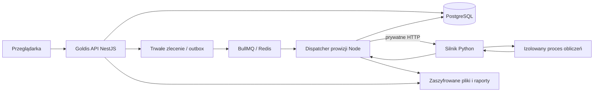

# Porównywarka prowizji — plan wykonawczy Python / VPS

Data: 5 listopada 2026. Rewizja 2. Status: implementacja repozytoryjna wykonana w dużej części; odbiór lokalny i wdrożenie VPS pozostają otwarte. Ten zestaw zastępuje wcześniejszą propozycję przenoszenia silnika do TypeScript oraz traktowania odbioru lokalnego jako końcowego celu. Docelowym środowiskiem jest Linux na VPS, z usługami Docker Compose. Zobacz [bieżący status i ograniczenia weryfikacji](IMPLEMENTATION_STATUS.md).

## Najważniejsza decyzja

**Reguły biznesowe, odczyt arkuszy i generowanie raportów pozostają w Pythonie.** Goldis zachowuje istniejący panel Next.js, API NestJS, PostgreSQL, BullMQ/Redis oraz obsługę sesji, grantów i audytu.

Nie wymagamy Microsoft Excel, Windows COM, LibreOffice ani usługi przeliczającej arkusze. `.xlsx` jest formatem wejścia/wyjścia, a nie środowiskiem wykonywania reguł. Odczyt zapewnia `openpyxl`; raporty tworzy `XlsxWriter`; obliczenia wykonują funkcje Pythona z `Decimal`. Dokumentacja [openpyxl](https://openpyxl.readthedocs.io/en/stable/simple_formulae.html) wyraźnie rozróżnia zapis/odczyt formuł od ich obliczania. Zapisane wyniki formuł w pliku nie potwierdzają ich aktualności.

Polityka pierwszej wersji:

- W krytycznym polu wejściowym, np. procencie, numerze lub dacie, formuła powoduje czytelny problem wskazujący komórkę i potrzebę dostarczenia wartości. Nie liczymy formuły i nie traktujemy nieznanego wyniku jako zera.
- Raport zawiera wyliczone liczby i statusy. Jego poprawność nie zależy od ponownego otwarcia lub przeliczenia w Excelu.
- `.xlsm` jest czytany jako dokument danych; VBA i zewnętrzne połączenia nie są wykonywane. Oryginał można zachować jako źródło, raport jest zwykłym `.xlsx`.
- Obecny eksport wykorzystujący lokalne narzędzia Codex nie jest zależnością produkcyjną VPS. Zastąpi go kontrolowany moduł eksportu w Pythonie.

## Architektura docelowa

### Podział odpowiedzialności

| Element | Odpowiada za | Nie odpowiada za |
| --- | --- | --- |
| Goldis API | Sesję, granty, przyjęcie pliku, wersje słownika, utworzenie zlecenia, odczyt wyników i pobieranie. | Obliczenia w czasie żądania użytkownika. |
| Dispatcher Node | Istniejący protokół BullMQ, dostęp do danych zadania, heartbeat, komunikację z Pythonem i atomowe zatwierdzenie wyniku. | Wybór procentu i interpretację ryzyka. |
| Usługa Python | Parsowanie, normalizację, porównanie, wyliczenie wyniku i budowę XLSX. | Konta użytkowników, bezpośredni dostęp do PostgreSQL/Redis i trwały magazyn plików. |
| PostgreSQL | Trwały stan, źródła, wersje, snapshoty, wyniki i audyt. | Obliczanie arkuszy. |
| Redis | Transport zadań i mechanizmy kolejki. | Jedyną kopię historii lub słownika. |
| Magazyn prywatny | Zaszyfrowane źródła i eksporty z identyfikatorami, a nie ścieżkami podanymi przez klienta. | Publiczne udostępnianie katalogu plików. |

To proponowany podział implementacji, nie ograniczenie samego języka Python. Pozwala zachować jedną trwałą kolejkę i jeden mechanizm autoryzacji. Nie wprowadzamy równolegle Celery ani ręcznego odtwarzania protokołu BullMQ w Pythonie.

Usługa Python jest wywoływana przez proces wykonujący zadanie w tle. Wewnętrzne żądanie może trwać do limitu danej operacji; przeglądarka nie utrzymuje go otwartego. Publiczne API zwraca identyfikator zadania i stan przyjęcia. FastAPI jest proponowaną cienką warstwą transportową; obliczenia działają w nadzorowanym procesie potomnym, poza obsługą HTTP.

Python nie otrzymuje kluczy szyfrowania, haseł PostgreSQL/Redis ani dostępu do wolumenu historycznych plików. Dispatcher przesyła wyłącznie dane niezbędne do konkretnego zadania, a odpowiedź zapisuje przez kontrolowane mechanizmy Goldis. Brak bezpośredniego zapisu przez Python upraszcza odrzucanie spóźnionych wyników i utrzymuje spójny audyt.

## Struktura planów

| Etap | Dokument | Końcowy rezultat |
| --- | --- | --- |
| P01 | [Kontrakty i przygotowanie silnika Python](01-KONTRAKTY-I-SILNIK-PYTHON.md) | Pakiet działający na Linux bez Excela, odtwarzający logikę v7. |
| P02 | [Moduł platformy i dane](02-MODUL-DANE-I-UPRAWNIENIA.md) | Modele, migracje, granty, magazyn plików i kontrakty komunikacji. |
| P03 | [Import plików](03-IMPORT-PLIKOW.md) | Bezpieczny import CRM/ASF/Warty i podgląd zakresu. |
| P04 | [Słownik i wersjonowanie](04-SLOWNIK-I-WERSJONOWANIE.md) | Import danych klienta i prosty edytor stawek z historią. |
| P05 | [Reguły porównania](05-REGULY-POROWNANIA.md) | Deterministyczny wynik z dowodem i dwoma kierunkami braków. |
| P06 | [Zadania i komunikacja z Pythonem](06-ZADANIA-I-KOMUNIKACJA.md) | Odporny na restart przebieg Node → Python → zatwierdzony wynik. |
| P07 | [Panel, historia i raporty](07-PANEL-HISTORIA-I-RAPORTY.md) | Pełny przepływ użytkownika i eksport liczony w Pythonie. |
| P08 | [Odbiór i wdrożenie VPS](08-ODBIOR-I-WDROZENIE-VPS.md) | Obrazy, konfiguracja, pomiary, backup/restore i kontrolowany start. |

Kolejność: P01 → P02 → P03/P04 → P05 → P06 → P07 → P08. Opis kontraktu transportowego z P06 trzeba uzgodnić już w P01/P02; testowe wykonanie Python może działać przed ukończeniem kolejki. Nowego widoku wyników nie odbieramy na atrapach obliczeń.

## Wzorzec v7

Dla obecnego prywatnego zestawu kontrolnego, bez zmiany reguł:

| Miara | Wynik |
| --- | ---: |
| CRM: wszystkie polisy | 1678 |
| CRM: wystawione 01.06–30.09.2026 | 944 |
| Dopasowane / brak rozliczenia / niepewny numer | 682 / 244 / 18 |
| Ocenione pozycje / bez oceny | 1651 / 481 |
| Rozbieżne pozycje / polisy z rozbieżnością | 257 / 140 |
| Wiersze raportów po pominięciu identycznego pliku | 3977 |
| Słownik: pozycje / grupy ofert | 653 / 36 |

Kontrola odwrotna pozostaje osobna: 83 grupy bez odpowiednika w całym dostarczonym CRM. Nie wliczamy ich do 244 braków rozliczeń. Porównujemy także pojedyncze pozycje, osoby, warianty, źródła i przyczyny. Te liczby nie są globalnymi limitami aplikacji ani oczekiwaniem wobec przyszłych plików.

Dotychczasowe 89 testów jest punktem startowym; integracja, sieć, izolacja procesów, role bazy i odtwarzanie po awarii wymagają nowych testów. Rzeczywiste dokumenty klienta i pliki wynikowe pozostają poza Git.

## Wspólne reguły dla wszystkich etapów

1. Osoba prowizyjna pochodzi z OFWCA rozliczenia; nie z loginu Goldis ani wystawcy CRM.
2. Python jest jedynym miejscem obliczania porównania. TypeScript opisuje transport, uprawnienia i kontrolę spójności, bez własnej kopii reguł stawek.
3. Procenty w JSON są ciągami dziesiętnymi w punktach procentowych, np. `"15.000000"`. Daty mają jawne znaczenie i format ISO; numer jest tekstem.
4. Analiza przypina zestaw plików oraz wersje: silnika, parserów, słownika, przypisań i normalizacji numerów. Zmiana wersji aktywnej nie zmienia już utworzonej analizy.
5. Niepewność biznesowa nie jest awarią techniczną. „Nie wiem” i „nie oferuję” nie usuwają rozliczenia i nie stają się stawką 0%.
6. Ten sam job może zostać dostarczony ponownie. Wynik jest zatwierdzany tylko dla aktualnej próby wykonania; nie zakładamy wykonania dokładnie jeden raz.
7. Ochrona danych, granty i blokady usuwania obowiązują dla źródeł, rekordów, stanu zadania i pobierania raportu.
8. Pierwsze wydanie zachowuje obecne niewiadome. Pakiety, terminy rozliczeń i nierozpoznane kody otrzymują nowe reguły dopiero po potwierdzeniu biznesowym.

## Warunek zakończenia całego wdrożenia

Na docelowym VPS użytkownik wgrywa pliki, wybiera okres i wersję słownika, uruchamia analizę, przegląda źródła problemów i pobiera raport. Ten przepływ działa po restarcie usług i bez Excela/LibreOffice. Zatwierdzony eksport i ekran odnoszą się do tego samego snapshotu. Dostęp bez grantu jest odrzucany, a wcześniejsze narzędzie OC zachowuje działanie.

## Dokumentacja techniczna wykorzystana przy planowaniu

- [openpyxl: odczyt plików i znaczenie zapisanych wartości formuł](https://openpyxl.readthedocs.io/en/stable/tutorial.html).
- [openpyxl: biblioteka nie oblicza formuł](https://openpyxl.readthedocs.io/en/stable/simple_formulae.html).
- [XlsxWriter: tworzenie XLSX w Pythonie](https://xlsxwriter.readthedocs.io/getting_started.html).
- [BullMQ: działanie workerów i ich blokad](https://docs.bullmq.io/guide/workers).
- [FastAPI: wdrażanie usługi w kontenerze](https://fastapi.tiangolo.com/deployment/docker/).

Wyboru wersji bibliotek i obrazów dokonujemy podczas implementacji, zapisując je w lockfile i manifestach obrazu. Nie opieramy wdrożenia produkcyjnego na nieprzypiętym `latest`.
